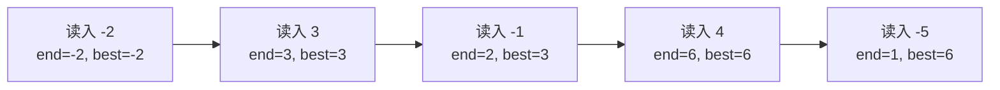

# Day 01：学习指南与算法基础

> 本资料以知识理解、案例、习题与工程应用为主。2027 年官方 408 大纲正文尚未逐项核验；题源待核实的习题不可认定为历年真题。


---

<a id="s42c870a91864"></a>

<a id="s42c870a91864-1"></a>
## 学习路径与约定

建议先学习算法基础和线性表，再学习栈、队列、数组与串，随后进入树、图、查找、排序和综合应用。

<a id="s42c870a91864-2"></a>
### 符号、下标与复杂度约定

时间与空间复杂度的基本定义由[算法基础与复杂度](Day01.md#s29cd9e7587d0)统一讲解。每个操作须明确下标、空值、输入规模与空间统计口径。

<a id="s42c870a91864-3"></a>
### 习题来源约定

区分已核实真题、平台题、自编题和来源待核实题；详见[题目总索引](习题索引.md#s22df6eaf3493)。


---

<a id="s29cd9e7587d0"></a>

<a id="s29cd9e7587d0-1"></a>
## 算法基础与复杂度

> 学习目标：能区分逻辑结构、存储结构和抽象数据类型；能说明复杂度的统计口径，并比较解决同一问题的不同算法。本文中的运算计数默认单个固定宽度整数运算为 O(1)；使用任意精度大整数时需另计位运算成本。

<a id="s29cd9e7587d0-2"></a>
### 从一个实际问题开始

某商店记录每天相对计划的利润变化，例如 `[-2, 3, -1, 4, -5]`。希望找到一段**连续、非空**的日期，使这段时间的利润变化之和最大。列举所有区间可以解决，但数据量扩大后，我们需要比较方法的增长速度；而记录如何存放、允许哪些操作，也影响算法选择。

<a id="s29cd9e7587d0-3"></a>
### 数据结构：关系、表示与操作

- **数据元素**是考虑问题时作为一个整体处理的单位，如一条商品记录；**数据项**是该记录中进一步划分的字段，如商品编号。二者是组成关系，不应机械地写成集合包含关系。
- **数据对象**是一类性质相同的数据元素的集合。**数据结构**关注元素之间的关系、这种关系在计算机中的表示，以及可施加的操作。
- **逻辑结构**描述元素之间的关系：线性结构表示前后次序；树形结构表现层级；图描述一般的多对多关系；集合强调成员身份。它不决定元素在内存中的具体位置。
- **存储结构**是表示方式：顺序存储将元素按规则安排在连续空间；链式存储用链接表示关系；索引存储通过附加索引定位；散列存储根据键计算位置并处理冲突。这些类别不是互斥的完整实现清单，实际系统常组合使用。

例如，同一个有序序列既可用数组也可用链表表示。数组能按下标直接定位；链表要沿链接访问。它们的逻辑次序可以相同，操作成本却不同。索引查找并不天然是 O(1)：它取决于索引组织方式，树形索引和散列索引的成本就不同。

**抽象数据类型（ADT）**规定数据对象、关系和操作的语义，而不绑定具体存储。例如“列表”可以规定取第 i 个元素、插入和删除；数组与链表是不同实现。接口说明“做什么”，实现说明“怎样做”。

```text
问题需求 → 逻辑关系与操作（ADT） → 选择存储方式 → 设计算法
                                     ↘ 评估时间和空间
```

<a id="s29cd9e7587d0-4"></a>
### 算法与评价

算法是解决问题的一组明确步骤。传统教材常用五项特征描述确定性算法：**输入**可以有零个或多个，**输出**至少一个，步骤有确定含义，基本步骤可执行，且对规定的合法输入在有限步内结束。随机算法可以把随机选择及其分布明确写入规则，其执行路径或结果可以受随机数影响；不要把“步骤明确”等同于所有算法都不能使用随机数。

评价还要看正确性、可读性、健壮性、时间和空间消耗。正确性需要根据前提和不变量论证，测试能发现错误，但有限测试不能证明对所有输入正确。

<a id="s29cd9e7587d0-5"></a>
### 时间与空间复杂度

设 n 为输入规模，T(n) 为某种固定操作模型下的操作次数。若存在常数 c、n₀，使所有 n ≥ n₀ 都满足 T(n) ≤ c·f(n)，则 T(n) 是 **O(f(n))**：这是渐近上界，不自动表示紧确数量级。Θ(f(n)) 同时给出渐近上界和下界；例如 `3n+2` 是 Θ(n)，也属于 O(n²)，但后者不够紧。

顺序执行的成本相加；嵌套循环要统计内层总执行次数，不是看到两层就必然是 n²。二分规模的循环通常为 Θ(log n)。常见增长顺序：常数、对数、线性、线性对数、平方、指数。具体运行时间还取决于实现、硬件和数据。

| 口径 | 含义 | 示例 |
|---|---|---|
| 最好 | 同规模合法输入中成本最小 | 无序数组顺序查找，首元素命中只需 1 次比较 |
| 最坏 | 同规模合法输入中成本最大 | 查找失败需检查 n 个元素 |
| 平均 | 按明确的输入或访问概率求期望 | 每个位置等概率命中，比较次数为 (n+1)/2 |
| 均摊 | 对一串操作的总成本求每次平均上界，不依赖随机输入 | 动态数组偶尔扩容，但连续尾插的总复制次数为 O(n) |

空间复杂度必须说清是否包含输入和输出。本文通常单独报告**辅助空间**：额外变量、辅助数组和递归调用栈。递归即使不显式分配数组，也可能使用与递归深度成正比的栈空间。原地算法常指辅助空间为 O(1)，但有些语境允许对数级栈，应以题目定义为准。

<a id="s29cd9e7587d0-6"></a>
### 案例一：最大子列和

要求从非空数组中选择连续非空区间。对于示例 `[-2, 3, -1, 4, -5]`，最佳区间是 `[3, -1, 4]`，和为 6。

| 方法 | 核心思路 | 时间 | 辅助空间 |
|---|---|---|---|
| 三重枚举 | 枚举左右端点，再逐项求和 | Θ(n³) | O(1) |
| 双重枚举 | 固定左端点，右端点右移时累加 | Θ(n²) | O(1) |
| 线性递推 | 保留“以当前位置结尾的最大和” | Θ(n) | O(1) |

线性方法之所以可行：处理第 i 个数时，最优的以 i 结尾的区间，要么只包含 `A[i]`，要么接在以 i−1 结尾的最优区间后。无需保存其他已经结束的区间。

```text
最大子列和(A):                    // 前提：A 非空
    end ← A[0]                   // 以当前位置结尾的最大和
    best ← A[0]                  // 已扫描范围内的最大和
    对 i 从 1 到 n-1:
        end ← max(A[i], end + A[i])
        best ← max(best, end)
    返回 best
```

| i | 当前值 | end：以此处结尾 | best：迄今最优 |
|---:|---:|---:|---:|
| 0 | -2 | -2 | -2 |
| 1 | 3 | 3 | 3 |
| 2 | -1 | 2 | 3 |
| 3 | 4 | 6 | 6 |
| 4 | -5 | 1 | 6 |

算法只返回最大和；若还需区间端点，须同步记录候选起点和最优起止位置，并规定同和时如何选择。全负数组如 `[-4,-2,-7]` 的结果是 -2，不能把初值设为 0；若允许空区间，则问题和答案约定不同。时间线性是因为每个位置只处理一次；除输入外仅保留常数个变量。

<a id="s29cd9e7587d0-7"></a>
### 案例二：斐波那契与重复子问题

定义 F(0)=0、F(1)=1、F(n)=F(n−1)+F(n−2)，n 为非负整数。求 F(5) 时，朴素递归分别为 F(4) 和 F(3) 再次求解 F(3)，子问题会重复。记忆化保存已算结果；迭代则从 0、1 向上更新相邻两项。

```text
求斐波那契(n):                 // n ≥ 0
    a ← 0; b ← 1
    重复 n 次:
        (a, b) ← (b, a + b)   // 同时更新
    返回 a
```

| 已完成轮数 | a | b |
|---:|---:|---:|
| 0 | 0 | 1 |
| 1 | 1 | 1 |
| 2 | 1 | 2 |
| 3 | 2 | 3 |
| 4 | 3 | 5 |
| 5 | 5 | 8 |

在固定宽度、每次加法按常数成本计且不考虑溢出的模型下：朴素递归时间 Θ(φⁿ)、栈空间 O(n)；记忆化时间 O(n)、额外空间 O(n)；迭代时间 Θ(n)、辅助空间 O(1)。若精确表示任意大的 F(n)，整数的位数随 n 增长，加法和存储就不能视为常数；实际程序还需处理整数溢出。

<a id="s29cd9e7587d0-8"></a>
### 工程应用与取舍

处理不断增长的日志记录时，动态数组适合顺序扫描和按下标读取；扩容时可能复制已有元素，单次追加存在延迟尖峰。若必须稳定控制单次延迟，可考虑分块存储，代价是定位和内存管理更复杂。分析时应同时说明吞吐、最坏延迟与内存，不能仅凭一个均摊 O(1) 就判断系统一定满足实时要求。

<a id="s29cd9e7587d0-9"></a>
### 图解：最大子列和的状态转移

以下图中的每个节点对应上方表格的一行；箭头表示读取下一个元素后的状态，不是不同候选区间的连接。`end` 必须以当前元素结尾，`best` 允许在更早位置结束。



<a id="s29cd9e7587d0-10"></a>
### 工程案例：选择日报趋势分析算法

**背景与输入**：运营系统要在一年的 365 条每日利润变化中，找到连续非空区间的最大和；示例仍用 `[-2,3,-1,4,-5]`。数据已经按日期放在顺序表里；问题只需一次扫描，不需要频繁中间插入。

**分析与选择**：三重枚举直接重算每段，二重枚举复用当前区间和，二者适合小规模核对；线性递推只保留以当前日结尾的最优值和全局最优值，适合持续接收数据。顺序读取数组有较好的局部性，若数据以流形式到达，也可以不保存完整数组。

**执行**：从第一个值初始化，依次得到 `end=-2,3,2,6,1`，全局 `best=-2,3,3,6,6`。第 4 天处理后，候选区间为第 2 至第 4 天，和为 6；第 5 天虽使 end 降为 1，best 保持 6。最终结果是 6。若要返回日期区间，还要保存候选起点和最优端点。

**成本与启示**：对 n 天数据只扫描一次，时间 Θ(n)，维护常数个状态，辅助空间 O(1)；若把数据输入数组也算在内，另需 O(n) 输入空间。算法减少计算不意味着系统一定快：读库、网络、对象分配、缓存命中及日志也可能占主要时间。应在真实数据量和工作负载下测量吞吐、内存与高分位延迟，并分别分析扩容或垃圾回收带来的延迟尖峰；不要用大 O 推断具体毫秒数。

<a id="s29cd9e7587d0-11"></a>
### 分级练习

本教材分级与平台难度不是同一标准。标注“自编”的题目不是 408 历年真题；平台题题面以链接为准。

<a id="s29cd9e7587d0-12"></a>
#### 基础

1. <a id="q-3e593b22eae29b"></a>**自编**：学生记录中的学号是数据项还是数据元素？一条学生记录是什么？提示：按字段与整体的组成关系判断。
2. <a id="q-6730803ea42fc1"></a>**自编**：代码顺序执行一个 n 次循环与一个 2n 次循环，求时间和常数变量的辅助空间。提示：相加得 Θ(n)，辅助空间 O(1)。
3. <a id="q-ae54cefefd82c8"></a>**自编**：无序表 n 个元素等概率成功命中，顺序扫描平均比较多少次？提示：(n+1)/2；写明成功和等概率条件。

<a id="s29cd9e7587d0-13"></a>
#### 进阶

1. <a id="q-b49708eb3cbcdc"></a>**平台题**：[LeetCode 509 斐波那契数](https://leetcode.cn/problems/fibonacci-number/)。比较递归、记忆化和迭代；注意平台 n 的取值范围及正文的整数成本模型。
2. <a id="q-d9bdf0aa969603"></a>**平台题**：[LeetCode 53 最大子数组和](https://leetcode.cn/problems/maximum-subarray/)。要求连续非空；先用正文状态表手算，再分析 O(n) 时间、O(1) 辅助空间。
3. <a id="q-e3e87c568d597d"></a>**自编**：对 `[-3,-1,-4]` 分别按“非空”和“允许空区间”计算最大和。提示：分别为 -1 和 0；两者是不同问题。

<a id="s29cd9e7587d0-14"></a>
#### 综合

1. <a id="q-f471e902aa8229"></a>**自编**：某日报系统输入一次 100 万条记录，也可能逐条接收数据。比较二重枚举与线性递推，讨论输入存储、内存、吞吐和高分位延迟；给出至少两种实测指标。提示：线性算法的辅助空间 O(1)，不等于整个系统总空间 O(1)。
