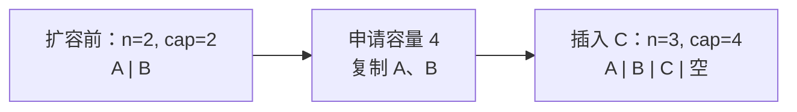
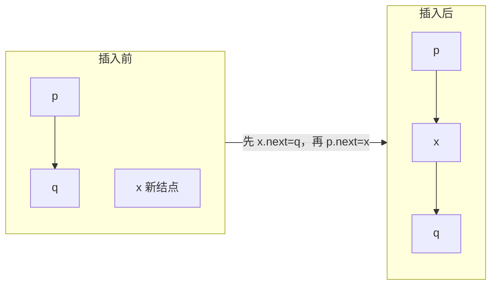
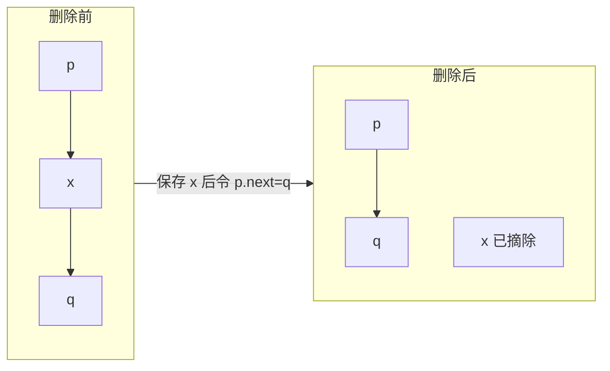
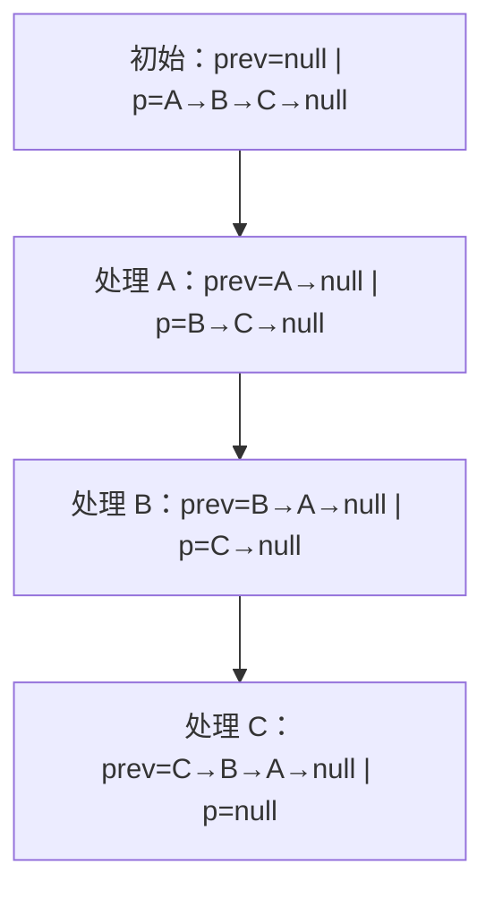
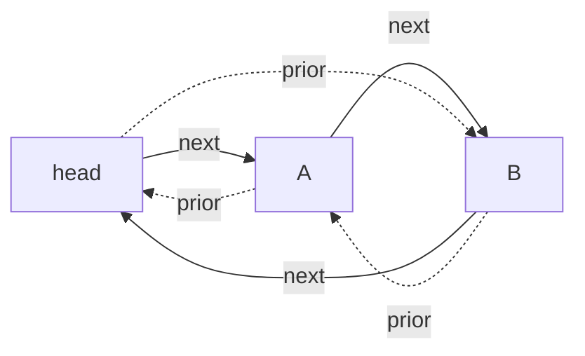
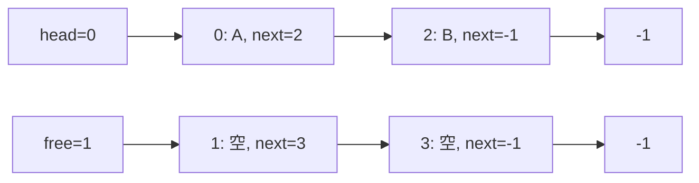

# Day 02：线性表

> 本资料以知识理解、案例、习题与工程应用为主。2027 年官方 408 大纲正文尚未逐项核验；题源待核实的习题不可认定为历年真题。


---

<a id="s907ba667adad"></a>

<a id="s907ba667adad-1"></a>
## 顺序表

> 前置：[算法基础与复杂度](Day01.md#s29cd9e7587d0)。本文约定数组下标从 0 开始，长度为 n，容量为 cap；辅助空间不计已有输入和输出。

<a id="s907ba667adad-2"></a>
### 为什么需要顺序表

学生成绩按报名顺序排列，常常需要快速读取第 i 条记录。线性表是有限个元素组成的序列：除首元素外每个元素有唯一直接前驱，除尾元素外每个元素有唯一直接后继；空表允许存在。逻辑上的先后由位置决定，不要求数值递增。

顺序表用连续存储单元保存元素。若每个槽宽度为 w，基地址为 base，则下标 i 的地址为 `base + i×w`。已知合法下标即可直接定位，时间 O(1)；这要求元素槽位宽度固定，且不代表任意抽象数据都必须物理等长。

```text
下标       0       1       2       3       4
数组     [10]    [20]    [30]    [  ]    [  ]
          └──── 有效元素 ────┘   可用容量
长度 n = 3，容量 cap = 5
```

数组的连续空间与逻辑顺序一致。固定容量的顺序表满时要拒绝插入；动态顺序表可申请更大空间，但仍可能分配失败。动态分配不等于可无限增长。

<a id="s907ba667adad-3"></a>
### 查找、插入和删除

按下标查找合法范围为 `0 ≤ i < n`，直接读取，O(1)。按值查找通常从头扫描无序表，成功最多比较 n 次，失败需检查 n 个元素，最坏 O(n)；有序表若支持随机访问，可用折半查找，需维护有序性。

在位置 i **之前**插入 x，合法范围为 `0 ≤ i ≤ n`。先检查容量；从后往前搬移，避免覆盖尚未移动的数据。

```text
插入(A, n, cap, i, x):
    若 i < 0 或 i > n: 返回“位置无效”
    若 n = cap: 返回“容量不足”       // 也可先调用扩容
    对 j 从 n-1 递减到 i:
        A[j+1] ← A[j]
    A[i] ← x
    返回 n+1
```

删除位置 i 的元素时，范围为 `0 ≤ i < n`；保存被删值后，将后缀从前往后搬移，长度减一。最后一个槽位是否清空是实现与资源管理问题，不改变逻辑长度。

```text
删除(A, n, i):
    若 i < 0 或 i ≥ n: 返回“位置无效”
    x ← A[i]
    对 j 从 i 到 n-2:
        A[j] ← A[j+1]
    返回 (n-1, x)
```

空表不能删除，尾部插入和尾部删除不需要搬移已有元素；这些边界中循环执行零次。插入前应确认内存足够或扩容成功。

<a id="s907ba667adad-4"></a>
### 案例：插入、删除与移动次数

已有 `[10,20,30,40]`，在下标 1 插入 15：

```text
初始        [10, 20, 30, 40,  _]
40 后移     [10, 20, 30, 40, 40]
30 后移     [10, 20, 30, 30, 40]
20 后移     [10, 20, 20, 30, 40]
写入 15     [10, 15, 20, 30, 40]
```

此处移动 3 个已有元素，即 `n−i=4−1`。若随后删除下标 2 的 20，30、40 向前各移动一次，得到 `[10,15,30,40]`。

对于长度 n 的表，插入位置 i 对应移动 `n−i` 个元素；若 n+1 个位置等概率，则平均移动次数为

`(n + (n−1) + … + 0)/(n+1) = n/2`。

删除位置 i 对应移动 `n−i−1` 个元素；若 n 个已有位置等概率，则平均为

`((n−1) + … + 0)/n = (n−1)/2`。

这只统计已有元素的**移动次数**，不包括定位、写入新元素、清理和扩容，也依赖等概率假设。

| 操作 | 时间 | 额外空间 | 条件 |
|---|---|---|---|
| 按下标读取 | O(1) | O(1) | 下标合法 |
| 无序表按值查找 | 最坏 O(n) | O(1) | 每次比较视为 O(1) |
| 插入或删除 | 最坏 O(n) | O(1) | 不计扩容；尾部操作可 O(1) |
| 一次扩容 | 最坏 O(n) | O(n) 新空间 | 新旧缓冲可能同时存在；具体分配器可能原地扩展 |

<a id="s907ba667adad-5"></a>
### 动态扩容与均摊

采用容量按固定倍数增长（例如满时翻倍）的策略，从空表连续尾插 n 次：扩容时复制的元素数量近似为 `1+2+4+…`，小于常数倍的 n。加上 n 次写入，总成本 O(n)，因此每次尾插**均摊 O(1)**；触发扩容的单次操作最坏仍为 O(n)。这不适用于任意位置插入，因为中间插入本身仍需搬移后缀；也不适用于每次只增加一个槽位的扩容策略。

<a id="s907ba667adad-6"></a>
### 与链表如何选

| 需求 | 顺序表 | 单链表 |
|---|---|---|
| 按位置读取 | O(1) | 从头访问最坏 O(n) |
| 已定位插入处 | 仍可能搬移 O(n) | 已知前驱时改链接 O(1) |
| 位置未定位 | 可能先搜索 O(n) | 也需搜索 O(n) |
| 内存 | 连续、可能预留容量 | 结点按需分配，有链接开销 |

工程中，动态数组适合读取频繁、顺序扫描较多的商品列表；局部移动虽然有渐进代价，却常有较好的缓存局部性。若经常持有要操作位置的结点引用、需要频繁局部插删，可考虑链表，但逐项查找、额外指针和内存分配可能抵消收益。选择应看真实访问模式及测量结果，不能只比较一个 O 记号。链表详见[单链表](Day02.md#sbec6e18439ba)。

<a id="s907ba667adad-7"></a>
### 图解：容量变化与扩容

下面展示一种翻倍策略：扩容前长度为 2、容量为 2，插入 C 时申请容量 4 的新数组并复制；实际实现也可能原地扩展，结果取决于分配器。



复制已有元素是 O(n) 的一次性成本。若新旧数组暂时同时存在，峰值内存可能超过最终容量；扩容失败时应保留原数据并报告失败。

<a id="s907ba667adad-8"></a>
### 工程案例：业务列表追加与中间插入

**背景与输入**：系统维护当天订单编号，初始有效数据 `[A,B]`、长度 2、容量 2；先在尾部追加 C，再将紧急订单 X 插到下标 1。操作顺序是题设，不假设特定编程语言容器的内部策略。

**选择理由**：页面经常按下标读取、从头遍历，动态数组能提供 O(1) 按位访问和连续扫描；代价是扩容及中间插入的移动。若频繁在已知结点前后插入且很少随机读取，可比较链表，但定位位置和指针开销不能忽略。

| 步骤 | 长度 / 容量 | 有效数据 | 发生的工作 |
|---|---|---|---|
| 初始 | 2 / 2 | A, B | — |
| 容量翻倍后追加 C | 3 / 4 | A, B, C | 在本例复制 A、B，再写 C |
| 下标 1 插入 X | 4 / 4 | A, X, B, C | 先将 C 后移，再将 B 后移 |

**结果与成本**：订单次序是 `[A,X,B,C]`。本次追加触发扩容，最坏 O(n)；第二次中间插入最坏 O(n)。只有在固定倍数扩容且连续尾插的操作序列中，尾插才有均摊 O(1)；记录对象大小、并发修改、扩容失败及峰值内存都影响实际工程选择。

<a id="s907ba667adad-9"></a>
### 分级练习

自编题不是历年真题；平台题须以官方题设为准。

<a id="s907ba667adad-10"></a>
#### 基础

1. <a id="q-2e2af7c006d54f"></a>**自编**：长度 6 的表在下标 2 插入、删除该位置原元素，分别移动几个已有元素？提示：4 个、3 个。
2. <a id="q-5a08e24412efb3"></a>**自编**：容量 5、长度 0 的空表，插入位置 0 是否有效？删除位置 0 呢？提示：插入有效，删除无效。
3. <a id="q-e3643bf8352bd5"></a>**自编**：等概率删除长度为 7 的任意元素，平均移动次数是多少？提示：`(7-1)/2=3`，只统计已有元素移动。

<a id="s907ba667adad-11"></a>
#### 进阶

1. <a id="q-3a16609b5f7561"></a>**平台题**：[LeetCode 27 移除元素](https://leetcode.cn/problems/remove-element/)。原地处理所有目标值；注意平台允许改变顺序。稳定覆盖法 O(n) 时间、O(1) 辅助空间。
2. <a id="q-24f5e2b2345cae"></a>**平台题**：[LeetCode 88 合并两个有序数组](https://leetcode.cn/problems/merge-sorted-array/)。利用第一数组末尾的额外容量从后向前归并；[独立题解](Day10.md#s1e09b32e3052)。
3. <a id="q-eb27c8ae92e762"></a>**自编**：长度 4、容量 4，按翻倍扩容后在头部插入 9；分别统计本例复制和移动已有元素的次数。提示：若扩容分配新数组，复制 4 次、头插移动 4 次；原地扩容时复制次数可不同。

<a id="s907ba667adad-12"></a>
#### 综合

1. <a id="q-66046148b9e345"></a>**自编**：订单系统需要高频按序扫描、少量中间插入和偶发大批追加。比较动态数组与链表，并说明为何仅凭尾插均摊 O(1) 不能保证单次延迟。提示：考虑定位、缓存局部性、扩容和分配失败。


---

<a id="sbec6e18439ba"></a>

<a id="sbec6e18439ba-1"></a>
## 单链表

> 前置：[顺序表](Day02.md#s907ba667adad)。本文主体采用带头结点的单链表：`head` 是哨兵，不保存有效元素；`head.next` 指向首个数据结点，空值记为 `null`。位序从 1 开始。

<a id="sbec6e18439ba-2"></a>
### 为什么用链接组织元素

歌曲播放列表经常在已知位置插入一首歌。若元素按顺序存放在数组里，插入中间可能移动后缀；链表将每个数据元素放在结点里，通过 `next` 指向后继。结点不要求物理相邻，但次序只能沿链接确定。

```text
head（头结点）      第 1 个          第 2 个
   [ next ] ─────→ [A | next] ───→ [B | null]
空表：head.next → null
```

头结点和头指针不同：头指针是保存起始位置的引用；头结点是可选的哨兵结点。不带头结点时，头指针直接指向首元结点，空表时为 null；在表头插入或删除后要把新头指针返回给调用方。带头结点时这些操作可统一为修改头结点的 next。

<a id="sbec6e18439ba-3"></a>
### 查找与建表

按位查找第 i 个元素（i ≥ 1）从 `head.next` 起走 i−1 条链接，若提前遇到 null 则位置无效；按值查找逐个比较。最坏都要检查 n 个结点，时间 O(n)，辅助空间 O(1)。若头结点另维护长度，取长度可为 O(1)，但每次插删都必须同步更新。

**头插法**依次读取元素，在头结点后插入：新结点先指向原首元结点，再让 `head.next` 指向新结点。输入 A、B、C 后得到 C→B→A，顺序反转。**尾插法**保留指向最后结点的 `tail`，每次将新结点接到其后并更新 tail；输入 A、B、C 得到 A→B→C。空表时 tail 初始指向 head。每次连接 O(1)，建 n 个结点 O(n) 时间、O(n) 结点空间；若每次从头找尾，建表为 O(n²)。

<a id="sbec6e18439ba-4"></a>
### 已知前驱时插入与删除

下图在前驱 p 后插入 node。插入前 node 已分配，且不属于该链表：

```text
初始：p ──→ q ──→ …       node
先接：p ──→ q ──→ …       node ──→ q
再改：p ──→ node ──→ q ──→ …
```

```text
在 p 后插入(node):
    node.next ← p.next       // 必须先保存原后继关系
    p.next ← node
```

删除 p 的后继时，若 `p.next = null` 应返回失败；否则先保存待删结点和数据，再令 `p.next ← victim.next`，最后按运行环境释放或回收 victim。不能释放后再读取它的 next。已知 p 时插入和删除其后继为 O(1)；若只给位序或值，先找到 p 最坏要 O(n)，总时间仍为 O(n)。仅有待删结点引用且它是单链表尾结点时，通常无法在 O(1) 时间内定位前驱并删除该结点。

删除所有值为 x 的结点时，p 始终指向最后一个保留结点（初始为 head）：

```text
删除所有(head, x):
    p ← head
    当 p.next ≠ null:
        若 p.next.data = x:
            victim ← p.next
            p.next ← victim.next
            释放 victim                 // 需手动管理内存时
        否则:
            p ← p.next
```

删除后 p 不前进，才能检查连续的 x。每个结点至多检查和删除一次，时间 O(n)、辅助空间 O(1)。空表、全部匹配、首尾结点匹配均适用。

<a id="sbec6e18439ba-5"></a>
### 案例：原地逆置单链表

**问题与选型**：把 A→B→C 改成 C→B→A。顺序表可逆序复制，但这里要求复用结点、辅助空间 O(1)。选择三个指针：prev 保存已逆置部分，p 指向未处理部分，next 暂存 p 的原后继，避免断链。

```text
逆置首元结点(first):
    prev ← null
    p ← first
    当 p ≠ null:
        next ← p.next
        p.next ← prev
        prev ← p
        p ← next
    返回 prev

head.next ← 逆置首元结点(head.next)
```

| 时刻 | prev 指向的已逆置部分 | p 指向的未处理部分 | 暂存后继 next |
|---|---|---|---|
| 初始 | null | A→B→C→null | — |
| 处理 A | A→null | B→C→null | B |
| 处理 B | B→A→null | C→null | C |
| 处理 C | C→B→A→null | null | null |

不变量：已逆置部分与未处理部分不重叠，合起来恰好包含原链表结点；每次处理一个结点，因此循环终止后 prev 即新首元结点。空表直接返回 null；单结点仍指向 null。n 个结点各处理一次，时间 O(n)、辅助空间 O(1)。这里的伪代码不适用于含环链表；若不保证无环，先检测或明确输入约束。

<a id="sbec6e18439ba-6"></a>
### 工程应用与边界

内存管理中的空闲块链、邻接表中的邻接结点，都可以用链接维护动态集合。已知前驱时插删只改少量链接，但查找位置仍要遍历；结点分散可能降低缓存局部性，额外链接和分配也有成本。程序中若外部仍持有被删除结点引用，还需定义引用失效与内存回收规则；并发操作需要额外同步，以上伪代码只描述单线程逻辑。

<a id="sbec6e18439ba-7"></a>
### 图解：插入、删除与逆置

每幅图中的箭头代表操作完成后的 `next`；`head` 是不存数据的哨兵，删除图假设 x 的后继为 q，且 x 不是 null。





逆置图每行分别是一个时刻，`|` 左侧为已逆置部分，右侧为未处理部分，左右两部分不存在连接：



<a id="sbec6e18439ba-8"></a>
### 工程案例：空闲块链的分配与回收

**背景与输入**：某教学版内存池使用单向空闲链记录三个同尺寸块，初始为 `head→A→B→C→null`；依次分配一块，再回收 A。这里是简化的定长块池，并非对某个生产分配器的实现描述。

**分析与选择**：分配只需要任意一个空闲块，不需要按位置随机访问。用头结点链接空闲块可在已知头结点时 O(1) 摘首和头插；若需要快速按地址合并相邻空闲块，还需额外的地址信息或其他索引，单链表本身不保证快速合并。

| 步骤 | 空闲链 | 解释 |
|---|---|---|
| 初始 | head→A→B→C | 三块均空闲 |
| 分配 A | head→B→C | 保存 A 后令 head.next 指向 B |
| 回收 A | head→A→B→C | A.next 先指向 B，再更新 head.next |

**结果与成本**：空闲数从 3 变为 2 再恢复为 3；上述两次局部修改各 O(1) 时间和 O(1) 辅助空间。实际分配器还要保证块大小、对齐、所有权、重复释放检测及并发安全，不能把简单链表视作完整内存管理方案。

<a id="sbec6e18439ba-9"></a>
### 分级练习

自编题不是历年真题；n 为数据结点数。

<a id="sbec6e18439ba-10"></a>
#### 基础

1. <a id="q-0a9a06fc13cf29"></a>**自编**：对空表依次头插 1、2、3，删除首元后是什么？提示：`2→1`。
2. <a id="q-23e80d8dab1934"></a>**自编**：带头结点的空表满足什么条件？不带头结点的空表呢？提示：分别为 `head.next=null` 和 `head=null`。
3. <a id="q-4e45a86a6a3d96"></a>**自编**：已知前驱删除其后继时，若后继为 null，应该如何处理？提示：报告不存在，不解引用空值。

<a id="sbec6e18439ba-11"></a>
#### 进阶

1. <a id="q-e07f5ca0987461"></a>**平台题**：[LeetCode 206 反转链表](https://leetcode.cn/problems/reverse-linked-list/)，题设为首元引用；[独立题解](Day10.md#s34de477b690f)使用三指针，时间 O(n)、辅助空间 O(1)。
2. <a id="q-34ae1d1cddbac0"></a>**平台题**：[LeetCode 141 环形链表](https://leetcode.cn/problems/linked-list-cycle/)。快慢指针相遇表示有环；注意输入可为空和单结点，时间 O(n)、辅助空间 O(1)。
3. <a id="q-a229b406d2567d"></a>**自编**：删除 `1→2→2→3→2` 中所有 2，并说明连续匹配时前驱为何不前移。提示：结果 `1→3`，时间 O(n)、辅助空间 O(1)。

<a id="sbec6e18439ba-12"></a>
#### 综合

1. <a id="q-18e98bd9ae048b"></a>**平台题**：[LeetCode 707 设计链表](https://leetcode.cn/problems/design-linked-list/)。按题设的 0 起始下标处理头尾、越界、空表；讨论只存头结点与额外存尾结点时的追加成本。不要把本页的 1 起始位序直接套入平台接口。


---

<a id="sd8dfc5172a82"></a>

<a id="sd8dfc5172a82-1"></a>
## 双向、循环与静态链表

> 前置：[单链表](Day02.md#sbec6e18439ba)。本文将 `head` 用作不保存有效数据的头结点，除特别说明外，空引用记为 `null`；操作均为单线程，复杂度不计结点的已有存储。

<a id="sd8dfc5172a82-2"></a>
### 从需求出发

单链表向后走很方便，但要找到某个结点的前驱，通常必须从头扫描。如果系统需要在**已知结点**的位置经常向前、向后移动，可以给每个结点增加前驱链接。代价是更多链接、更新步骤和存储空间。

<a id="sd8dfc5172a82-3"></a>
### 双向链表

双链表数据结点保存 `prior`、`data`、`next`，分别指向前驱和后继。非循环版本中，头结点的 `prior` 为 null，尾结点的 `next` 为 null；空表为 `head.next = null`。遍历可向前或向后，但从头按位查找仍为 O(n)。

```text
null ← [head] ⇄ [A] ⇄ [B] → null
                 prior / next 分别指向前驱 / 后继
```

在已知数据结点 p 和其非空后继 q 之间插入新结点 x：

```text
x.prior ← p
x.next ← q
p.next ← x
q.prior ← x
```

若在非循环表尾插入，q 为 null，此时不能写 `q.prior`；若另维护尾指针，也要更新它。删除已知数据结点 x 时，先令前驱的 `next` 越过 x，再在后继非空时令其 `prior` 指回前驱；若 x 为尾结点，还需更新尾指针。带头结点时首元结点的前驱为 head，哨兵不能当普通数据删除。这些局部操作都在已知位置时为 O(1)；寻找位置仍可能 O(n)。

<a id="sd8dfc5172a82-4"></a>
### 循环单链表

将尾结点的 `next` 指回头结点，形成环。以下采用**带头结点**约定：空表 `head.next = head`，非空时尾结点 `tail.next = head`。遍历从首元结点开始，到再次遇到 head 为止。

```text
        ┌─────────────────────────────┐
        ↓                             │
      [head] → [A] → [B] ────────────┘
```

只保存 head 时，头插 O(1)，尾插需先找尾，最坏 O(n)；若额外保存 tail，头插与尾插均可 O(1)。带尾指针并非所有操作都变成 O(1)：单链表删尾仍需找到尾的前驱，最坏 O(n)。由于没有以 null 终止的尾链接，不应使用“走到 null”为停止条件；损坏的链接也可能导致遍历无法终止。

<a id="sd8dfc5172a82-5"></a>
### 循环双链表：一次插入的完整过程

循环双链表同时维护两个方向。空表 `head.next = head` 且 `head.prior = head`；非空时 head 的 next 指向首元、prior 指向尾元。要在 p 后插入 x，先保存原后继 q：

```text
q ← p.next
x.prior ← p
x.next ← q
p.next ← x
q.prior ← x
```

初始为空表时 p=q=head，操作依次得到：

```text
初始：head.next = head，head.prior = head
保存：q = head
连接：x.prior = head，x.next = head
完成：head.next = x，head.prior = x

        ┌── next ──→ [x] ── next ──┐
      [head]                       │
        └── prior ←─ [x] ←─ prior ─┘
```

图中的两个 `[x]` 表示同一结点：head 与 x 的 next、prior 都指向对方。对于已有多个结点的情况，q 是 p 原来的后继，插入后必须同时满足 `p.next = x`、`x.prior = p`、`x.next = q`、`q.prior = x`。

删除已知数据结点 x 的局部操作为 `x.prior.next ← x.next` 和 `x.next.prior ← x.prior`；之后回收 x。只有一个数据结点时，两个赋值会使 head 的两个链接都指回自身。head 为哨兵，不能作为待删数据结点。借助 `head.prior` 可 O(1) 找到尾结点，因此头尾插入、删除在已知头结点和结点有效的条件下均为 O(1)。

<a id="sd8dfc5172a82-6"></a>
### 静态链表：用数组下标当链接

有些环境希望使用预先分配的结点池。静态链表把结点放在数组槽位中，用整数游标代替指针；数组在物理上连续，但逻辑次序由游标决定。下例使用 `-1` 表示无后继，并将“数据链”和“空闲链”分开：

```text
槽位    0        1        2        3
数据   [A| 2]  [空| 3]  [B|-1]  [空|-1]
数据链：head = 0   → 2 → -1        即 A → B
空闲链：free = 1   → 3 → -1
```

要在槽位 0 后插入 C：从空闲链取下 1，将 free 更新为 3；写入 `data[1]=C`；令 `next[1]=next[0]`，再令 `next[0]=1`。结果数据链为 `0→1→2→-1`，空闲链为 `3→-1`。删除槽位时先从数据链摘除，再把槽位接回空闲链；否则容量会逐渐泄漏。若 free 为 -1，固定容量池已满，插入须报告失败。数据链 head 和空闲链 free 是不同的游标；二者都为 -1 含义也不同。

| 操作或成本 | 循环单链表 | 循环双链表 | 静态链表 |
|---|---|---|---|
| 已知前驱后插入 | O(1) | O(1) | O(1)，且需有空闲槽 |
| 从头按位查找 | O(n) | O(n) | O(n) |
| 已知数据结点删除 | 一般需找前驱，O(n) | O(1) | 仅知游标一般需找前驱，O(n) |
| 额外结构 | 一个链接/结点 | 两个链接/结点 | 数组、游标及空闲链管理 |

表中假设不额外维护前驱索引等辅助结构；静态链表也可以设计成可扩容的数组池，但本例固定容量。

<a id="sd8dfc5172a82-7"></a>
### 工程应用与取舍

循环双链表适合需要从已知结点频繁摘除、移动到另一端的场景。例如 LRU 缓存可用哈希表定位缓存项，再用双链表调整访问次序；只用单链表时，除非额外维护前驱信息，摘除已知结点可能仍需扫描。双链表需要更多链接，哈希表与链表更新还须保持一致；并发、容量和淘汰策略另需设计。

静态链表适合预先分配内存、希望限制分配次数或使用整数句柄的结点池；优点是容量可控，局限是必须维护空闲链、处理满池和避免使用已释放游标。循环链表可表达轮转次序，但不自动解决调度公平性或并发安全。

<a id="sd8dfc5172a82-8"></a>
### 图解：双向关系与静态链表

双向箭头在下图中画成两条有方向的边：实线方向为 next，虚线方向为 prior。图表示带哨兵的**循环双链表**，不是非循环双链表。



静态链表使用上面的四个槽位；图中的边标注的是数组下标或 -1，不表示物理地址。方框 `free` 与 `head` 是独立游标。



<a id="sd8dfc5172a82-9"></a>
### 工程案例：LRU 缓存的访问与淘汰

**背景与输入**：缓存最多保存两个键，操作依次为 `put(A)`、`put(B)`、`get(A)`、`put(C)`。左端表示最近使用，右端表示最久未使用；每个键对应的数据值省略。

**分析与选择**：需要按键找到缓存项，又需要把已找到的结点移到队首，并能快速淘汰队尾。哈希表提供平均 O(1) 键定位；双向链表提供已知结点的 O(1) 摘除与头插。仅用单链表时，找到结点后通常还要寻找前驱；仅用双链表查找键则可能 O(n)。

| 操作 | 最近 → 最久 | 哈希表包含的键 | 说明 |
|---|---|---|---|
| 初始 | 空 | ∅ | — |
| put(A) | A | A | 头插 A |
| put(B) | B, A | A, B | 头插 B |
| get(A) | A, B | A, B | A 被访问，移到头部 |
| put(C) | C, A | A, C | 淘汰尾部 B，并删除其哈希项 |

**结果与复杂度**：缓存保留 A、C。按容量为 c、哈希操作平均 O(1) 的模型，每次 get/put 平均 O(1)，存储 O(c)；哈希退化时最坏不保证 O(1)。这是单线程模型；实际系统还需处理并发同步、异常时两种结构的一致性、内存占用与淘汰开销。适合近期访问具有参考价值的负载；扫描型访问可能污染 LRU，需根据工作负载测量并考虑替代策略。

<a id="sd8dfc5172a82-10"></a>
### 分级练习

自编题不是历年真题；head 均为哨兵，除非题目另有说明。

<a id="sd8dfc5172a82-11"></a>
#### 基础

1. <a id="q-5ef4aec7d87d7f"></a>**自编**：循环单链表只有数据结点 A 时，head.next 与 A.next 分别是什么？提示：A 和 head。
2. <a id="q-328ff8a864663d"></a>**自编**：循环双链表只含 x，删除后 head 的两个链接指向哪里？提示：都指向 head。
3. <a id="q-2682763c9d66d9"></a>**自编**：静态链表 `next[0]=2, next[2]=-1`、`head=0` 的逻辑槽位顺序是什么？提示：0、2；下标不要求连续。

<a id="sd8dfc5172a82-12"></a>
#### 进阶

1. <a id="q-072c247031ee53"></a>**平台题**：[LeetCode 707 设计链表](https://leetcode.cn/problems/design-linked-list/)。可以使用双链表；注意平台下标从 0 开始，边界条件以原题为准。
2. <a id="q-cc8744807cbd42"></a>**自编**：循环单链表已知 tail，为何尾插 O(1) 但删除尾结点一般仍为 O(n)？提示：删除还要定位前驱。
3. <a id="q-f8063c6059f85a"></a>**自编**：原静态链案例中插入 C 后删除槽位 1 并回收；写出两条链。提示：数据链 `0→2→-1`，空闲链 `1→3→-1`。

<a id="sd8dfc5172a82-13"></a>
#### 综合

1. <a id="q-7491a75523dbd0"></a>**平台题**：[LeetCode 146 LRU 缓存](https://leetcode.cn/problems/lru-cache/)。用哈希表加双向链表；解释容量、更新已有键、淘汰尾部与两种结构一致性。平均操作 O(1)，空间 O(c)。
