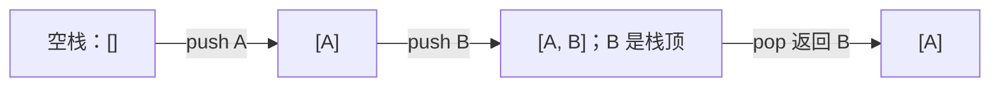
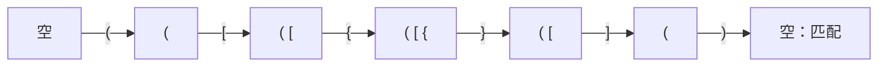
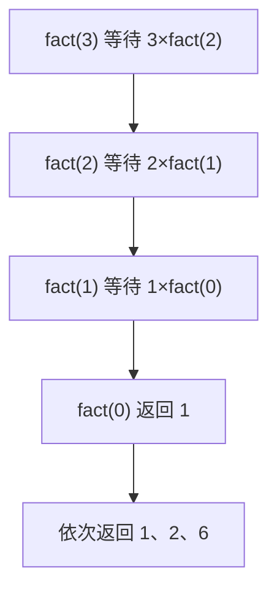
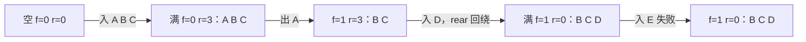
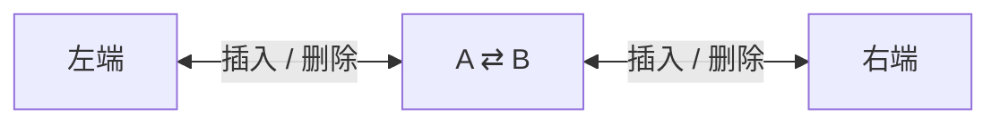

# Day 03：栈、队列与数组

> 本资料以知识理解、案例、习题与工程应用为主。2027 年官方 408 大纲正文尚未逐项核验；题源待核实的习题不可认定为历年真题。


---

<a id="s17acfd19f168"></a>

<a id="s17acfd19f168-1"></a>
## 数组与矩阵

> 前置：[顺序表](Day02.md#s907ba667adad)。本文数组下标从 0 开始；矩阵压缩公式中另外注明使用的下标。元素占 w 字节，地址计算不考虑越界和整数溢出。

<a id="s17acfd19f168-2"></a>
### 从存储传感器数据开始

某设备每小时记录多个传感器读数。数据形成“小时 × 传感器”的矩阵：程序要能快速定位某一行某一列，也希望在大量读数为零时节省空间。选择时需要分清逻辑上的二维结构和底层的一维存储布局。

二维数组 A 有 r 行、c 列，0 基下标 `0≤i<r, 0≤j<c`。元素槽宽相同，存放连续，首元素地址为 base：

- 行优先：`LOC(A[i,j]) = base + (i×c+j)×w`。
- 列优先：`LOC(A[i,j]) = base + (j×r+i)×w`。

例如 r=2、c=3 时，行优先依次存 `A00,A01,A02,A10,A11,A12`；列优先存 `A00,A10,A01,A11,A02,A12`。这两式以整个矩阵为一块连续存储为前提；由多个独立行对象组成的结构不一定满足。已知下标计算地址 O(1)，保存整个矩阵占 O(rc) 空间。

<a id="s17acfd19f168-3"></a>
### 特殊矩阵：利用重复或固定值

以下矩阵为 n×n、n≥1，矩阵下标 i、j 从 1 开始，压缩数组下标 k 从 0 开始。压缩只改变表示，读取时必须根据规则还原逻辑值。

| 类型 | 性质和保存方式 | 映射 |
|---|---|---|
| 对称矩阵 | `A[i,j]=A[j,i]`，按行保存下三角含主对角线，共 n(n+1)/2 项 | 当 i≥j：`k=i(i-1)/2+j-1`；否则交换 i、j 再用同式 |
| 下三角矩阵 | 主对角线上方都是同一常数 c；按行存下三角，再存一个 c | i≥j 用上式，否则读末尾常数单元 |
| 上三角矩阵 | 主对角线下方均为 c；按行保存上三角，再存一个 c | i≤j 时 `k=(i-1)(2n-i+2)/2+(j-i)`，否则读末尾常数 |
| 三对角矩阵 | 仅主对角线及相邻两条对角线可能非零，按行存有效带内位置 | 1 基 i、j 时 `k=2i+j-3`，仅在 `abs(i-j)≤1` 适用；其他位置读 0 |

三对角矩阵的有效槽位是 3n−2（n=1 时为 1）；带内值也可以是 0。上述直接映射访问为 O(1)，对称和三角压缩空间仍为 Θ(n²)，三对角为 Θ(n)。下三角公式来自前 i−1 行分别保存 1、2、…、i−1 项，再加本行从 0 开始的偏移 j−1。

<a id="s17acfd19f168-4"></a>
### 案例：对称距离表

**背景与输入**：三个机房之间的距离满足双向相同，矩阵如下；主对角线为 0：

```text
        1   2   3
    1 [ 0   4   7 ]
    2 [ 4   0   5 ]
    3 [ 7   5   0 ]
```

**选择理由**：距离无方向，`A[i,j]=A[j,i]`。保存下三角比存两个方向的重复值省空间，并可以按公式随机读取；如果关系变成有向距离，这一假设不再成立。

| 步骤 | 压缩数组（下标从 0） | 说明 |
|---|---|---|
| 存第 1 行 | `[0]` | A11 |
| 存第 2 行 | `[0,4,0]` | A21、A22 |
| 存第 3 行 | `[0,4,0,7,5,0]` | A31、A32、A33 |

查询 A[2,3] 时先交换得到 A[3,2]；`k=3×2/2+2−1=4`，数组下标 4 的值为 5。构建时写 6 项，Θ(n²)；单次取值 O(1)，保存 n(n+1)/2 项。压缩矩阵不能按普通完整二维数组的布局计算地址。

```text
读对称(A压缩, i, j):          // 1 ≤ i,j ≤ n
    若 i < j: 交换 i, j
    k ← i×(i-1)/2 + j-1
    返回 A压缩[k]
```

<a id="s17acfd19f168-5"></a>
### 案例：三对角矩阵的压缩与还原

某线性方程组的系数矩阵只有主对角线和相邻两条对角线可能非零。给定 4×4 矩阵，矩阵行列下标从 **1** 开始：

```text
       j=1  2  3  4
i=1     1  2  0  0
i=2     3  4  5  0
i=3     0  6  7  8
i=4     0  0  9 10
```

按行优先只存储满足 `|i-j|≤1` 的位置。带内位置即使值为 0 也要占用槽位，本例的带内元素恰好都非零。

| 矩阵行 | 按列递增的带内位置 | 保存的值 | 压缩数组下标 |
|---:|---|---|---|
| 1 | (1,1)、(1,2) | 1、2 | 0、1 |
| 2 | (2,1)、(2,2)、(2,3) | 3、4、5 | 2、3、4 |
| 3 | (3,2)、(3,3)、(3,4) | 6、7、8 | 5、6、7 |
| 4 | (4,3)、(4,4) | 9、10 | 8、9 |

压缩数组下标从 **0** 开始，因此得到 `B=[1,2,3,4,5,6,7,8,9,10]`。查询 A[3,4] 时满足 `|3−4|≤1`，代入 `k=2i+j−3` 得 `k=2×3+4−3=7`；读取 `B[7]=8`，与原矩阵一致。反向按给定位置还原时，先检查矩阵下标是否合法：如果在带内，按公式读取 B；如果在带外，按三对角矩阵的定义返回 0。例如 A[1,4] 不在带内，返回 0，不应对它使用带内映射。

4×4 稠密表示需要 16 个元素槽，压缩后需要 `3n−2=10` 个槽；一般 n×n 矩阵分别使用 Θ(n²) 和 Θ(n) 个元素槽。这里比较的是元素槽位，不包含记录矩阵维度等元数据，也不意味着所有带内元素必须非零。

<a id="s17acfd19f168-6"></a>
### 稀疏矩阵

当非零项 t 远少于 rc，可保存 `(行,列,值)` 三元组；行列下标与排序规则必须声明。若以下标从 0 开始、按行列升序：`[(0,2,5),(2,0,7)]` 表示 3×3 矩阵仅 A[0,2]=5、A[2,0]=7。需要另记行数、列数和 t；存储 O(t) 条记录加 O(1) 元数据，顺序查找某位置最坏 O(t)，增加索引可改变查找成本。

十字链表中每个非零结点分别沿行链和列链链接，可按行或列访问，但需要额外指针和头部管理；若只做顺序遍历，三元组更简单。稀疏表示是否节省实际字节取决于数值、下标、指针和分配开销，不能只看非零比例。

<a id="s17acfd19f168-7"></a>
### 工程应用与练习

科学计算和图数据可能存在稀疏矩阵，压缩能减少存储和对零项的遍历，但随机更新、索引结构和局部性都有成本；选择表示时先确认矩阵规模、零的比例和主要操作。

<a id="s17acfd19f168-8"></a>
#### 基础

1. <a id="q-064c946182d1b1"></a>**自编**：2×3 行优先数组，A[1,2] 的元素偏移是几？答：5。
2. <a id="q-8e0fd231aae615"></a>**自编**：4×4 对称矩阵下三角含对角线共几项？答：10。
3. <a id="q-4a3694d4997c57"></a>**自编**：n=3 的三对角矩阵最多保存几个带内位置？答：7。

<a id="s17acfd19f168-9"></a>
#### 进阶

1. <a id="q-c821722757876f"></a>**自编**：按上述对称例计算 A[1,3] 的压缩下标和值。答：交换为 (3,1)，k=3，值 7。
2. <a id="q-ad243f3270d40a"></a>**平台题**：[LeetCode 867 转置矩阵](https://leetcode.cn/problems/transpose-matrix/)。m×n 的结果是 n×m；复制所有元素时间 O(mn)，输出占 O(mn)，不计输出的辅助空间 O(1)。
3. <a id="q-8c52009325eae1"></a>**自编**：两条三元组 `(0,2,5),(2,0,7)` 的 3×3 矩阵，A[1,1] 是多少？答：0。

<a id="s17acfd19f168-10"></a>
#### 综合

1. <a id="q-b27fc0ea1c069e"></a>**自编**：给定 10,000×10,000 矩阵、仅 1,000 个非零项，分别估算稠密元素槽和三元组数，讨论哪种操作适合何种结构。提示：前者 10⁸ 槽，后者 1,000 条加元数据；不要忽略下标开销和随机查找。


---

<a id="sfcd1dfd24554"></a>

<a id="sfcd1dfd24554-1"></a>
## 栈与递归

> 前置：[顺序表](Day02.md#s907ba667adad)、[单链表](Day02.md#sbec6e18439ba)。图中栈底在左、栈顶在右；空栈的出栈和取顶均须报告失败。

<a id="sfcd1dfd24554-2"></a>
### 栈：后进先出

浏览器记录的简化“后退”操作需要先取出最近一次访问的位置。栈是仅允许在同一端插入和删除的线性结构，遵循后进先出（LIFO）。ADT 包含 `push(x)`、`pop()`、`top()` 和 `empty()`；ADT 规定行为，不要求使用某一种存储方式。



顺序栈用容量 M 的数组，约定 top 指向栈顶元素：空时 top=-1，满时 top=M−1；先判满，再 `top←top+1; A[top]←x`。出栈先判空，返回 A[top] 后令 top 减一。两者均 O(1)，固定数组占 O(M)。链栈把栈顶设为单链表首元，入栈相当于头插、出栈相当于头删，O(1) 时间、O(n) 结点存储；结点分配仍可能失败。

**共享栈**：两栈共用 M 个槽，top0 从 -1 向右，top1 从 M 向左，二者都指向各自栈顶元素；空分别为 top0=-1、top1=M，满为 `top0+1=top1`。例如 top0=2、top1=7，空闲下标是 3、4、5、6，共 4 格，而不是 1 格。两栈共享的是总容量，不保证某一栈始终拥有固定配额。

固定输入顺序的 n 个互不相同元素允许入栈、出栈交错时，合法出栈序列数是卡特兰数 Cₙ=binom(2n,n)/(n+1)；该计数假设栈容量足够且每个元素恰好入栈、出栈一次。例如 n=3 时有 5 种。

<a id="sfcd1dfd24554-3"></a>
### 案例：括号匹配

**背景**：配置文件需要检查 `([{}])` 的括号是否按类型和嵌套次序闭合。最近遇到的尚未闭合左括号必须最先匹配，所以选栈而不是普通先进先出队列。

```text
括号匹配(s):                  // 只接受 ()、[]、{} 六种字符
    创建空栈 S
    对 s 中每个字符 c:
        若 c 是左括号: S.push(c)
        否则若 S 为空或 S.top() 与 c 类型不匹配: 返回 false
        否则: S.pop()
    返回 S.empty()
```

栈底在左：

| 字符 | 动作 | 栈 |
|---|---|---|
| `(` | 入栈 | `(` |
| `[` | 入栈 | `( [` |
| `{` | 入栈 | `( [ {` |
| `}` | 与 `{` 匹配并出栈 | `( [` |
| `]` | 与 `[` 匹配并出栈 | `(` |
| `)` | 与 `(` 匹配并出栈 | 空 |



结果为 true。空串按本算法为 true；`([)]` 因栈顶类型不匹配而失败，右括号多于左括号时不能对空栈取顶。每个字符最多进出栈一次，时间 O(n)，最坏辅助空间 O(n)。若要检查实际代码，还需考虑字符串字面量、注释等语法，不能直接把这个简化算法当完整编译器。

<a id="sfcd1dfd24554-4"></a>
### 案例：后缀表达式求值

`(2+3)×4` 的后缀形式为 `2 3 + 4 *`。遇数字入栈，遇二元运算符先弹出**右操作数**，再弹出左操作数，计算并压回。

| 输入 | 操作 | 栈（底→顶） |
|---|---|---|
| 2 | 入栈 | 2 |
| 3 | 入栈 | 2,3 |
| + | 2+3 | 5 |
| 4 | 入栈 | 5,4 |
| * | 5×4 | 20 |

结果 20。token 数为 n 时，栈操作总数 O(n)，辅助空间最坏 O(n)；假定算术操作 O(1)。若输入不受信任，还需检查操作数数量、非法 token、除零和结束时栈中是否恰有一个值；整数除法的舍入和溢出按题设确定。

<a id="sfcd1dfd24554-5"></a>
### 案例：中缀表达式转后缀表达式

中缀表达式 `(2+3)*4-6/2` 中，括号、优先级和结合性决定先算什么。转换时使用**运算符栈**暂存还不能输出的运算符，操作数直接输出。以下约定 `*`、`/` 的优先级高于 `+`、`-`，四者均为左结合；输出中的空格用来区分操作数和运算符。

处理规则如下：

1. 读到操作数，直接追加到后缀输出；多位数先作为一个完整 token 读取。
2. 读到左括号 `(`，直接入栈。它是边界，比较优先级时不能越过它。
3. 读到右括号 `)`，反复弹出并输出栈顶运算符，直到遇到 `(`；再弹出这个 `(`，括号本身不输出。若找不到匹配左括号，表达式无效。
4. 读到当前运算符时，反复查看栈顶：只要栈顶不是 `(`，且**栈顶优先级高于当前运算符**，就弹出并输出；若二者优先级相等、**当前运算符是左结合**，也弹出并输出。直到条件不再成立，再将当前运算符入栈。
5. 对右结合运算符，栈顶同级运算符**不因同级而弹出**；栈顶优先级更高时仍须弹出。例如若另行定义 `^` 为右结合的幂运算，`2^3^4` 转为 `2 3 4 ^ ^`，表示 `2^(3^4)`。具体优先级和结合性由所处理语言的规则决定。
6. 输入结束后依次弹出并输出剩余运算符；若栈中仍有括号，表达式无效。

下表从左到右扫描，运算符栈的**栈底在左、栈顶在右**；每行显示本次操作完成后的状态。

| 当前字符 | 运算符栈 | 后缀输出 | 本次操作 |
|---|---|---|---|
| `(` | `(` | 空 | 左括号入栈 |
| `2` | `(` | `2` | 输出操作数 |
| `+` | `( +` | `2` | 栈顶为左括号，`+` 入栈 |
| `3` | `( +` | `2 3` | 输出操作数 |
| `)` | 空 | `2 3 +` | 输出 `+`，弹出但不输出 `(` |
| `*` | `*` | `2 3 +` | 栈空，`*` 入栈 |
| `4` | `*` | `2 3 + 4` | 输出操作数 |
| `-` | `-` | `2 3 + 4 *` | 栈顶 `*` 优先级更高，先输出 `*`，再压入 `-` |
| `6` | `-` | `2 3 + 4 * 6` | 输出操作数 |
| `/` | `- /` | `2 3 + 4 * 6` | 栈顶 `-` 优先级较低，`/` 入栈 |
| `2` | `- /` | `2 3 + 4 * 6 2` | 输出操作数 |
| 输入结束 | 空 | `2 3 + 4 * 6 2 / -` | 依次输出 `/`、`-` |

最终后缀表达式为 `2 3 + 4 * 6 2 / -`，按上节方法求值：`(2+3)×4−6/2=17`。例如 `8-3-2` 中两个减号同级且左结合，第二个 `-` 入栈前应先输出第一个，得到 `8 3 - 2 -`，结果为 3。

对已正确分词且语法合法的输入，每个 token 最多入栈和出栈一次，因此转换时间 O(n)，运算符栈最坏 O(n)；保存输出还需要 O(n) 空间。实际解析器还应检查缺少操作数、未知运算符和括号不匹配；一元负号、函数和其他运算符需要额外规则，不能直接套用本例的二元运算符处理方式。

前缀表达式把运算符放在操作数之前；后缀表达式把运算符放在对应的操作数之后。对完整中缀 `(2+3)*4-6/2`，表达式树为：

```text
             -
           /   \
          *     /
         / \   / \
        +   4 6   2
       / \
      2   3
```

根结点 `-` 的左操作数是 `(2+3)*4`，右操作数是 `6/2`；`+` 的左右操作数分别是 2、3，`/` 的左右操作数分别是 6、2。按根→左→右读取得到前缀 `- * + 2 3 4 / 6 2`；按左→右→根读取得到后缀 `2 3 + 4 * 6 2 / -`，与上表一致。树的左右子树不能交换：先计算 `2+3=5`、`5*4=20` 和 `6/2=3`，最后为 `20-3=17`，前缀与后缀均表示同一个运算顺序。单独的 `* + 2 3 4` 只表示左子表达式 `(2+3)*4`，值为 20。

由中缀转前缀也可先构造表达式树再前序遍历；普通中序序列若省略必要括号，可能无法唯一表达运算次序。

<a id="sfcd1dfd24554-6"></a>
### 递归与显式栈：同一任务

求 3!，递归式 `fact(0)=1`、`fact(n)=n×fact(n−1)`（n 为非负整数）。调用栈逐层保存尚未完成的乘法：



用显式栈记录等待乘的数，模拟相同后进先出次序：

```text
阶乘_显式栈(n):               // 前提 n ≥ 0
    S ← 空栈
    当 n > 0:
        S.push(n); n ← n-1
    result ← 1
    当 S 非空: result ← result × S.pop()
    返回 result
```

n=3 时依次入栈 3、2、1，出栈 1、2、3，结果 1→1→2→6；n=0 时不入栈，返回 1。两种形式均做 O(n) 次固定成本乘法，栈占 O(n)；直接迭代累乘可降至 O(1) 辅助空间。精确大整数的乘法和存储成本需另计。

<a id="sfcd1dfd24554-7"></a>
### 工程应用

运行时常用调用栈或等效机制维护返回位置、局部状态等；具体布局、尾调用优化及栈大小依语言与运行时而异。递归深度过大可能耗尽资源，显式栈能让程序控制存储方式，但并不自动降低最坏空间。编译器或表达式解释器可用栈保存嵌套状态与操作数，真实语言还需词法、语法、异常和类型处理。浏览器“后退/前进”可用两个栈建模；访问新页面通常清除前进记录，实际浏览器还涉及标签页和持久化。

<a id="sfcd1dfd24554-8"></a>
### 分级练习

自编题不是历年真题；平台题按其原题约束处理。

<a id="sfcd1dfd24554-9"></a>
#### 基础

1. <a id="q-343ba82b62df97"></a>**自编**：依次 push A、B，pop 后栈顶是什么？答：A。
2. <a id="q-befdefcacaff2c"></a>**自编**：容量 8 的顺序栈、top 指向栈顶且空时 -1；何时满？答：top=7。
3. <a id="q-4cb702ebe3b10f"></a>**自编**：`([)]` 是否匹配？答：否，遇 `)` 时栈顶为 `[`。

<a id="sfcd1dfd24554-10"></a>
#### 进阶

1. <a id="q-9b566d1073aef2"></a>**平台题**：[LeetCode 20 有效的括号](https://leetcode.cn/problems/valid-parentheses/)，注意平台输入长度及字符范围。
2. <a id="q-f61a1990b5056b"></a>**平台题**：[LeetCode 150 逆波兰表达式求值](https://leetcode.cn/problems/evaluate-reverse-polish-notation/)，题目规定整数除法向零截断。
3. <a id="q-c8cf2ff75aeaa3"></a>**自编**：后缀 `8 3 - 2 *` 求值。答：(8−3)×2=10；时间 O(n)、辅助空间 O(n)。

<a id="sfcd1dfd24554-11"></a>
#### 综合

1. <a id="q-3618cdfad8f776"></a>**自编**：用两个栈建模浏览器后退/前进，说明新页面访问后为什么清空前进栈，并手动追踪 A→B→C、后退一次、访问 D。答：当前 D，后退历史 A、B，前进历史空；模型需为每个标签页维护独立状态。


---

<a id="s9927a41afd04"></a>

<a id="s9927a41afd04-1"></a>
## 队列与双端队列

> 前置：[顺序表](Day02.md#s907ba667adad)、[单链表](Day02.md#sbec6e18439ba)、[栈](Day03.md#sfcd1dfd24554)。本文环形数组下标从 0 开始，M≥2；`front` 指向队头元素，`rear` 指向队尾元素的下一位置。

<a id="s9927a41afd04-2"></a>
### 队列与假溢出

任务依次到达后台，单个工作线程先处理最早到达且尚未处理的任务。队列是先进先出（FIFO）的抽象：在队尾入队，在队头出队。空队列取头或出队必须返回失败。

非循环顺序队列用数组保存数据，front、rear 只向右移动。即使前面已有出队后空出的槽位，rear 到数组末尾也不能继续追加，这叫**假溢出**。循环队列让下标对 M 取模，将空出的槽位重新利用；这不消除真正的容量限制。

<a id="s9927a41afd04-3"></a>
### 循环队列：三种判空、判满约定

| 方案 | 空 | 满 | 元素个数与容量 |
|---|---|---|---|
| 牺牲一个槽位 | front=rear | (rear+1) mod M=front | `(rear-front+M) mod M`；容量 M−1 |
| 计数 size | size=0 | size=M | size；容量 M |
| 标志 tag | front=rear 且 tag=0 | front=rear 且 tag=1 | 相等时由 tag 区分满/空；否则用模公式，容量 M |

标志法初始化为 tag=0；**成功**入队后设 1，成功出队后设 0；失败操作不更改状态。计数和标志法在满时 `front=rear`，直接使用模公式会得到 0，因此必须单独处理。不能混合不同约定的公式。

以下伪代码使用牺牲一个槽位的方案：

```text
入队(x):
    若 (rear+1) mod M = front: 返回“满”
    Q[rear] ← x
    rear ← (rear+1) mod M
    返回“成功”

出队():
    若 front = rear: 返回“空”
    x ← Q[front]
    front ← (front+1) mod M
    返回 x
```

操作都为 O(1) 时间；数组占 O(M)，单次操作辅助空间 O(1)。此伪代码仅适用于单线程或已有同步的环境。

<a id="s9927a41afd04-4"></a>
### 案例：循环任务缓冲

**背景与输入**：单个消费者按到达顺序处理任务，使用 M=4、牺牲一槽的队列，最多保留 3 个任务。依次入队 A、B、C，出队一次，再入队 D；尝试再入队 E。

| 操作 | front | rear | 队列逻辑次序 | 说明 |
|---|---:|---:|---|---|
| 初始 | 0 | 0 | 空 | — |
| 入 A | 0 | 1 | A | Q[0]=A |
| 入 B | 0 | 2 | A,B | Q[1]=B |
| 入 C | 0 | 3 | A,B,C | 满，因为 (3+1) mod 4=0 |
| 出队 | 1 | 3 | B,C | 返回 A |
| 入 D | 1 | 0 | B,C,D | Q[3]=D，rear 回绕到 0 |
| 尝试入 E | 1 | 0 | B,C,D | 满，拒绝；状态不变 |



这个模型确保队列内任务的出队次序为 B、C、D；如果多个消费者并发执行，**完成顺序**不一定与出队顺序一致。选择环形数组是因为容量固定、空间可复用且操作简洁；代价是必须有满时策略和同步机制。

<a id="s9927a41afd04-5"></a>
### 链队列与双端队列

带头结点的链队列，front 指向哨兵、rear 指向尾结点；空时 front=rear。入队将新结点接到 rear 后并更新 rear；出队删除哨兵后第一个结点。删除最后一个数据结点时必须将 rear 重新指回哨兵。已知两个指针时操作 O(1)，n 个数据结点占 O(n)；内存不足仍会失败。

双端队列允许两端插入、删除。受限版本可只允许一端插入或一端删除；栈和普通队列可看作某些操作受限的用法。

下面为便于比较，约定输入受限队列只能在**右端插入**，输出受限队列只能在**左端删除**；具体题目也可以选择相反端点。

| 类型 | 左端插入 | 右端插入 | 左端删除 | 右端删除 |
|---|---|---|---|---|
| 普通双端队列 | 允许 | 允许 | 允许 | 允许 |
| 输入受限双端队列 | 不允许 | 允许 | 允许 | 允许 |
| 输出受限双端队列 | 允许 | 允许 | 允许 | 不允许 |

“受限”限制的是允许执行的操作，不改变当前已有元素的相对次序。初始化为空时，任何一端的删除都必须报告失败。



注意：四个元素依次输入时无约束双端队列恰能得到全部 24 种排列，但不能推广为任意 n 都能得到 n! 种。比如输入 1–5 允许两端入出且可交错时，输出 `5,1,3,2,4` 不可达；这是一条反例，不是判断任意序列的完整算法。

<a id="s9927a41afd04-6"></a>
### 案例：滑动窗口最大值

**问题**：传感器依次产生数组 `A=[1,3,-1,-3,5,3,6,7]`，窗口大小 k=3。每次窗口向右移动一格，求当前窗口内的最大值；数组下标从 0 开始。

可以用一个**普通双端队列**存放候选元素的下标，并通过额外规则保持这些下标对应的值从队头到队尾严格递减。这种用双端队列维护单调性的做法称为**单调队列技巧**；普通双端队列本身不要求元素有序。

处理下标 i 时先从队头移除已经离开窗口的下标（`≤ i-k`）；再从队尾移除值小于或等于 `A[i]` 的下标，最后将 i 加到队尾。因为新元素更晚离开窗口，而被移除的旧元素值不大于新元素，只要旧元素仍在窗口内，新元素也在且不比它小，旧元素就不可能是此后窗口中**必须保留的最大值候选**。值相等时保留较新的下标，同样能得到正确最大值；若需要保留最早最大值的位置，应另定相等值处理规则。

```text
滑动窗口最大值(A, k):             // 前提 1 ≤ k ≤ |A|
    D ← 空双端队列                 // 保存下标，队头在左
    result ← 空列表
    对 i 从 0 到 |A|-1:
        当 D 非空 且 D.front ≤ i-k: D.pop_front()
        当 D 非空 且 A[D.back] ≤ A[i]: D.pop_back()
        D.push_back(i)
        若 i ≥ k-1: result.append(A[D.front])
    返回 result
```

| i | 新值 | 当前窗口 | 操作完成后的队列下标（头→尾） | 当前最大值 |
|---:|---:|---|---|---:|
| 0 | 1 | 窗口尚未填满 | `[0]` | — |
| 1 | 3 | 窗口尚未填满 | `[1]` | — |
| 2 | -1 | `[1,3,-1]` | `[1,2]` | 3 |
| 3 | -3 | `[3,-1,-3]` | `[1,2,3]` | 3 |
| 4 | 5 | `[-1,-3,5]` | `[4]` | 5 |
| 5 | 3 | `[-3,5,3]` | `[4,5]` | 5 |
| 6 | 6 | `[5,3,6]` | `[6]` | 6 |
| 7 | 7 | `[3,6,7]` | `[7]` | 7 |

例如 i=4 时，下标 1 已离开窗口，先从队头移除；然后队尾下标 3、2 对应值分别为 -3、-1，都不大于新值 5，依次从队尾移除，最后加入下标 4。结果为 `[3,3,5,5,6,7]`。

每个下标恰好入队一次，至多从某一端出队一次，尽管内层有循环，总时间仍为 O(n)。队列中至多保存 k 个窗口内下标，辅助空间 O(k)；返回的 n−k+1 个结果另占 O(n−k+1) 输出空间。若 k≤0 或 k>n，本案例的前提不成立，调用方应报告参数无效。

<a id="s9927a41afd04-7"></a>
### 工程应用：消息与背压

生产者向缓冲区提交任务，消费者取出处理；缓冲可以吸收短时速率波动。若生产持续快于消费，有限队列最终会满，系统必须选择阻塞生产者、拒绝、丢弃或扩容等策略；**背压**是让上游感知并降低发送速率的一类机制。环形数组只描述内存缓冲，不自动提供线程安全、持久化、确认、重试、去重或跨机器顺序。具体消息系统的保证须以其协议为准。

树的层次遍历与图的 BFS 使用队列保存待访问节点，分别见[树的遍历](Day05.md#s536adf5e7ddc)与[图的遍历](Day07.md#sea5f4a9d838f)。双端队列也可支持工作调度或滑动窗口，但是否线程安全取决于实现。

<a id="s9927a41afd04-8"></a>
### 分级练习

<a id="s9927a41afd04-9"></a>
#### 基础

1. <a id="q-f8953de82181c1"></a>**自编**：M=6、牺牲一槽，实际容量是多少？答：5。
2. <a id="q-3a3687ce307ece"></a>**自编**：上述方案 front=4、rear=1，元素有多少？答：(1−4+6) mod 6=3。
3. <a id="q-13be8076d886ce"></a>**自编**：带头结点链队列删除最后一个元素后 rear 应指向哪里？答：头结点。

<a id="s9927a41afd04-10"></a>
#### 进阶

1. <a id="q-7a40a4dffef221"></a>**平台题**：[LeetCode 622 设计循环队列](https://leetcode.cn/problems/design-circular-queue/)。题目的 k 是可用容量；若牺牲一槽，应分配 k+1 个槽或改用计数法。
2. <a id="q-70bca07154da6e"></a>**平台题**：[LeetCode 232 用栈实现队列](https://leetcode.cn/problems/implement-queue-using-stacks/)。当出栈为空时转移入栈元素；单次可能 O(n)，一系列操作每个元素至多转移一次，均摊 O(1)。
3. <a id="q-6a46559a771d8c"></a>**自编**：计数法 M=4，front=rear 且 size=4 时队列空还是满？答：满；模公式单独会误得 0。

<a id="s9927a41afd04-11"></a>
#### 综合

1. <a id="q-76589a95ec639d"></a>**自编**：生产者每秒稳定提交 10 个任务，消费者每秒完成 8 个；有限队列长期会怎样？设计满时策略并说明是否会丢任务。提示：不考虑其他因素时积压平均每秒增加 2，有限容量终会用尽；阻塞、拒绝和丢弃有不同语义。
