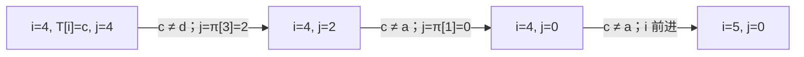

# Day 04：串与匹配

> 本资料以知识理解、案例、习题与工程应用为主。2027 年官方 408 大纲正文尚未逐项核验；题源待核实的习题不可认定为历年真题。


---

<a id="s2a9cdfad1a37"></a>

<a id="s2a9cdfad1a37-1"></a>
## 串的表示

> 前置：[顺序表](Day02.md#s907ba667adad)、[单链表](Day02.md#sbec6e18439ba)。本文除特别说明外以“字符序列”讨论，并用 0 基、左闭右开区间 `[l,r)` 表示子串。

<a id="s2a9cdfad1a37-2"></a>
### 从搜索文本开始

日志分析器需要从一段文本中找出 `ERROR` 是否出现，并在展示时截取上下文。文本中的字符有顺序，搜索内容也由连续字符构成；这正是串和模式匹配要解决的问题。

**串**是零个或多个字符组成的有限序列。长度为 0 的空串与包含一个空格的串不同。子串是连续片段：`abcde[1,4)` 为 `bcd`；不连续选取 `ace` 是子序列，不是子串。两个串相等要求长度相同、对应字符均相等；字典序按首个不同字符比较，若一方是另一方前缀，则较短者通常排前，具体比较规则须明确。

串 ADT 描述赋值、求长、比较、连接、子串、定位、插入、删除和替换的语义。`substring(S,l,r)` 在 `0≤l≤r≤n` 时返回 `S[l,r)`；`l=r` 返回空串，非法边界报告失败。`index(S,P)` 的结果表示 P 首次出现的位置，不存在时返回 -1；本教材约定空模式首次出现位置为 0。不同 API 或题目可有不同约定。

<a id="s2a9cdfad1a37-3"></a>
### 顺序、动态与块链存储

| 方式 | 表示 | 优势与局限 |
|---|---|---|
| 定长顺序串 | 固定容量连续槽位和长度 | 可 O(1) 按槽访问；容量不足时按接口约定拒绝或截断，不能默认静默丢失 |
| 动态顺序串 | 运行时分配的连续缓冲，记录长度及可能的容量 | 可扩容；扩容和插入可能复制内容，是否可变取决于具体类型 |
| 块链串 | 每个结点存一块字符、长度和下一链接 | 块内连续、块间相连；定位需走过前面的块，结点和尾块有额外开销 |

顺序串 n、m 表示输入长度；若结果需新分配并复制，连接时间和结果空间均 O(n+m)，复制长度为 k 的子串为 O(k) 时间和 O(k) 输出空间；若采用共享视图，复制和生命周期成本会不同。串比较最多比较 O(min(n,m)) 个字符（假定单字符比较为 O(1)）。固定容量原地删除需移动后缀，最坏 O(n)，不额外分配缓冲时辅助空间 O(1)。

块链的**数据槽位利用率**与整个结点的**存储密度**不是同一口径。若 n 个字符、每块 B 个槽、共 k=⌈n/B⌉ 块，则槽位利用率为 n/(kB)（n>0）；若每槽占 w 字节、每个结点含 h 字节元数据和指针，忽略填充时整体密度为 nw/[k(Bw+h)]。实际结构还可能有对齐填充；不能忽略尾块空槽而断言结点越大密度一定单调增大。

“字符”在工程中可能指字节、Unicode 码点或用户可见字符簇；UTF-8 中一个汉字常占多个字节。按字节索引、按码点索引和显示宽度并不等价。文中 BF/KMP 示例使用 ASCII，避免在算法状态表中混淆单位；具体编码与规范化按系统要求处理。

<a id="s2a9cdfad1a37-4"></a>
### 案例：提取日志中的状态字段

**背景与输入**：日志内容是 `"ID=7;ERROR;END"`；已由其他步骤确定 `ERROR` 的起点 l=5 和终点 r=10（0 基、右端不包含）。要求取出这一字段。

| 步骤 | 状态 | 说明 |
|---|---|---|
| 校验 | 0≤5≤10≤14 | 字符长度为 14 |
| 截取 | `S[5,10)` | 依次取下标 5、6、7、8、9 |
| 结果 | `ERROR` | 长度 10−5=5 |

```text
取子串(S, l, r):              // 返回新串，长度单位为字符槽
    若 l < 0 或 r < l 或 r > S.length: 返回“边界错误”
    新建长度 r-l 的结果 T
    对 i 从 l 到 r-1: T[i-l] ← S[i]
    返回 T
```

题设采用新串复制，时间 O(r−l)、输出空间 O(r−l)、除输出外辅助空间 O(1)。若取 `[10,10)` 得到空串；若 r>n 应拒绝而不是越界。真实日志常采用分隔符解析或索引定位，再进行截取；本例不把已知起点的截取误称为字符串搜索。

<a id="s2a9cdfad1a37-5"></a>
### 模式匹配与工程取舍

模式匹配是查找一个模式串 P 在文本 T 中首次或所有出现的位置。例如在 `"ababa"` 中查 `"aba"`，首次为 0，可重叠出现位置为 0 和 2。普通搜索与 KMP 的实现、空模式和重叠处理见 [BF 与 KMP](Day04.md#sc65065c5b49e)，此处不重复其推导。

文本编辑器和日志系统需要查找、截取及显示上下文：连续字符串便于顺序扫描和利用局部性；频繁在大文本中间插入可能造成复制，块链或其他分块结构可减少局部搬移，但引入块管理和跨块搜索成本。真实实现还要处理编码、换行、规范化及多字节边界。

<a id="s2a9cdfad1a37-6"></a>
### 分级练习

<a id="s2a9cdfad1a37-7"></a>
#### 基础

1. <a id="q-8e8b6261bd0532"></a>**自编**：`" "` 和空串长度是否相同？答：不相同；前者有一个空格字符。
2. <a id="q-2dc04a6c87f9ac"></a>**自编**：`"abcde"[1,4)` 是什么？答：`bcd`。
3. <a id="q-55ce34726afc7c"></a>**自编**：`ace` 是 `abcde` 的子串吗？答：不是连续子串，是子序列。

<a id="s2a9cdfad1a37-8"></a>
#### 进阶

1. <a id="q-9599d09338d9a7"></a>**平台题**：[LeetCode 28 找出字符串中第一个匹配项的下标](https://leetcode.cn/problems/find-the-index-of-the-first-occurrence-in-a-string/)。注意平台约束模式非空，返回 0 基位置或 -1。
2. <a id="q-c2604cfc6941fb"></a>**自编**：`"aaaa"` 中 `"aa"` 的可重叠出现位置？答：0、1、2。
3. <a id="q-db25a560f2f5c4"></a>**自编**：复制 `S[2,2)` 的结果是什么？答：空串；按本文约定合法。

<a id="s2a9cdfad1a37-9"></a>
#### 综合

1. <a id="q-e29c41fb2b4fc5"></a>**自编**：日志由很多短行组成，比较把所有内容连接成一个大串与按块保存的优缺点；讨论跨块匹配、复制成本和下标含义。答案取决于读取、修改和搜索负载，不能只依据一种大 O 结论。


---

<a id="sc65065c5b49e"></a>

<a id="sc65065c5b49e-1"></a>
## BF 与 KMP：字符串匹配

> 前置：[串的表示](Day04.md#s2a9cdfad1a37)。本页匹配伪代码统一采用 0 基下标、右开区间，`n=|T|`、`m=|P|`；约定空模式首次匹配位置为 0，找不到返回 -1。比较单位是字符，示例使用 ASCII。

<a id="sc65065c5b49e-2"></a>
### 问题：在日志中找固定标记

在文本 T 中寻找模式 P 的第一次连续出现。简单方法在每个可能起点逐字符比较；当文本和模式有较多重复前缀时，许多已经知道的字符又被比较。KMP 利用模式自身的前后缀信息，失配后只调整模式中的位置，不让文本下标回退。

<a id="sc65065c5b49e-3"></a>
### BF：逐个起点检查

```text
BF(T, P):
    n ← |T|; m ← |P|
    若 m = 0: 返回 0
    对 start 从 0 到 n-m:            // 若 m > n，不进入循环
        j ← 0
        当 j < m 且 T[start+j] = P[j]: j ← j+1
        若 j = m: 返回 start
    返回 -1
```

非空模式时最多检查 `max(0,n−m+1)` 个起点，每个起点最多比较 m 次，最坏 O(nm)，额外空间 O(1)。当首次位置就完整匹配时仍要读取 m 个字符；平均表现依赖文本、模式和字符分布，不能笼统保证 KMP 在每次输入都更快。

<a id="sc65065c5b49e-4"></a>
### 前缀函数 π：失配后保留什么

`π[i]` 是子串 `P[0..i]` 的**最长相等真前后缀长度**；真前缀和真后缀不等于整个串。若已匹配 j 个字符，当前文本字符与 P[j] 失配，则可保留长度 `π[j−1]` 的前缀，把 j 改为该长度，文本位置不动；若 j=0 仍不等，才推进文本。

以 P=`"ababd"` 为例：

| i | P[i] | 前缀 P[0..i] | 最长相等真前后缀 | π[i] |
|---:|---|---|---|---:|
| 0 | a | a | 空 | 0 |
| 1 | b | ab | 空 | 0 |
| 2 | a | aba | a | 1 |
| 3 | b | abab | ab | 2 |
| 4 | d | ababd | 空 | 0 |

```text
构造前缀函数(P):
    m ← |P|
    若 m = 0: 返回空数组
    π[0] ← 0; j ← 0
    对 i 从 1 到 m-1:
        当 j > 0 且 P[i] ≠ P[j]: j ← π[j-1]
        若 P[i] = P[j]: j ← j+1
        π[i] ← j
    返回 π
```

`j` 每次回退都会减小，而整个构造过程中增加次数有线性上界，因此构造 O(m) 时间、O(m) 数组空间。

<a id="sc65065c5b49e-5"></a>
### KMP 查找伪代码

```text
KMP首次匹配(T, P):
    若 |P| = 0: 返回 0
    π ← 构造前缀函数(P)
    j ← 0
    对 i 从 0 到 |T|-1:
        当 j > 0 且 T[i] ≠ P[j]: j ← π[j-1]
        若 T[i] = P[j]: j ← j+1
        若 j = |P|: 返回 i-|P|+1
    返回 -1
```

不变量：处理下一个文本字符之前，`P[0..j)` 与已经扫描文本的某个最长可延续后缀相等。每次回退使 j 减少，文本 i 只向前推进，累计匹配 O(n)；含预处理为 O(n+m)，辅助空间 O(m)。若模式比文本长，仍可安全返回 -1。若需要全部可重叠匹配，在完整匹配后先记录位置，再令 `j←π[m−1]` 并继续；不允许重叠时可令 j←0。

<a id="sc65065c5b49e-6"></a>
### 完整案例：失配后的两次回退

**背景与输入**：日志文本 `T="ababcababd"`，搜索固定标记 `P="ababd"`。BF 可以逐起点回试；KMP 预处理 `π=[0,0,1,2,0]`，适合模式重复查询或文本中有重复前缀的情况。下表 `j` 是比较**之前**已匹配字符数；箭头表示处理当前字符后状态。

| 文本 i | T[i] | 比较前 j | 比较/动作 | 比较后 j |
|---:|---|---:|---|---:|
| 0 | a | 0 | 等于 P[0] | 1 |
| 1 | b | 1 | 等于 P[1] | 2 |
| 2 | a | 2 | 等于 P[2] | 3 |
| 3 | b | 3 | 等于 P[3] | 4 |
| 4 | c | 4 | 不等于 P[4]=d，回退至 π[3] | 2 |
| 4 | c | 2 | 不等于 P[2]=a，回退至 π[1] | 0 |
| 4 | c | 0 | 不等于 P[0]=a，推进 i | 0 |
| 5 | a | 0 | 等于 P[0] | 1 |
| 6 | b | 1 | 等于 P[1] | 2 |
| 7 | a | 2 | 等于 P[2] | 3 |
| 8 | b | 3 | 等于 P[3] | 4 |
| 9 | d | 4 | 等于 P[4]，完成匹配 | 5 |

结果起点 `9−5+1=5`，对应 `T[5..10)="ababd"`。文本位置 i=4 在两次回退期间没有前移，直到 j=0 仍不匹配才推进；已经匹配的 `abab` 的后缀 `ab` 可作为候选前缀。



本例包括预处理 O(m) 和扫描 O(n)，辅助 O(m)。若只搜索一个很短的模式，BF 的简单性可能更合适；同一模式搜索多个文本时可以复用 π。

<a id="sc65065c5b49e-7"></a>
### 与教材式 next、nextval 的对照

下面另列原资料常见的**1 基教材约定**，只用于对照；不能直接把这些数组放入上面的 0 基 π 伪代码。

- 模式字符编号为 1..m；定义 `next[1]=0`，对 `2≤j≤m`，`next[j]=π[j−2]+1`。`0` 是哨兵，表示第一个字符失配后要推进文本；`1` 才表示失配前的最长相等真前后缀长度为 0。
- 教材式匹配若在第 j 个字符失配，则令 `j←next[j]`；当 j=0 时推进文本并把 j 设回 1。这个 j 是**下一待比较字符的 1 基位置**，不是上文已匹配长度。
- `nextval[1]=0`；对 j≥2，令 k=next[j]：若 k>0 且 `P[j]=P[k]`，令 `nextval[j]=nextval[k]`，否则 `nextval[j]=k`。它跳过已知会重复失配的相同字符；使用其匹配循环也必须遵守 1 基哨兵约定。

| j（1 基） | P[j] | next[j] | nextval[j] |
|---:|---|---:|---:|
| 1 | a | 0 | 0 |
| 2 | b | 1 | 1 |
| 3 | a | 1 | 0 |
| 4 | b | 2 | 1 |
| 5 | d | 3 | 3 |

例如 j=3 时 P[3] 和 P[next[3]]=P[1] 都为 a；若文本当前字符已与 P[3] 失配，再比较相同的 a 仍会失配，所以可以跳到 nextval[1]=0。其他教材对 next 的定义可能不同，不能只看数组名套公式。

<a id="sc65065c5b49e-8"></a>
### 周期与边界

对非空串 s，长度 n，`p=n−π[n−1]` 是其最小正周期长度；若 `n mod p=0`，它可由长度 p 的前缀完整重复 `n/p` 次。若要求**至少重复两次**，还须 `p<n`；例如 `ab` 的 π 为 `[0,0]`、p=2，不是两个 `a`。周期不要求整除：`ababa` 的最小周期为 2，但它不是由 `ab` 完整重复整数次得到。

空模式返回 0 是本教材 API 约定；某些题目不接受空模式。单字符、全相同字符、模式长于文本、失配发生在首字符以及重叠匹配都要测试。前缀函数的 `π[m−1]` 与教材式 `next[m]` 不是同一含义：后者只涉及失配位置之前的前缀，不能直接将 `m-next[m]` 当通用周期公式。

<a id="sc65065c5b49e-9"></a>
### 工程应用

搜索引擎、日志过滤或编辑器都可能反复扫描文本。预处理可复用的模式能避免重复工作；流式处理还需保存跨块的 j 状态。真实系统要确认大小写、编码、Unicode 规范化和下标单位，库函数也可能采用其他高效算法；不应假设每种输入下 KMP 都是最快方案。

<a id="sc65065c5b49e-10"></a>
### 分级练习

<a id="sc65065c5b49e-11"></a>
#### 基础

1. <a id="q-e30fc72249f124"></a>**自编**：P=`aba` 的 π 是什么？答：`[0,0,1]`。
2. <a id="q-743caacb5402c2"></a>**自编**：本文 KMP 中空模式首次匹配位置？答：0；这是 API 约定。
3. <a id="q-4ef675a1979838"></a>**自编**：P=`ababd` 的 1 基 next[4] 是多少？答：2，对应 π[2]+1。

<a id="sc65065c5b49e-12"></a>
#### 进阶

1. <a id="q-43880f3aaff052"></a>**平台题**：[LeetCode 28 找出字符串中第一个匹配项的下标](https://leetcode.cn/problems/find-the-index-of-the-first-occurrence-in-a-string/)。平台限制模式非空，返回 0 基位置或 -1。
2. <a id="q-732dc329fc7886"></a>**平台题**：[LeetCode 459 重复的子字符串](https://leetcode.cn/problems/repeated-substring-pattern/)。可用 π 求 p，检查 p<n 和 n mod p=0，时间 O(n)、辅助空间 O(n)。
3. <a id="q-28866222905d48"></a>**自编**：在 `aaaa` 中找 `aa`，允许重叠时位置为多少？答：0、1、2；匹配后令 j=π[1]=1。

<a id="sc65065c5b49e-13"></a>
#### 综合

1. <a id="q-672863da5ef95c"></a>**自编**：将文本分成 `ababc` 与 `ababd` 两块，逐块执行同一次 KMP 扫描，说明需要跨块保留什么。答：保存模式 π、当前匹配长度 j 和全局偏移；本例在第一块处理完 j=0，结果全局起点仍为 5。另试把块切在 `ab` 后，说明 j 不应无条件清零。
