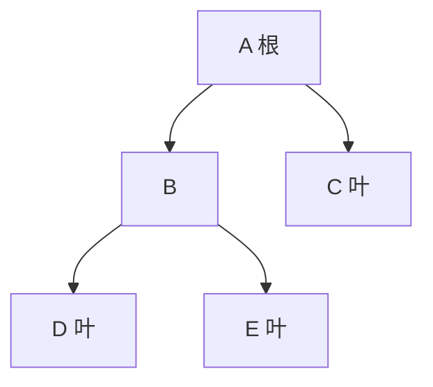
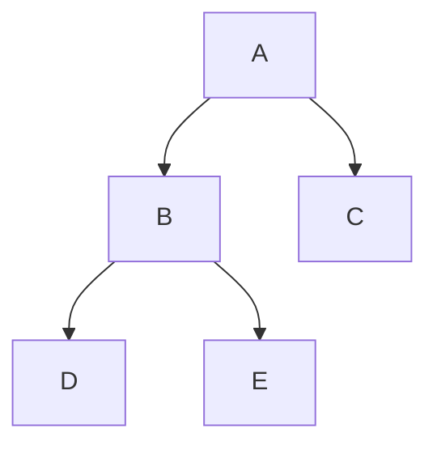

# Day 05：树与二叉树基础

> 本资料以知识理解、案例、习题与工程应用为主。2027 年官方 408 大纲正文尚未逐项核验；题源待核实的习题不可认定为历年真题。


---

<a id="s841cd20970da"></a>

<a id="s841cd20970da-1"></a>
## 树与二叉树基础

> 前置：[算法基础与复杂度](Day01.md#s29cd9e7587d0)、[数组与矩阵](Day03.md#s17acfd19f168)。本文根为第 1 层，树高按层数计；空树高度为 0。结点数记为 n，树高记为 h。

<a id="s841cd20970da-2"></a>
### 从文件夹层级开始

文件系统中的文件夹可以包含子文件夹，路径反映层级归属。若每个非根目录只有一个上级，就可用树描述这种关系；文件系统中的符号链接可能形成一般图，不能不加区分地把所有路径关系都当作树。

树是结点的有限集合：空集合为空树；非空时有唯一根，其余结点分为互不相交的若干子树。结点的**度**是孩子数；度为 0 的是叶子。双亲、孩子、兄弟描述相邻层的关系，祖先与后代描述沿多条边向上或向下的关系。树的度是所有结点度的最大值，层数从根为 1；高度取最大层数。空树没有根、叶子和非空树的最大度，约定高度 0。



图中 A 的度为 2，B、C 是兄弟，D、E 的双亲是 B；总计 5 个结点、4 条边、高度 3。非空树每个非根结点恰有一条来自双亲的边，故边数是 n−1，所有结点度之和也为 n−1。它不适用于 n=0 的空树。

<a id="s841cd20970da-3"></a>
### 二叉树与形态

二叉树为空或由一个根、左子树和右子树组成；左右位置有区别，即使只有一个孩子，也要区分左孩子和右孩子。不要把“度不超过 2 的普通树”直接等同于不区分左右的二叉树。

按根和子树是否存在，二叉树有五种基本结构：空树；只有根；根只有左子树；根只有右子树；根同时有左、右子树。后面三种中的子树本身也可以继续有自己的孩子。这五种结构是递归定义的基本情形，与下述“满”“完全”等整体形态分类是不同角度。

- **满二叉树**：按本文教材约定，h 层都排满，共 `2^h−1` 个结点；英语 full 在不同资料中也可能指每个结点有 0 或 2 个孩子，读英文时应看定义。
- **完全二叉树**：结点位置与同高度满二叉树按层、从左到右编号的前 n 个位置一致。最底层可能未满，但已有结点靠左连续排列。满二叉树必为完全二叉树，反之不一定。
- **正则二叉树**：每个结点有 0 或 2 个孩子，不要求叶子全在同一层。它与完全二叉树都不是对方的必要条件。
- **BST、AVL** 在此是以键顺序或高度平衡为约束的二叉树，性质和操作在 [BST 与 AVL](Day06.md#sb76ad17e0a6b) 讲解，不将它们与“满/完全”混为一谈。

<a id="s841cd20970da-4"></a>
### 重要性质与推导

非空二叉树中，设 n₀、n₁、n₂ 分别为度数 0、1、2 的结点数。按结点数与边数计数：

`n=n₀+n₁+n₂`，`n−1=n₁+2n₂`，两式相减得到 **n₀=n₂+1**。这个公式要求树非空；空树不满足 0=0+1。

| 性质 | 结论与条件 |
|---|---|
| 第 i 层最多结点 | `2^(i−1)`，i≥1；每个结点至多产生两个孩子 |
| 高度为 h 的二叉树最多结点 | `2^h−1`；逐层求和 |
| 非空完全二叉树高度 | `floor(log₂ n)+1`，等于 `ceil(log₂(n+1))` |
| 完全二叉树的叶子数 | `ceil(n/2)`；编号 `floor(n/2)+1..n` 为叶子 |
| 1 基层序编号的完全二叉树 | 结点 i 的双亲 `floor(i/2)`（i>1），左孩子 2i、右孩子 2i+1；孩子编号不超过 n 才存在 |
| 空链接数 | 对 n 个真实结点的二叉链表，2n 个孩子域中有 n−1 条边，故空孩子域 n+1；n>0。 |

有的教材将高度按边数而不是层数定义，公式需要相应调整。对一般二叉树，1 基堆式编号仍能表达位置，但数组可能出现大量空洞；例如高度为 h 的右斜树需要的最大编号随 h 指数增长。

<a id="s841cd20970da-5"></a>
### 存储与操作成本

**顺序存储**用数组按层序编号保存完全二叉树，直接计算孩子位置，空间 Θ(n)，常用于堆；稀疏或退化形态可能浪费大量槽位。**二叉链表**结点保存值、左孩子和右孩子引用，空间 Θ(n)，访问已知结点的孩子 O(1)，但找任意值通常需要遍历 O(n)。如果额外保存双亲引用，可 O(1) 向上移动，但更新时须维护它。遍历和构造方法见 [遍历与线索](Day05.md#s536adf5e7ddc)。

<a id="s841cd20970da-6"></a>
### 案例：检查一棵完全二叉树

仓库按层排列 6 个货架位置，编号从 1 开始，判断叶子与孩子位置。将货架按编号放在数组中：

```text
          1
       /     \
      2       3
     / \     /
    4   5   6
```

编号为 1..6 且没有中间空洞，是完全二叉树。高度 `floor(log₂6)+1=3`；编号大于 floor(6/2)=3 的 4、5、6 是叶子，共 3 个；结点 3 的左孩子编号 6 存在，右孩子编号 7 超过 6，不存在。用数组判断一个已知编号的孩子只需一次乘法和边界比较，为 O(1)；整个数组占 O(n)。如果输入是一棵链式二叉树，不能只看结点数，需要层次遍历并检查空位置后的结点，详见遍历章。

<a id="s841cd20970da-7"></a>
### 工程取舍

树适合目录层级、表达式语法结构以及堆的组织；数组堆适合接近完全二叉树且需按位置访问的场景，链式结点适合结构变化和稀疏形态。已知局部连接的修改可以很快，但查找目标位置、内存分配和并发同步仍有成本；不要将某个操作的 O(1) 扩展为整棵树所有操作均为 O(1)。

<a id="s841cd20970da-8"></a>
### 分级练习

<a id="s841cd20970da-9"></a>
#### 基础

1. <a id="q-c70eadb5f4d639"></a>**自编**：只有根的一棵树高度、边数和叶子数各是多少？答：1、0、1。
2. <a id="q-755afedfbd14d6"></a>**自编**：非空二叉树 n₂=4 时 n₀ 是多少？答：5。
3. <a id="q-de696a12b726e6"></a>**自编**：完全二叉树 n=10，编号 4 的左右孩子？答：8、9。

<a id="s841cd20970da-10"></a>
#### 进阶

1. <a id="q-4209938791f318"></a>**平台题**：[LeetCode 104 二叉树的最大深度](https://leetcode.cn/problems/maximum-depth-of-binary-tree/)，空树按题设返回 0，递归遍历时间 O(n)、栈 O(h)。
2. <a id="q-ac5ab0497822c0"></a>**自编**：判断编号 1、2、3、5 的形态是否为完全二叉树。答：否，编号 4 有空洞而 5 存在。
3. <a id="q-5552da0104e0b8"></a>**自编**：高度为 4 的二叉树最多多少结点？答：15；至少 4 个结点。

<a id="s841cd20970da-11"></a>
#### 综合

1. <a id="q-0618b4f1d32f39"></a>**自编**：比较用连续数组和链式结点保存 100 个结点的完全树与极度倾斜树，讨论空间、找孩子和插入位置成本；说明必须先明确编号和操作条件。


---

<a id="s536adf5e7ddc"></a>

<a id="s536adf5e7ddc-1"></a>
## 二叉树遍历与线索

> 前置：[树与二叉树基础](Day05.md#s841cd20970da)、[栈与递归](Day03.md#sfcd1dfd24554)、[队列](Day03.md#s9927a41afd04)。n 为结点数，h 为树高；空树遍历结果为空序列。结果列表若需保存，另占 O(n) 输出空间。

<a id="s536adf5e7ddc-2"></a>
### 为什么访问次序重要

目录树中的每个文件都要被检查；表达式树则可能需要先处理操作数，再计算运算符。遍历是按确定规则访问每个结点一次，选择不同次序可满足不同任务。假设孩子的左右次序已确定：

- **先序**：根 → 左子树 → 右子树；适合先处理容器再处理内部内容。
- **中序**：左子树 → 根 → 右子树；对严格 BST 会得到递增键序列。
- **后序**：左子树 → 右子树 → 根；适合先计算孩子结果再合并到父结点。
- **层序**：从根开始逐层、每层从左至右；使用队列保存待访问结点。

<a id="s536adf5e7ddc-3"></a>
### 案例：同一棵树的四种遍历

树表示一个根任务 A，下含 B、C，B 下含 D、E：



| 规则 | 执行次序 | 解释 |
|---|---|---|
| 先序 | A B D E C | 先根 A，再依次处理 B 子树、C |
| 中序 | D B E A C | 先 B 的左、B、右，再 A、C |
| 后序 | D E B C A | B 的子任务 D、E 先于 B；最后处理 A |
| 层序 | A B C D E | 根层、第二层、第三层 |

递归中序伪代码：

```text
中序(p):
    若 p = null: 返回
    中序(p.left)
    访问(p)
    中序(p.right)
```

递归栈保存“返回后继续做什么”，是 [函数调用栈](Day03.md#sfcd1dfd24554) 的应用；深度可达 h，最坏 O(n)。显式栈版中序按左链入栈，弹出时访问，再转向右子树：

```text
中序_显式栈(root):
    S ← 空栈; p ← root
    当 p ≠ null 或 S 非空:
        当 p ≠ null:
            S.push(p); p ← p.left
        p ← S.pop(); 访问(p)
        p ← p.right
```

入栈后按 LIFO 弹出，例如先入 A、B、D，首先弹出 D；空树时外层循环不进入。先序可用栈弹根、先压右再压左；后序要确保两棵子树先访问，例如用显式栈记录“是否已访问右子树”的状态，不能简单地把中序的访问位置后移。层序使用 [队列](Day03.md#s9927a41afd04)：非空根入队，反复出队访问并依左、右顺序入队非空孩子。

一种非递归后序方法在栈中保存“结点、是否已展开”两个状态；先展开时把稍后访问自身的标记压栈，再依次压入右、左孩子，让左孩子最先出栈。这里只处理非空结点：

```text
后序_显式栈(root):
    S ← 空栈
    若 root ≠ null: S.push((root, 未展开))
    当 S 非空:
        (p, 状态) ← S.pop()
        若 状态 = 已展开: 访问(p)
        否则:
            S.push((p, 已展开))
            若 p.right ≠ null: S.push((p.right, 未展开))
            若 p.left ≠ null: S.push((p.left, 未展开))
```

每个结点最多压栈两次，时间 O(n)；待处理条目与树高成正比，辅助空间 O(h)，不计输出。空树不入栈，返回空序列。

层序案例的队列状态：

| 动作 | 队列（头→尾） | 输出 |
|---|---|---|
| A 入队 | A | 空 |
| 出 A，入 B、C | B,C | A |
| 出 B，入 D、E | C,D,E | A,B |
| 出 C | D,E | A,B,C |
| 出 D、E | 空 | A,B,C,D,E |

四种遍历均对每个结点处理常数次，时间 O(n)。先/中/后序的递归或显式栈为 O(h) 辅助空间；层序队列最坏 O(n)，实际取决于最大宽度。以上不计结果输出空间；“显式栈先压右再压左”仅指上述先序方案，不自动适用于所有非递归 DFS 写法。

<a id="s536adf5e7ddc-4"></a>
### 遍历序列重建

若结点标识**互不相同**且序列来自同一棵树，先序+中序可唯一重建：先序第一个是根，在中序中找到根，把中序分成左右子树，再按左右结点数切分先序并递归。上例先序 `ABDEC`、中序 `DBEAC`：根 A；中序左段 `DBE` 有 3 个结点，对应先序左段 `BDE`，其余 C 为右子树。每个递归子问题按相同规则继续，得到图中结构。

中序+后序、在相同唯一标识条件下的中序+层序也能确定；仅有先序+后序一般不唯一：单个孩子可能是左孩子或右孩子。重复键若没有额外结点身份或约束，重建可能不唯一。用哈希表索引中序位置、传下标范围时，平均 O(n) 时间、索引 O(n) 与递归栈 O(h) 辅助空间；逐次线性查找最坏 O(n²)。若输入序列不一致，应报告失败，不能随意构造。

<a id="s536adf5e7ddc-5"></a>
### 线索二叉树

二叉链表中的空孩子域可用于保存某种遍历次序的前驱或后继；必须另设标志区分孩子和线索。以**中序线索**为例：`ltag=0` 表示 left 是左孩子，`ltag=1` 表示 left 是中序前驱；`rtag=0` 表示 right 是右孩子，`rtag=1` 表示 right 是中序后继。首结点前驱、末结点后继可为 null（也有带头结点的其他约定）。建线索时先按中序遍历，保存上一个访问结点 prev：当前结点无左孩子时设前驱线索；prev 无右孩子时设其后继线索。遍历结束要按约定处理最后结点。建线索时间 O(n)，递归构建辅助空间 O(h)，标志和线索存于原结点。

以上例的中序 `D B E A C` 为准：D 的后继线索指向 B；E 的前驱线索指向 B、后继线索指向 A；C 的前驱线索指向 A，后继为 null。查某结点的中序后继：若 rtag=1，直接取 right；否则进入右子树，沿**真正左孩子**走到最左结点，不能把 ltag=1 的线索当孩子继续走。前驱对称处理。单次查找最坏 O(h)，连续线索中序遍历全部结点总时间 O(n)、不计输出的额外工作空间 O(1)。

<a id="s536adf5e7ddc-6"></a>
### 工程应用与练习

表达式树常用后序计算：先算两个子表达式，再处理当前运算符；语法树的具体结点、类型检查和异常处理由语言决定。层序访问适合按层展示组织结构，但队列峰值随树宽增长；链式树的递归遍历对极深树可能耗尽调用栈，显式栈只是把状态转移到可控的存储中。

<a id="s536adf5e7ddc-7"></a>
#### 基础

1. <a id="q-c53d974cfe1b93"></a>**自编**：上图中序是什么？答：D B E A C。
2. <a id="q-8c5d417f43114b"></a>**自编**：空树的层序输出是什么？答：空序列。
3. <a id="q-f6bbfe86e0f9fc"></a>**平台题**：[LeetCode 94 二叉树的中序遍历](https://leetcode.cn/problems/binary-tree-inorder-traversal/)。

<a id="s536adf5e7ddc-8"></a>
#### 进阶

1. <a id="q-13c1dc7c05d2a1"></a>**平台题**：[LeetCode 102 二叉树的层序遍历](https://leetcode.cn/problems/binary-tree-level-order-traversal/)。输出按层分组；每轮先记录当前队列长度。
2. <a id="q-02e7479ef0e107"></a>**平台题**：[LeetCode 105 从前序与中序遍历序列构造二叉树](https://leetcode.cn/problems/construct-binary-tree-from-preorder-and-inorder-traversal/)。题目保证元素不重复。
3. <a id="q-0527349a32a064"></a>**自编**：上图 E 的中序前驱、后继是谁？答：B、A；说明如何区分线索和孩子。

<a id="s536adf5e7ddc-9"></a>
#### 综合

1. <a id="q-9981201edb5ba9"></a>**平台题**：[LeetCode 236 二叉树的最近公共祖先](https://leetcode.cn/problems/lowest-common-ancestor-of-a-binary-tree/)。先明确题目给定的两个结点都存在；可用后序信息合并，时间 O(n)、递归栈 O(h)。


---

<a id="s2e85120de24f"></a>

<a id="s2e85120de24f-1"></a>
## 树、森林与存储表示

> 前置：[树与二叉树基础](Day05.md#s841cd20970da)、[遍历与线索](Day05.md#s536adf5e7ddc)。本页的树为有序树，孩子从左到右有确定次序；空指针为 null。

<a id="s2e85120de24f-2"></a>
### 为什么一棵树有多种表示

一个组织有部门，每个部门又有不同数量的团队。若要频繁找上级，保存双亲方便；若要列出下属，保存孩子关系方便。表示方式是实现选择，不改变树本身的父子关系。

| 表示 | 记录内容 | 主要代价 |
|---|---|---|
| 双亲表示 | 每个结点记录双亲下标；根用特殊值如 -1 | 已知结点找双亲 O(1)；无额外索引时找全部孩子需扫描 O(n) |
| 孩子表示 | 每个结点指向其孩子列表 | 枚举结点的 d 个孩子 O(d)；若未另存双亲，找双亲可能 O(n) |
| 孩子兄弟表示 | `firstChild` 指向第一个孩子，`nextSibling` 指向下一个兄弟 | O(n) 存储；逐个访问孩子 O(d)，不能把兄弟指针当作原树的孩子 |

<a id="s2e85120de24f-3"></a>
### 案例：部门树转成二叉链式表示

**输入与目的**：组织 A 下有 B、C，B 下有 D、E，C、D、E 无孩子。要用统一的两条链接保存任意数量的孩子。选孩子兄弟表示：第一个孩子走左链接，下一个兄弟走右链接。


| 原树结点 | 第一个孩子 → 二叉左孩子 | 下一个兄弟 → 二叉右孩子 |
|---|---|---|
| A | B | null |
| B | D | C |
| C | null | null |
| D | null | E |
| E | null | null |

结果二叉树链接为 A.left=B、B.left=D、B.right=C、D.right=E。注意二叉树中的 B→C 是右孩子链接，但在原树中 C 是 B 的**兄弟**，不是 B 的下属。每个结点检查一次、每条原树边处理常数次，转换时间 O(n)，结果结点空间 O(n)；如果新建表示，递归或栈的额外空间视实现而定。

```text
构建孩子兄弟(T):              // 输入是有序树；输出为新表示
    若 T 为空: 返回 null
    为每个原结点建立对应结点
    对每个结点 p:
        若 p 有孩子:
            p.firstChild ← 第一个孩子的对应结点
            按原顺序将相邻孩子的 nextSibling 相连
        最后一个孩子的 nextSibling ← null
    返回根的对应结点
```

实现需先建立原结点与新结点的对应关系，或采用递归返回新结点；映射表为 O(n) 额外空间，不能把它漏掉。伪代码未赋值的空链接应初始化为 null。

<a id="s2e85120de24f-4"></a>
### 遍历的对应关系

上面的原树先根序为 `A B D E C`，后根序为 `D E B C A`。孩子兄弟表示所得二叉树的先序和中序恰好分别是这两个序列：先序先访问结点再依次访问孩子；二叉中序先处理第一个孩子及兄弟链，再访问该结点，对应原树后根。

**森林**是一组有序的不相交树。先将各棵树转成孩子兄弟形式，再把各棵树的根依次用右兄弟链接连接；这时得到的是整片森林对应的一棵二叉树。森林先序对应二叉树先序，常见教材定义的森林中序对应二叉树中序。对单棵树，先根/后根分别对应二叉树先序/中序；不要把原树后根误写成对应二叉树后序。

例如森林由 A(B,C) 和 D(E) 构成：二叉链接为 A.left=B、B.right=C、A.right=D、D.left=E。二叉先序为 A B C D E，二叉中序为 B C A E D，分别对应森林先序、中序。只转一棵树时，树根没有同层兄弟，其 right 为 null；森林中后续根要通过右链接连接。

<a id="s2e85120de24f-5"></a>
### 工程应用

文档解析器或目录系统常有可变数量的子项。孩子列表直接适合逐项枚举，双亲指针便于沿路径向上；孩子兄弟表示用固定两个链接支持多叉结构，但按第 k 个孩子访问需要沿兄弟链行走 O(k)，不适合频繁随机访问。真实数据如果存在共享子结点、循环引用或跨链接，则可能是图，应先定义访问去重与环检测。

<a id="s2e85120de24f-6"></a>
### 分级练习

<a id="s2e85120de24f-7"></a>
#### 基础

1. <a id="q-1afbbcb1e5da75"></a>**自编**：上例 B 的第一个孩子和下一个兄弟分别是谁？答：D、C。
2. <a id="q-ec28d6d87762a4"></a>**自编**：双亲数组中的根需要什么约定？答：用 -1 等不与合法下标冲突的标记。
3. <a id="q-f7b19c221f1571"></a>**自编**：孩子兄弟表示中，原树叶子一定没有二叉树右孩子吗？答：不一定，右链接可能指向它的兄弟。

<a id="s2e85120de24f-8"></a>
#### 进阶

1. <a id="q-6f0f3926ad225e"></a>**自编**：树 R 的孩子依次为 X、Y、Z，列出 firstChild 和 nextSibling。答：R.firstChild=X，X.nextSibling=Y，Y.nextSibling=Z，Z.nextSibling=null。
2. <a id="q-2214f08bd9beee"></a>**自编**：仅保存双亲数组，列出某结点所有孩子最坏要多久？答：扫描 n 个结点为 O(n)，若另建索引则另论。
3. <a id="q-6df20b684856d4"></a>**自编**：森林 A(B,C)、D(E) 的森林先序是什么？答：A B C D E。

<a id="s2e85120de24f-9"></a>
#### 综合

1. <a id="q-e8b83855b37477"></a>**自编**：设计文档目录的表示，要求频繁列出全部子项与偶尔回溯上级；比较孩子列表和额外双亲指针的空间、维护及访问成本，并说明出现快捷链接时为什么需要图模型。
