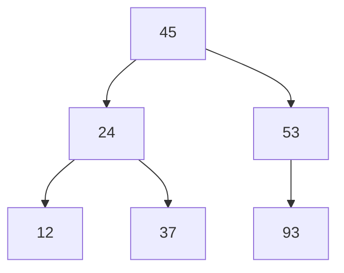

# Day 06：查找树、哈夫曼与并查集

> 本资料以知识理解、案例、习题与工程应用为主。2027 年官方 408 大纲正文尚未逐项核验；题源待核实的习题不可认定为历年真题。


---

<a id="sb76ad17e0a6b"></a>

<a id="sb76ad17e0a6b-1"></a>
## 二叉排序树与 AVL 树

> 前置：[二叉树基础](Day05.md#s841cd20970da)、[遍历](Day05.md#s536adf5e7ddc)、[复杂度](Day01.md#s29cd9e7587d0)。本文严格 BST 不存重复键；高度按层数计，空树高度为 0。比较成本假设为 O(1)。

<a id="sb76ad17e0a6b-2"></a>
### 为什么既要有序又要动态更新

应用维护一组不断增减的订单号，需要按键查找，也可能按顺序输出。排序数组支持 O(log n) 折半查找，但中间插入需移动元素；二叉排序树通过链接组织有序键，操作成本取决于树的高度。若更新顺序使树严重倾斜，性能也会恶化。

**二叉排序树（BST）**是空树，或每个结点都满足：左子树**所有键**小于当前键，右子树所有键大于当前键，左右子树本身也为 BST。只检查直接孩子不够：根 10 的左孩子为 5、5 的右孩子为 20，虽然局部有 5<10、20>5，20 却位于 10 的左子树，违反全局约束。严格 BST 中序遍历得到严格递增序列。

<a id="sb76ad17e0a6b-3"></a>
### 查找、插入和删除

```text
查找(root, key):
    p ← root
    当 p ≠ null:
        若 key = p.key: 返回 p
        若 key < p.key: p ← p.left
        否则: p ← p.right
    返回 null
```

插入从根沿同一比较路径向下，在遇到的空链接处接入新叶；键已存在时本页约定不插入。查找、插入均为 O(h)。空树查找返回 null，空树插入需更新根引用。

删除分三类：叶结点直接摘除；只有一个孩子时让该孩子接到原位置；有两个孩子时，可复制左子树最大结点（直接前驱）的键到目标，再从左子树删除该前驱；前驱没有右孩子，因此后续至多有一个孩子。也可对称使用右子树最小结点作为后继。若数据记录与键绑定，替换时必须维护完整记录及外部引用语义。

**高度修正**：对上述普通 BST 的前驱/后继替换删除，不进行旋转，新树高度不会比原树更高；它可能不变或降低。复制键不改变结构，摘除前驱/后继至多把其唯一孩子上移。AVL 的删除另有重新平衡过程，不能把这个推理不加说明地套到任意自平衡实现。

<a id="sb76ad17e0a6b-4"></a>
### 案例：构造 BST 并计算查找长度

按顺序插入 `45,24,53,12,37,93`，每次从根比较：24 小于 45 到左；53 大于 45 到右；12、37 分别成为 24 的左右孩子；93 为 53 的右孩子。



这棵树的高度为 3；查找 37 比较 45、24、37 共 3 次；查找 30 比较 45、24、37 后落到空链接，共 3 次**真实键比较**。若六个已有键等概率被成功查询，比较次数依次是 `1,2,2,3,3,3`，成功 ASL 为 `14/6=7/3`。

失败 ASL 必须给出失败情况的概率。本例共有 7 个空链接；若人为约定七个键区间**等概率**，按仅计真实键比较，结点 53 左空贡献 2 次，其余 6 个空链接的双亲都在第 3 层各贡献 3 次，失败 ASL 为 `(2+6×3)/7=20/7`。若将最后的空链接检查也单独计一次，则该特定计数为 27/7，不能把它叫作完全相同的“关键字比较次数”。实际请求不等概率时要以各区间概率加权。

若高度 h=O(log n)，查找、插入、普通删除都是 O(log n)；递增序列插入可生成高度 n 的单链，最坏均为 O(n)。构造 n 个结点最坏 O(n²)，不能无条件写 O(n log n)。递归操作栈 O(h)，迭代查找辅助 O(1)，均不含树本身 O(n) 存储。

<a id="sb76ad17e0a6b-5"></a>
### AVL：用旋转限制高度

AVL 是满足 BST 性质的二叉树，并要求每个结点左右子树高度差的绝对值不超过 1。本文平衡因子 `BF=左高−右高`。插入后从下往上检查第一个失衡祖先：

| 类型 | 插入方向 | 修复 |
|---|---|---|
| LL | 左孩子的左侧 | 对失衡结点右旋 |
| RR | 右孩子的右侧 | 对失衡结点左旋 |
| LR | 左孩子的右侧 | 先左旋左孩子，再右旋失衡结点 |
| RL | 右孩子的左侧 | 先右旋右孩子，再左旋失衡结点 |

旋转只改变局部链接，不改变中序键次序；需先更新旋下结点高度，再更新新子树根的高度。删除也可能失衡，并可能沿多层祖先继续调整；不能把“插入修复一次后高度恢复”的性质无条件套给删除。

<a id="sb76ad17e0a6b-6"></a>
#### 完整案例：LR 双旋

插入序列 30、10、20：插入前两项后，30 的左孩子为 10；插入 20 后，它位于 10 的右边，30 的 BF=2、左孩子 BF=-1，属于 LR。

```text
插入 20 后            先对 10 左旋            再对 30 右旋
     30                     30                     20
    /                      /                      /  \
   10                     20                     10  30
     \                   /
     20                 10
```

中序在三幅图中始终为 `10,20,30`；完成后根 20 的 BF=0，两个叶子 BF=0。已定位失衡位置后的每次旋转改常数条链接，O(1)；从根查找、沿路径更新高度为 O(log n)。要把旋转后的**新子树根**接回其父结点，若旋转的是整棵树的根还要更新 root。

令 N(h) 为高度 h 的 AVL 树最少结点数，`N(0)=0,N(1)=1,N(h)=1+N(h−1)+N(h−2)`（h≥2）：为满足平衡且有高度 h，两子树最小高度可取 h−1、h−2。这个递推随 h 指数增长，因此高度 O(log n)。插入与删除的查找和沿路径重平衡最坏 O(log n)，维护高度使用每结点常数额外字段；递归实现工作栈 O(log n)。

<a id="sb76ad17e0a6b-7"></a>
### 红黑树与工程取舍

红黑树也是自平衡 BST：通常用黑色空叶哨兵、根为黑色、红结点不能有红孩子、从任一结点到其后代空叶的路径黑结点数相同等规则限制高度。查找和更新最坏 O(log n)，但颜色与旋转维护规则不同于 AVL，不能将 AVL 的 BF 判断直接套用。AVL 的严格高度约束利于控制查找路径，但实际性能还取决于更新比例、内存布局和实现；数据库磁盘页索引常采用多路结构，详见 [B 树与 B+ 树](Day08.md#s2750714d0b21)。

<a id="sb76ad17e0a6b-8"></a>
#### 红黑树插入案例：重着色与旋转

本例从空树依次插入 **10、5、15、1、3**，键不重复；按普通 BST 定位后，先将新真实结点染红，再按需要修复。插红色结点不会像插黑色结点那样直接使经过该位置的路径多一个黑结点，但可能与红父结点相邻；首个结点作为根时还须染黑。

红黑性质：根为黑；每个 NIL 外部叶为黑；红结点的孩子均为黑；从任一结点到其后代 NIL 的各条路径黑结点数相同。图中省略的每个空孩子均表示黑色 NIL。本例的黑高 `bh(x)` 按**不计起点 x、计入终点黑色 NIL**统计；例如红或黑的真实叶结点到其 NIL 孩子的黑高均为 1。NIL 是逻辑上的黑色外部叶，程序可用哨兵或以空指针配合判色规则表示，但不可解引用空指针。

图中 `黑`、`红` 标记真实结点颜色。下面“初始插入后”尚未完成修复，允许临时出现不合法状态；每步“修复完成”才要求整棵树满足性质。

**1. 插入 10：**初始红根违反根黑，将根染黑。

```text
插入前：空树      初始插入后：10红      修复完成：10黑
```

根黑高为 1；左右空孩子均为黑 NIL。

**2. 插入 5：**父 10 为黑，不产生红红冲突，无需修复。

```text
插入前          初始插入后（即修复完成）
 10黑                  10黑
                       /
                     5红
```

**3. 插入 15：**父 10 为黑，仍无需修复。

```text
插入前          初始插入后（即修复完成）
  10黑                 10黑
 /                    /    \
5红                  5红   15红
```

**4. 插入 1：**初始状态中 1红 的父 5红 也是红，违反红结点无红孩子；叔叔 15红。将父 5 和叔叔 15 染黑，祖父 10 染红，修复位置上移；因为 10 是根，再将根染黑。

```text
插入前              初始插入后            重着色中间态           修复完成
   10黑                 10黑                   10红                 10黑
  /    \               /    \                 /    \               /    \
5红    15红           5红    15红            5黑    15黑          5黑    15黑
                      /                      /                    /
                    1红                    1红                  1红
```

中间态 10红 作为根暂时违反根黑；最终根染黑，各性质恢复。本步不旋转。

**5. 插入 3：**3红 是 1红 的右孩子，出现红红冲突；祖父是 5黑，叔叔是 5 的右孩子黑 NIL，属于祖父左子树中的 LR 情况。

```text
插入前              初始插入后             对父 1 左旋后
   10黑                 10黑                    10黑
  /    \               /    \                  /    \
5黑    15黑           5黑    15黑             5黑    15黑
/                     /                       /
1红                  1红                     3红
                       \                     /
                       3红                  1红

3 染黑、5 染红：          再对祖父 5 右旋，修复完成：
   10黑                         10黑
  /    \                       /    \
5红    15黑                   3黑    15黑
/                            /   \
3黑                        1红   5红
/
1红
```

左旋使 1 的右孩子 3 上升、1 成为 3 的左孩子；再对 5 右旋，使 3 上升、5 成为 3 的右孩子。一般旋转还需正确转接被提升结点的中间子树；本例该子树是 NIL。左旋后、重着色后的中间态不必单独满足全部红黑性质；应在右旋完成后整体检查。两次旋转前后中序均为 `1,3,5,10,15`。

最终根 10 为黑，所有 NIL 为黑；红结点 1、5 的孩子都是黑 NIL，没有红红父子。根 10 的每条后代 NIL 路径都经过一个真实黑结点（3 或 15）和一个黑 NIL，故 `bh(10)=2`；`bh(3)=bh(15)=bh(1)=bh(5)=1`。同时中序严格递增，BST 性质保持。

**方向速查**：以下均指插入修复时父红、叔黑，方向按祖父→父→新结点判断；实际修复还须配合重着色。本例只实际演示 LR，其他三种是规则对照。

| 形态 | 局部旋转方向 | 颜色处理的要点 |
|---|---|---|
| LL | 对祖父右旋 | 父染黑、祖父染红 |
| RR | 对祖父左旋 | 父染黑、祖父染红 |
| LR | 对父左旋，再对祖父右旋 | 第一旋转后提升的结点染黑、祖父染红 |
| RL | 对父右旋，再对祖父左旋 | 第一旋转后提升的结点染黑、祖父染红 |

红叔叔先重着色并向上检查，不直接套用黑叔叔旋转表。红黑树依据颜色和黑高约束修复；AVL 依据左右子树高度差，二者都可旋转，但触发条件不同。常见错误是漏掉根最终染黑、把 NIL 当作无颜色、只核验根而忽略其他结点的黑高，或把本例 LR 双旋误称覆盖了所有修复情况。

<a id="sb76ad17e0a6b-9"></a>
### 分级练习

<a id="sb76ad17e0a6b-10"></a>
#### 基础

1. <a id="q-97cd6e5694f3e4"></a>**自编**：依次插入 2、1、3，中序序列？答：1、2、3。
2. <a id="q-4b937a0cc90357"></a>**自编**：在上述约定下，空树查找结果？答：null。
3. <a id="q-d9ea1f29d0eceb"></a>**自编**：左子树高 3、右子树高 1 时 BF？答：2，当前结点失衡。

<a id="sb76ad17e0a6b-11"></a>
#### 进阶

1. <a id="q-4426ec2a332fed"></a>**平台题**：[LeetCode 98 验证二叉搜索树](https://leetcode.cn/problems/validate-binary-search-tree/)。必须传播祖先上下界或检查严格递增中序；O(n) 时间、O(h) 栈。
2. <a id="q-b7008b04844bf0"></a>**平台题**：[LeetCode 110 平衡二叉树](https://leetcode.cn/problems/balanced-binary-tree/)。自底向上同时返回高度和失衡状态，O(n) 时间、O(h) 栈；其题设是高度平衡判断，不要求 BST。
3. <a id="q-cf0bb07921bebf"></a>**自编**：依次插入 10、30、20，第一个失衡结点的类型？答：RL，先对 30 右旋、再对 10 左旋。

<a id="sb76ad17e0a6b-12"></a>
#### 综合

1. <a id="q-df1b1b57a4e6e7"></a>**自编**：给出只含 1..n 的插入顺序，使普通 BST 高度为 n；再讨论需要有序动态更新时 AVL 与排序数组的查找、插入和范围遍历权衡。答：升序插入会右斜；数组查找 O(log n) 而中间插入 O(n)，AVL 查找与更新最坏 O(log n)。


---

<a id="scbe14233cc32"></a>

<a id="scbe14233cc32-1"></a>
## 哈夫曼树与并查集

> 前置：[二叉树基础](Day05.md#s841cd20970da)、[树的遍历](Day05.md#s536adf5e7ddc)。本页是并查集原理的唯一主讲位置；图模块的 Kruskal 引用这里的合并和判连通操作。

<a id="scbe14233cc32-2"></a>
### 一、哈夫曼树：让高频符号使用较短路径

假设通信系统需要编码不同字符，出现频率不同。固定长度编码容易随机定位，但对高频字符也使用相同长度；若需要无分隔地逐位解码，可采用**前缀编码**：任何字符的编码都不是另一个字符编码的前缀。哈夫曼算法为已知非负权值构造带权路径长度最小的二叉前缀编码树。

叶子权值 wᵢ 可为出现次数或概率；叶子深度 lᵢ 是根到该叶的**边数**。带权路径长度 `WPL=Σwᵢlᵢ`；以出现次数作权时，消息总位数的期望模型由权值代表的频率决定。每次取两棵权值最小的树合并为新树，新根权值为两者之和；重复至只剩一棵树。

```text
构造哈夫曼树(权值):             // 至少两个叶子，权值非负
    将每个权值建立为一棵叶子树，放入最小优先队列
    当队列大小 > 1:
        a ← 取出最小树; b ← 取出次小树
        新根.weight ← a.weight + b.weight
        新根.left ← a; 新根.right ← b
        将新根放回队列
    返回队列中唯一的树
```

左右分配 0/1 可不同，权值相等时合并选择也可能不同；编码不是唯一的，但在满足条件的构造中最小 WPL 相同。若只有一种符号，树的边长与空码字/至少一位码的约定要单独规定，实际编码还需保证消息可解码；不能直接把一般多符号结论机械套入单符号。

<a id="scbe14233cc32-3"></a>
### 案例：六种字符的编码

**背景与输入**：A、B、C、D、E、F 的频次依次是 5、9、12、13、16、45。需要一种可即时解码的前缀编码；选择哈夫曼树以最小化这些频次下的总带权路径长度。

| 轮次 | 取出的最小权值 | 合并结果 | 结束后的权值集合 |
|---:|---|---:|---|
| 初始 | — | — | 5,9,12,13,16,45 |
| 1 | 5,9 | 14 | 12,13,14,16,45 |
| 2 | 12,13 | 25 | 14,16,25,45 |
| 3 | 14,16 | 30 | 25,30,45 |
| 4 | 25,30 | 55 | 45,55 |
| 5 | 45,55 | 100 | 100 |

若小权值子树取 0、另一子树取 1，可得到 F=0、C=100、D=101、A=1100、B=1101、E=111。各叶权×深度之和为 `45×1+12×3+13×3+5×4+9×4+16×3=224`，也等于五次新根权值和 `14+25+30+55+100=224`。6 个叶结点且每个内部结点有两个孩子，因 n₀=n₂+1，结点总数为 11。

用这组编码发送 `BADFACE`：它是 **7 个字符**，码长依次 4、4、3、1、4、3、3，总计 22 位；若对 6 种字符采用定长 3 位码，该条消息为 7×3=21 位。哈夫曼对给定权值的**加权总量**最优，不保证任意一条具体消息都比定长编码短；这也修正原例把消息称为 8 个字符的错误。

小根堆初始化若逐项插入为 O(n log n)，每次合并执行两次取最小、一次插入，共 O(n log n) 时间；树和堆占 O(n) 空间。若构造后还要显式保存所有码字，空间取决于码字总长度，最坏可能为 O(nh)，不能一概算成 O(n)。编码、解码的成本还与消息和输出的实际位数有关。

<a id="scbe14233cc32-4"></a>
### 二、并查集：维护不断合并的集合

社交系统中用户通过关系逐步连接，需要回答两人是否属于同一连通组。并查集维护不相交集合，支持 `find(x)` 找代表元，`union(a,b)` 合并所在集合。以下采用 parent 指向双亲、根满足 `parent[root]=root`；代表元只是集合标识，不保证是最小编号，也不支持直接回答路径或拆分集合。

```text
find(x):
    若 parent[x] ≠ x:
        parent[x] ← find(parent[x])   // 路径压缩
    返回 parent[x]

union(a,b):                         // 按秩合并
    ra ← find(a); rb ← find(b)
    若 ra = rb: 返回
    若 rank[ra] < rank[rb]: 交换 ra, rb
    parent[rb] ← ra
    若 rank[ra] = rank[rb]: rank[ra] ← rank[ra]+1
```

初始化 parent[i]=i、rank[i]=0；调用需保证下标合法。按秩合并把较低秩根接到较高秩根；相等时选择一个根并增加其秩。路径压缩会缩短路径，因此 rank 是用于合并的上界信息，不一定等于当前真实高度。也可用集合大小代替秩，但两种字段和更新规则不可混用。

对 n 个元素初始化 O(n)；随后 m 次操作同时采用按秩和路径压缩时，总成本可表示为 O((n+m)α(n))，所以操作序列的均摊代价接近常数；α 是增长极慢的反阿克曼函数。**均摊不是单次操作的最坏常数保证**。parent、rank 占 O(n)；上面递归 find 还使用与当前路径长度有关的调用栈，若需规避递归可用迭代两遍压缩。

<a id="scbe14233cc32-5"></a>
### 案例：合并连接关系与检查根

元素 0..5 初始各成一个集合，依次考虑边 `(0,1),(1,2),(3,4),(4,5),(2,3)`。每次比较两个端点的根并合并，不需要保存整张图即可维护当前连通分量。

| 步骤 | 边 | 合并后的集合划分 |
|---|---|---|
| 初始 | — | {0},{1},{2},{3},{4},{5} |
| 1 | (0,1) | {0,1},{2},{3},{4},{5} |
| 2 | (1,2) | {0,1,2},{3},{4},{5} |
| 3 | (3,4) | {0,1,2},{3,4},{5} |
| 4 | (4,5) | {0,1,2},{3,4,5} |
| 5 | (2,3) | {0,1,2,3,4,5} |

最终有 1 个集合；根据秩相同的选根策略不同，具体 parent 数组可能不同。例如 `parent=[0,0,0,0,3,3]` 是合法的一种状态：0 指向自身，是唯一根；3 的父结点为 0，4、5 经 3 到达 0。对 4 执行带压缩的 find 后，parent[4] 可直接变成 0。不能把 parent[4]=3 理解为“3 一定是根”，也不能在没调用 find 时把直接父结点当作代表元。

图的 Kruskal 算法可把每条候选边的两端交给 find：根相同表示已有连接，再加入该无向边会成环；根不同则可合并。算法流程见[最小生成树](Day07.md#sda1d99b13f42)。并查集适合只增连接的动态连通性；若要删除边、列出实际路径或分析有向可达性，需要其他结构或算法。

<a id="scbe14233cc32-6"></a>
### 工程应用与取舍

哈夫曼编码可作为压缩格式的一部分，但真实压缩系统还要存储或共享码表、处理字节对齐、输入分布变化和单符号边界；频率估计、码表开销和其他压缩步骤影响总收益。并查集可用于批量连通分组和去重的等价关系合并，但不能仅凭它恢复具体连接路径，也不适合直接处理任意删除。

<a id="scbe14233cc32-7"></a>
### 分级练习

<a id="scbe14233cc32-8"></a>
#### 基础

1. <a id="q-d6f7ebf041d413"></a>**自编**：频次 2、3、4，先合并哪两个？答：2、3，得到 5。
2. <a id="q-9805e182f03e41"></a>**自编**：`parent=[0,0,1]` 中 2 的根是谁？答：0，不是直接父结点 1。
3. <a id="q-0d5df6fd824272"></a>**自编**：前缀码 `0,10,11` 是否存在一个编码是另一个编码的前缀？答：不存在。

<a id="scbe14233cc32-9"></a>
#### 进阶

1. <a id="q-fa5469701a1ba4"></a>**自编**：权 2、3、4 的 WPL 是多少？答：先 2+3=5，再 4+5=9，WPL=5+9=14。
2. <a id="q-272975d63bc20c"></a>**平台题**：[LeetCode 547 省份数量](https://leetcode.cn/problems/number-of-provinces/)。可按矩阵连接合并集合；扫描 n×n 邻接矩阵为 O(n²)，还需计并查集操作，额外 parent/rank 空间 O(n)。
3. <a id="q-cf7f1e12a830b4"></a>**自编**：按秩合并时两根秩相同，为什么只增加新根的秩？答：合并后最高路径可能增加一层，另一根已不再是根。

<a id="scbe14233cc32-10"></a>
#### 综合

1. <a id="q-841c208d44efec"></a>**自编**：对包含相同权值的字符集，构造两种左右 0/1 分配，比较 WPL、前缀性和逐位解码；说明码表本身及消息分布可能如何影响实际压缩收益。
