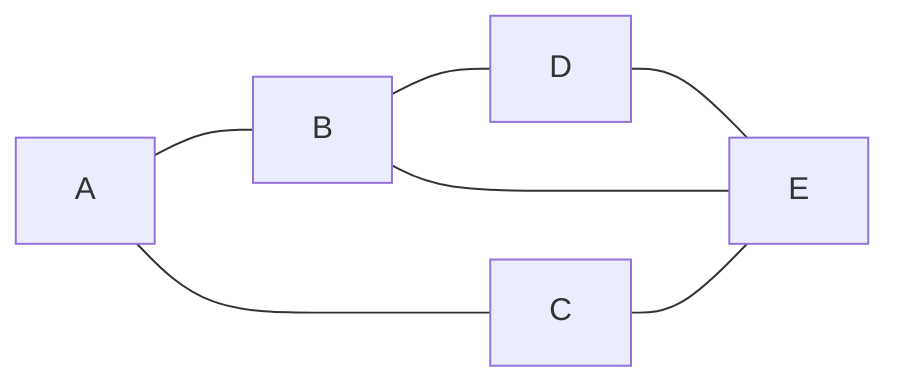
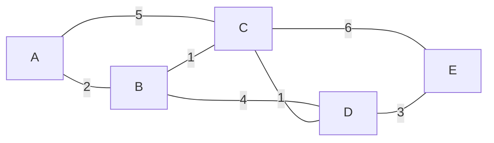
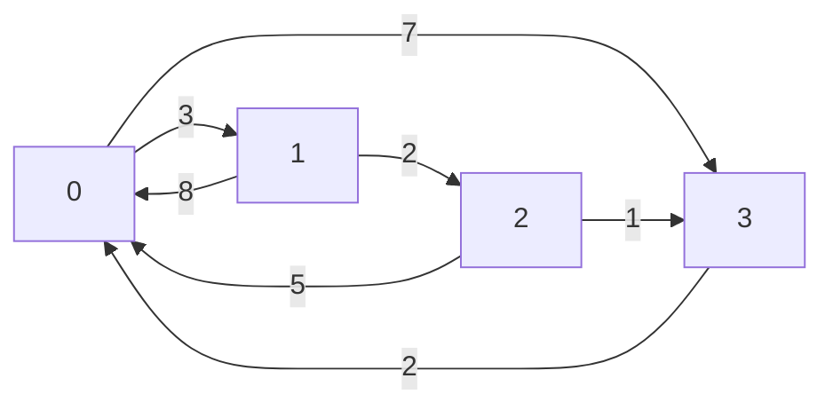
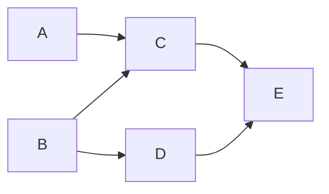
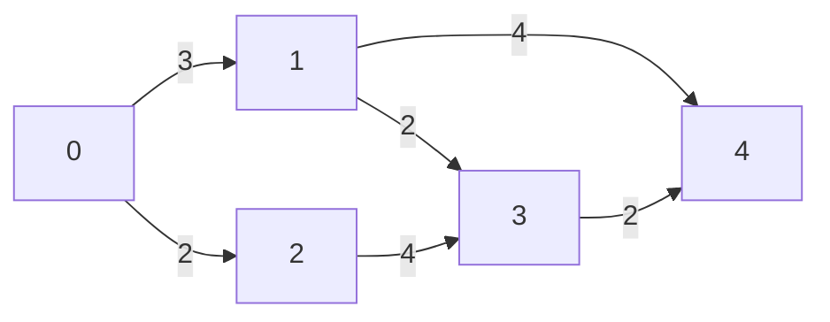

# Day 07：图

> 本资料以知识理解、案例、习题与工程应用为主。2027 年官方 408 大纲正文尚未逐项核验；题源待核实的习题不可认定为历年真题。


---

<a id="s66fab66556a3"></a>

<a id="s66fab66556a3-1"></a>
## 图的基本概念与存储

> 前置：[数组与矩阵](Day03.md#s17acfd19f168)、[链表](Day02.md#sbec6e18439ba)。本文默认有限简单图：无自环、无平行边；顶点数 V=|V|，边数 E=|E|。允许自环或重边时要重新说明计数与表示。

<a id="s66fab66556a3-2"></a>
### 从城市路线开始

城市之间的道路既可能双向通行，也可能是单行线；两个城市之间还可能有多条路线。线性表只能直接表达一个前后次序，树要求层级关系，而**图**用顶点和边表达一般的多对多关系。建模时先说明“顶点代表什么、边代表什么、方向和权重代表什么”。

图 G=(V,E) 由顶点集合 V 和边集合 E 组成。**无向边** `{u,v}` 没有方向；**有向边** `u→v` 只能沿指定方向走。带权图的边可附带距离、费用或时间等权；无权图可以只记录连接关系。

- 无向图的**度**是与顶点相接的边数；有向图的**出度**是从该点出发的弧数，**入度**是到该点的弧数。简单无向图满足度数之和 `2E`；有向图入度之和、出度之和分别都是 `E`。
- **路径**表示按边连接的一串顶点；有向图必须遵守箭头。路径长度若未特别说明，通常指边数，带权路径的代价则是权值之和。教材中“路径”是否允许重复顶点的用词可能不同，本章明确称允许重复的序列为**游走**。
- 无向图任意两点可达称连通图；其极大连通子图称连通分量。有向图中任意两点相互可达称强连通图；极大强连通子图是强连通分量。单向可达不代表强连通。
- 连通无向图的生成树含所有 V 个顶点和 V−1 条边；非连通图没有覆盖全部顶点的生成树，但各连通分量各选一棵树可组成生成森林。仅有 E=V−1 不保证图是树：三角形加一个孤立点有 4 顶点、3 条边，却有环且不连通。

<a id="s66fab66556a3-3"></a>
### 案例：同一张无向图的两种表示

假设五个站点之间的双向道路为 `{AB,AC,BD,BE,CE,DE}`。顶点顺序固定为 A、B、C、D、E，供下一节遍历复用。



各顶点度数分别为 A=2、B=3、C=2、D=2、E=3，总和 12=2×6。无向邻接矩阵按相同顶点顺序为：

| | A | B | C | D | E |
|---|---:|---:|---:|---:|---:|
| A | 0 | 1 | 1 | 0 | 0 |
| B | 1 | 0 | 0 | 1 | 1 |
| C | 1 | 0 | 0 | 0 | 1 |
| D | 0 | 1 | 0 | 0 | 1 |
| E | 0 | 1 | 1 | 1 | 0 |

矩阵关于主对角线对称。等价的邻接表（邻居按字母升序）为 A:`B,C`；B:`A,D,E`；C:`A,E`；D:`B,E`；E:`B,C,D`。无向边在常见邻接表中出现两次，故本例存放 12 个邻接项。构建矩阵先初始化 V² 个槽，再填 E 条边，为 O(V²+E) 时间、O(V²) 空间；按已知顶点映射构建邻接表 O(V+E) 时间和空间。

对带权图，无边不能一概用 0 表示：若存在权重 0 的合法边，会与无边混淆。最短路中常用 ∞ 表示不可达、对角线按算法定义初始化为 0，并在加法前防止哨兵溢出。

<a id="s66fab66556a3-4"></a>
### 选择存储结构

| 结构 | 表示方法 | 空间 | 典型操作及限制 |
|---|---|---|---|
| 邻接矩阵 | A[u,v] 标记边或保存权 | O(V²) | 判断指定边 O(1)，扫描一个顶点的邻居 O(V)；适合稠密图和 Floyd |
| 邻接表 | 每个顶点一列出边/邻居 | O(V+E) | 扫描 u 的出边 O(outdegree(u))；判断指定边通常需扫该表；适合稀疏图 |
| 逆邻接表 | 每个顶点保存入边来源 | O(V+E) | 扫入边方便，普通出边需要另建索引或全图扫描 |
| 边集数组 | 每条边存端点及可选权 | O(E)，另算顶点存储 | 便于按边排序，如 Kruskal；找某顶点邻居通常需扫描所有边 |

有向图普通邻接表按出边建立；若只存出边，要统计单个顶点的入度通常需扫描所有顶点表和边，O(V+E)，不是 O(入度)。无向简单图每条边在普通邻接表记录两次，仍为 O(V+E)。

**十字链表**用于有向图。每条弧结点只存一次，包含弧尾 tail、弧头 head、指向同弧尾下一条弧的 `tlink`、指向同弧头下一条弧的 `hlink`；每个顶点保存首条出弧与首条入弧。比如 A→B 的弧同时在 A 的出弧链和 B 的入弧链中。它便于按方向访问入弧和出弧，代价是维护两套链接。

**邻接多重表**用于无向图。每条边只存一个结点，记录两个端点 u、v 和各自的下一条关联边链接；从 u 遍历时沿 u 对应链接走，从 v 遍历时沿 v 对应链接走。边的访问标记可放在共同边结点，但插删时必须维护两个端点的链；是否 O(1) 删除取决于是否已经取得对应前驱等信息。

若 A 是无权图的 0/1 邻接矩阵，普通算术矩阵幂的 `(A^k)[i,j]` 计数长度恰为 k 的**游走**数，允许重复顶点和边；它不一般等于不重复顶点的简单路径数。

<a id="s66fab66556a3-5"></a>
### 工程应用与练习

交通、依赖和社交关系都可建模为图，但道路方向、权限、实时状态与权重定义可能不同。稀疏网络通常优先考虑邻接表；密集且频繁判断任意两点是否相连时矩阵可能更方便，代价是 V² 空间。不要仅凭稀疏或稠密标签推断实际系统速度。

<a id="s66fab66556a3-6"></a>
#### 基础

1. <a id="q-cff20cc394a3d5"></a>**自编**：有向边 A→B 对 A 的出度和 B 的入度各贡献多少？答：各 1。
2. <a id="q-43a6d105405239"></a>**自编**：本案例中 B 的度和图的边数？答：3 和 6。
3. <a id="q-a42d53a712050d"></a>**自编**：权值 0 能否一律当作无边？答：不能，可能是合法零权边。

<a id="s66fab66556a3-7"></a>
#### 进阶

1. <a id="q-fc37758e0a6028"></a>**平台题**：[LeetCode 1971 寻找图中是否存在路径](https://leetcode.cn/problems/find-if-path-exists-in-graph/)。注意题目是无向图，可用遍历；邻接表 O(V+E) 时间和空间。
2. <a id="q-c36e3c37f64c94"></a>**自编**：图由三角形和孤立点组成，为什么不是树？答：既有环又不连通，虽然 E=V−1。
3. <a id="q-0d9cf8f050e961"></a>**自编**：有向图若需要频繁列出某个顶点的入边，普通出边邻接表与十字链表有什么差异？提示：前者可能全图扫描，后者直接沿入弧链走。

<a id="s66fab66556a3-8"></a>
#### 综合

1. <a id="q-c9f8bcedc88aad"></a>**自编**：设计一个包含单行路、双向路和旅行时间的站点网络。比较邻接矩阵、邻接表和边集数组对查询邻居、查询指定边、按费用排序的成本；说明如何区分零权边和无边。


---

<a id="sea5f4a9d838f"></a>

<a id="sea5f4a9d838f-1"></a>
## 图的遍历：DFS 与 BFS

> 前置：[图的表示](Day07.md#s66fab66556a3)、[栈与递归](Day03.md#sfcd1dfd24554)、[队列](Day03.md#s9927a41afd04)。V 为顶点数，E 为边数；空图无起点，整图遍历输出空序列。

<a id="sea5f4a9d838f-2"></a>
### 搜索站点网络

需要从某个站点找出所有可达站点。图可能含环：如果不标记访问过的顶点，搜索就会在环中反复走。深度优先搜索（DFS）沿一条路线尽量深入再回退；广度优先搜索（BFS）先访问距起点一条边、再两条边的顶点。

<a id="sea5f4a9d838f-3"></a>
### 递归 DFS 与队列 BFS

```text
DFS(u):                            // visited 初始均为 false
    visited[u] ← true; 访问 u
    按约定顺序枚举 u 的邻居 v:
        若 visited[v] = false: DFS(v)

BFS(s):                            // visited 初始均为 false
    visited[s] ← true; s 入队
    当队列非空:
        u ← 出队; 访问 u
        按约定顺序枚举 u 的邻居 v:
            若 visited[v] = false:
                visited[v] ← true   // 入队时标记，避免重复入队
                v 入队
```

DFS 的递归栈记录回退位置；要模拟与递归一致的次序，显式栈须按具体压栈与标记策略设计，不能只笼统说“逆序压栈就一定相同”。BFS 的队列实现详见前置章节。对于不连通无向图，从一个起点只能访问其连通分量；整图遍历需按顶点顺序再次从未访问顶点启动。对有向图，外层启动次数不等于强连通分量数。

<a id="sea5f4a9d838f-4"></a>
### 案例：同一张图的 DFS 和 BFS

使用[图的表示](Day07.md#s66fab66556a3)中的无向图，边为 AB、AC、BD、BE、CE、DE；邻居按字母升序。从 A 开始。


**DFS** 每次进入最小的未访问邻居：A→B→D→E→C。栈中记当前未返回的递归调用；读到已访问邻居时跳过。

| 首次访问 | 递归调用栈（底→顶） | 解释 |
|---|---|---|
| A | A | 起点 |
| B | A,B | A 的首个未访问邻居 |
| D | A,B,D | B 的未访问邻居，跳过已访问 A |
| E | A,B,D,E | D 的未访问邻居 |
| C | A,B,D,E,C | E 的未访问邻居；其余邻居最终均已访问 |

之后 C、E、D、B、A 依次返回。DFS 序列 `A,B,D,E,C`；若邻接表顺序改变，合法序列也可能改变。

**BFS** 在入队时标记，状态如下：

| 出队访问 | 本轮新入队 | 操作后队列（头→尾） | 已输出 |
|---|---|---|---|
| — | A | A | 空 |
| A | B,C | B,C | A |
| B | D,E | C,D,E | A,B |
| C | 无 | D,E | A,B,C |
| D | 无 | E | A,B,C,D |
| E | 无 | 空 | A,B,C,D,E |

BFS 序列为 `A,B,C,D,E`。例如 C 检查到 E 时，E 已在 B 访问时标记并入队，因此不重复入队。

无权图中 BFS 的层号给出源点到各可达点的最少边数：A=0，B、C=1，D、E=2。若记录首次发现每个顶点时的前驱，可以回溯一条最短路径；多条等长路径时结果依赖邻居顺序。权重不等时最少边数不一定对应最小权值，需看[最短路径](Day07.md#s7f28ed8f6878)。

<a id="sea5f4a9d838f-5"></a>
### 成本与适用条件

采用邻接表并对整张图遍历，初始化 visited、扫描每个顶点及邻接项，时间 O(V+E)；递归 DFS 的栈、BFS 队列、visited 最坏各 O(V)，不含图本身。采用邻接矩阵并遍历整图，每个顶点可能扫描整行，时间 O(V²)，辅助空间仍为 O(V)，矩阵本身占 O(V²)。仅从起点遍历且不初始化全局数组时，可以按实际可达顶点与扫描的边计数。

工程上，依赖分析、连通区域搜索和爬虫发现链接都可使用遍历；DFS 深度可能很大，应考虑调用栈容量；BFS 在宽图上可能保存很多待访问顶点。线上图可能变化或有权限限制，还需要一致性、去重与资源上限策略。

<a id="sea5f4a9d838f-6"></a>
### 分级练习

<a id="sea5f4a9d838f-7"></a>
#### 基础

1. <a id="q-9f7bf38418d8af"></a>**自编**：本例 A 的 BFS 第 1 层有哪些点？答：B、C。
2. <a id="q-edcab84b25de2c"></a>**自编**：BFS 为什么在入队时标记？答：避免不同父顶点重复将同一顶点入队。
3. <a id="q-224ad59805a43c"></a>**自编**：从 A 在本例递归 DFS 的第三个访问顶点是什么？答：D。

<a id="sea5f4a9d838f-8"></a>
#### 进阶

1. <a id="q-bd7b5443f8c2a7"></a>**平台题**：[LeetCode 1971 寻找图中是否存在路径](https://leetcode.cn/problems/find-if-path-exists-in-graph/)。邻接表遍历的 O(V+E) 时间包括建表或按题目输入实际说明。
2. <a id="q-fe49a70ae4035a"></a>**平台题**：[LeetCode 200 岛屿数量](https://leetcode.cn/problems/number-of-islands/)。把上下左右相邻陆地看作边；m×n 网格时间 O(mn)，访问标记或栈最坏 O(mn)。
3. <a id="q-07222592fa9547"></a>**自编**：给本例加孤立点 F，从 A 开始 BFS 会访问 F 吗？答：不会；整图遍历外层需再从 F 启动。

<a id="sea5f4a9d838f-9"></a>
#### 综合

1. <a id="q-839ad0fa9716cb"></a>**自编**：地图只允许经过双向道路，如何用 BFS 输出 A 到 E 的一条最少边数路线？提示：首次入队时记录前驱；本例按字母顺序得到 A→B→E，距离 2。若道路有不同费用，解释为何要改选其他最短路算法。


---

<a id="sda1d99b13f42"></a>

<a id="sda1d99b13f42-1"></a>
## 最小生成树：Prim 与 Kruskal

> 前置：[图的表示](Day07.md#s66fab66556a3)、[并查集](Day06.md#scbe14233cc32)。本文讨论有限、连通、无向带权图；顶点数 V≥1，边数 E。权可相等，也可为 0 或负数。

<a id="sda1d99b13f42-2"></a>
### 连接所有站点，费用尽量少

要用线缆连接所有站点，边权表示铺设费用。**生成树**覆盖全部顶点、连通且无环，有 V−1 条边；**最小生成树（MST）**是所有生成树中权值总和最小者。它优化总铺设费用，不保证任意两点之间在树上的路径最短。

非连通无向图没有覆盖所有顶点的生成树；可分别求各连通分量的最小生成树，合为最小生成森林。边权互不相同是 MST 唯一的充分条件，但不是必要条件；有相同权值不必然产生多个 MST。

<a id="sda1d99b13f42-3"></a>
### Prim：从顶点集合向外扩张

从一个起点开始，维护已选顶点集合 S；每轮选择一条一端在 S、一端在外部的最小权边，加入边和外部顶点。这个选择使用切分性质：跨某个切分的最小权边可属于某棵 MST；权值相同时需确定一个可复现的并列规则。

```text
Prim(G, s):                       // 非空无向图；矩阵版
    S ← {s}; 其他顶点的 best ← 从 s 到该顶点的边权或 ∞
    parent[v] ← s 或 null
    重复 V-1 次:
        从 S 外选择 best 最小的顶点 v
        若 best[v] = ∞: 返回“不连通”
        选边 (parent[v], v); 将 v 加入 S
        对 S 外每个顶点 x:
            若存在边 (v,x) 且 w(v,x) < best[x]:
                best[x] ← w(v,x); parent[x] ← v
    返回所选边
```

best 是“从已选集合到某个未选顶点的一条最小边的权”，不是从源点的路径长度。若 V=1，直接返回空边集；边权相等时本伪代码保留先发现的候选。

<a id="sda1d99b13f42-4"></a>
### Kruskal：按边排序并避免环

把边按权值非递减排序，依次考虑：若边两端尚未连通则选中，否则跳过。用[第三批并查集](Day06.md#scbe14233cc32)维护当前连通分量，这里只调用其 find/union，不重复实现其原理。

```text
Kruskal(G):
    为每个顶点初始化独立集合
    将边按权值非递减排序
    selected ← 空集合
    对每条边 (u,v,w):
        若 find(u) ≠ find(v):
            selected 加入该边; union(u,v)
            若 selected 的边数 = V-1: 停止
    若 selected 的边数 < V-1: 返回“不连通及当前森林”
    返回 selected
```

若 V=1，可以直接返回空边集。权值相等时按端点名称排序只是示例约定；其他并列顺序可能得到不同的最小生成树。

<a id="sda1d99b13f42-5"></a>
### 案例：同一张图对比两种算法

连接五个站点，边权为 AB=2、AC=5、BC=1、BD=4、CD=1、CE=6、DE=3。图为无向图。



**Prim 从 A 出发**，每一步选取跨越已选和未选顶点的最小边：

| 步骤 | 已选顶点 S | 本轮选边 | 已选边权之和 | 未选顶点的 best（括号内为来源） |
|---|---|---|---:|---|
| 初始 | A | — | 0 | B=2(A), C=5(A), D=∞, E=∞ |
| 1 | A,B | AB=2 | 2 | C=1(B), D=4(B), E=∞ |
| 2 | A,B,C | BC=1 | 3 | D=1(C), E=6(C) |
| 3 | A,B,C,D | CD=1 | 4 | E=3(D) |
| 4 | A,B,C,D,E | DE=3 | 7 | 无 |

**Kruskal** 按权值排序，权值相同时按边名字母顺序；每次比较的是当前已选边形成的连通分量：

| 考虑边 | 结果 | 累计选边 | 权值和 |
|---|---|---|---:|
| BC=1 | 选择 | BC | 1 |
| CD=1 | 选择 | BC,CD | 2 |
| AB=2 | 选择 | BC,CD,AB | 4 |
| DE=3 | 选择，已达 V−1 条 | BC,CD,AB,DE | 7 |

两者均得到边集 `{AB,BC,CD,DE}`，总权 7。Kruskal 在已选够四条边后结束；BD、AC、CE 未再检查。若为教学演示继续检查，这三条都会连接已在同一集合中的顶点，应跳过。Prim 不是全图中任意选最小边，它只能选当前切分上的边。

<a id="sda1d99b13f42-6"></a>
### 实现成本与工程取舍

| 实现 | 时间 | 空间及说明 |
|---|---|---|
| Prim，邻接矩阵与线性选最小 | O(V²) | 矩阵 O(V²)，best、parent 等额外 O(V)；常用于稠密图 |
| Prim，邻接表与带索引的二叉堆 | O((V+E) log V) | 图 O(V+E)，堆及数组 O(V)；稀疏图可能合适，具体取决于实现 |
| Kruskal，边集排序与并查集 | O(E log E + V + Eα(V)) | 边集 O(E)、并查集 O(V)，排序辅助空间取决于排序算法；边少或边集已给定时方便 |

边权分布、图是否稠密、排序是否已有序、堆实现和内存限制都会影响实际成本；“Prim 一定比 Kruskal 快”不成立。施工费用还可能受预算、地形或节点可靠性约束，单一边权的 MST 不能直接解决所有工程规划要求。

<a id="sda1d99b13f42-7"></a>
### 分级练习

<a id="sda1d99b13f42-8"></a>
#### 基础

1. <a id="q-c2b2e4f4fc6ed3"></a>**自编**：5 个顶点的生成树有几条边？答：4。
2. <a id="q-bee00be046dba1"></a>**自编**：非连通无向图是否有覆盖全部顶点的生成树？答：没有。
3. <a id="q-cf09b98b48b538"></a>**自编**：边权可否为负？答：最小生成树可以使用负权边。

<a id="sda1d99b13f42-9"></a>
#### 进阶

1. <a id="q-985bcedd1e35c6"></a>**平台题**：[LeetCode 1584 连接所有点的最小费用](https://leetcode.cn/problems/min-cost-to-connect-all-points/)。题目使用曼哈顿距离构成完全图，讨论矩阵式 Prim 的 O(V²) 时间。
2. <a id="q-58ab22e7265eb5"></a>**自编**：本例 Prim 从 A 首先选哪条边？答：AB，权 2。
3. <a id="q-be0752432b3ded"></a>**自编**：Kruskal 已选 BC、CD、AB、DE 后再看 BD，应否加入？答：否，两端已连通。

<a id="sda1d99b13f42-10"></a>
#### 综合

1. <a id="q-06e5e5744a6fb6"></a>**自编**：将上例 AC 的权值改为 2，重新计算两种算法；说明边权相同时最小树可能不唯一，但不能仅凭存在相同边权就断言一定不唯一。比较铺设总费用和两点最短路的不同目标。提示：选 BC、CD、DE 后，连接 A 可选 AB 或 AC，两种树的总权均为 7。


---

<a id="s7f28ed8f6878"></a>

<a id="s7f28ed8f6878-1"></a>
## 最短路径：Dijkstra 与 Floyd

> 前置：[图的表示](Day07.md#s66fab66556a3)、[BFS](Day07.md#sea5f4a9d838f)。V 为顶点数、E 为边数；不可达记为 ∞，前驱不存在记为 `—`。以下权值加法假设不会溢出，且任何与 ∞ 的加法先判断可达性。

<a id="s7f28ed8f6878-2"></a>
### 先选对问题

路线规划需要最小化从起点到终点的距离；它和[最小生成树](Day07.md#sda1d99b13f42)最小化所有铺设边的总费用不同。若每条边代价相同，BFS 可求最少边数；若边权均非负，可用 Dijkstra 求单源最短路径；Floyd 可计算所有顶点对的最短路径。**标准 Dijkstra 不适用于存在负权边的一般情形**：它可能在含负边的某些特定图上碰巧正确，但没有通用正确性保证。

<a id="s7f28ed8f6878-3"></a>
### Dijkstra：逐步确定单源距离

从源点 s 出发，`dist[v]` 是已发现的最短距离上界，`pred[v]` 记录对应路径的前驱。每轮从尚未确定的可达顶点中选 dist 最小者 u，将它确定，再用边 u→v 松弛其他顶点。边权非负保证一旦 u 被选中，后续经过尚未确定顶点的路径不会再缩短它。

```text
Dijkstra(G, s):                       // 每条边权均 ≥ 0，s 合法
    dist 全设为 ∞; pred 全设为 —; settled 全设为 false
    dist[s] ← 0
    重复至多 V 次:
        u ← 未确定顶点中 dist 最小者
        若不存在 u 或 dist[u]=∞: 结束
        settled[u] ← true
        对 u 的每条出边 (u,v,w):
            若 v 未确定 且 dist[u]+w < dist[v]:
                dist[v] ← dist[u]+w; pred[v] ← u
    返回 dist, pred
```

若存在并列最短路，用 `<` 保留先发现的前驱；不同遍历次序可能得到另一条同长路径。未到达顶点距离仍为 ∞，前驱为 —；s 的前驱也为 —。回溯时应从可达终点沿 pred 回到 s 并反转，不可将不可达点当作存在路径。

<a id="s7f28ed8f6878-4"></a>
#### 完整案例：同一张带权图

使用 [最小生成树](Day07.md#sda1d99b13f42) 中的无向图：AB=2、AC=5、BC=1、BD=4、CD=1、CE=6、DE=3，源点 A。无向边在计算时可视为两个方向的弧。图如下：


表中每轮为**选择 u 并完成松弛后**；距离和前驱均按 A、B、C、D、E 顺序列出：

| 轮次 | 已确定顶点 | dist[A,B,C,D,E] | pred[A,B,C,D,E] | 本轮变化 |
|---|---|---|---|---|
| 初始 | 空 | `[0,∞,∞,∞,∞]` | `[—, —, —, —, —]` | 源点距离为 0 |
| 选 A | A | `[0,2,5,∞,∞]` | `[—, A, A, —, —]` | 更新 B、C |
| 选 B | A,B | `[0,2,3,6,∞]` | `[—, A, B, B, —]` | C 经 B 变 3，D 经 B 为 6 |
| 选 C | A,B,C | `[0,2,3,4,9]` | `[—, A, B, C, C]` | D 经 C 变 4，E 经 C 为 9 |
| 选 D | A,B,C,D | `[0,2,3,4,7]` | `[—, A, B, C, D]` | E 经 D 变 7 |
| 选 E | A,B,C,D,E | `[0,2,3,4,7]` | `[—, A, B, C, D]` | 无改进 |

从 E 沿前驱回溯 E←D←C←B←A，反转得到 A→B→C→D→E，距离 `2+1+1+3=7`。本图恰好与所选生成树上的路径一致，但这只是本例现象，MST 不保证最短路。

邻接矩阵、线性选最小并扫描行：O(V²) 时间，图 O(V²) 空间，dist/pred/标记额外 O(V)。邻接表加支持 decrease-key 的索引二叉堆：O((V+E) log V) 时间、图 O(V+E) 及工作 O(V)；若使用可重复入堆的普通堆，堆中可能有 O(E) 条目，界与实现不同。未指定实现时不能混写复杂度。

<a id="s7f28ed8f6878-5"></a>
### Floyd：所有顶点对之间的距离

设 `D^(k)[i,j]` 为只允许编号不大于 k 的顶点作为**中间顶点**时，从 i 到 j 的最短距离。转移为 `min(D[i,j], D[i,k]+D[k,j])`。初始化直接边权、对角线为 0、无边为 ∞；若存在负权自环，对角线应保留更小的自环权，以便检测。每次只在两段均可达时相加。

```text
Floyd(D):                             // D 已按上面的约定初始化
    对 k 从 0 到 V-1:
        对 i 从 0 到 V-1:
            对 j 从 0 到 V-1:
                若 D[i,k] ≠ ∞ 且 D[k,j] ≠ ∞:
                    D[i,j] ← min(D[i,j], D[i,k]+D[k,j])
    返回 D
```

k 必须为最外层，确保本轮允许的中间顶点集合符合递推；路径还原需要另外维护 next 或 predecessor 矩阵。经典矩阵实现时间 O(V³)、距离矩阵空间 O(V²)；若原图以邻接表给出，初始化矩阵仍需 O(V²+E)。

<a id="s7f28ed8f6878-6"></a>
#### 完整案例：逐轮距离矩阵

考虑另一个**有向图**，顶点 0..3，弧 `0→1:3、0→3:7、1→0:8、1→2:2、2→0:5、2→3:1、3→0:2`。表中行是起点、列是终点；每个矩阵都在该轮**全部 i、j 更新完成后**给出。∞ 代表不可达。



```text
初始 D（仅直接边）       k=0 完成后             k=1 完成后
     0  1  2  3             0  1  2  3             0  1  2  3
0 [  0  3  ∞  7 ]      0 [  0  3  ∞  7 ]      0 [  0  3  5  7 ]
1 [  8  0  2  ∞ ]      1 [  8  0  2 15 ]      1 [  8  0  2 15 ]
2 [  5  ∞  0  1 ]      2 [  5  8  0  1 ]      2 [  5  8  0  1 ]
3 [  2  ∞  ∞  0 ]      3 [  2  5  ∞  0 ]      3 [  2  5  7  0 ]

k=2 完成后              k=3 完成后
     0  1  2  3             0  1  2  3
0 [  0  3  5  6 ]      0 [  0  3  5  6 ]
1 [  7  0  2  3 ]      1 [  5  0  2  3 ]
2 [  5  8  0  1 ]      2 [  3  6  0  1 ]
3 [  2  5  7  0 ]      3 [  2  5  7  0 ]
```

例如 k=1 时，0→1→2 将 D[0,2] 从 ∞ 改为 3+2=5；k=2 时 0→1→2→3 将 D[0,3] 从 7 改为 5+1=6；k=3 时 1→2→3→0 将 D[1,0] 从 7 改为 3+2=5。最终 D[0,3]=6。

<a id="s7f28ed8f6878-7"></a>
### 负权边与负权环

Floyd 可以处理负权边；若不存在相关的负权环，有限最短距离有定义。完成 Floyd 后若 `D[k,k]<0`，说明存在从 k 可到达并回到 k 的负权闭合游走。对于能从 i 到达该负环、且能从负环到达 j 的顶点对，可绕环任意多次使代价无下界，其最短距离不是有限值，应标为负无穷或报告未定义；其他与该负环无关的顶点对仍可能有有限最短路或不可达。仅检测对角线并不会自动把受影响的每一对标为负无穷。

有负权边的单源问题可考虑 Bellman–Ford：对所有边反复松弛，最多 V−1 轮后再检查是否仍有**从源点可达**的边可松弛，从而检测源点可达的负权环；复杂度通常 O(VE)，还需根据输入表示及路径需求计空间。

<a id="s7f28ed8f6878-8"></a>
### 工程应用与练习

地图路径、网络延迟和服务依赖距离都需要先定义权值：时间是否随时段变化、有向道路是否可通、负权是否有意义。Dijkstra 的静态非负模型不自动处理实时变化；全源 Floyd 适合顶点数较小且需要大量点对查询的情形，代价是立方时间和平方空间。

<a id="s7f28ed8f6878-9"></a>
#### 基础

1. <a id="q-295e48c47d76bb"></a>**自编**：无权图求最少边数通常可用什么算法？答：BFS。
2. <a id="q-7caf57af3db03a"></a>**自编**：Dijkstra 的不可达顶点距离和前驱如何表示？答：∞ 和 —。
3. <a id="q-3ea2e1951407bb"></a>**自编**：Floyd 是否允许负权边？答：允许，但相关负权环会使部分点对不存在有限最短距离。

<a id="s7f28ed8f6878-10"></a>
#### 进阶

1. <a id="q-6b784305f55cd5"></a>**平台题**：[LeetCode 743 网络延迟时间](https://leetcode.cn/problems/network-delay-time/)。有向边权非负；从指定源求所有可达距离，并处理不可达节点。
2. <a id="q-78c5723845bdc8"></a>**平台题**：[LeetCode 1091 二进制矩阵中的最短路径](https://leetcode.cn/problems/shortest-path-in-binary-matrix/)。题目允许八方向，路径长度按单元格数计，不是边数。
3. <a id="q-457e5b56fc4bb0"></a>**自编**：本页 Dijkstra 案例中，B 被确定后 dist[C] 和 pred[C] 是什么？答：3 和 B。

<a id="s7f28ed8f6878-11"></a>
#### 综合

1. <a id="q-add1491833f210"></a>**自编**：给出有向边 A→B=2、A→C=5、C→B=−10；说明标准 Dijkstra 为何不能可靠确定 B，并比较使用 Bellman–Ford 的条件。提示：B 可能先被确定为 2，但经 C 的路径为 −5。


---

<a id="s2a3a97bbc878"></a>

<a id="s2a3a97bbc878-1"></a>
## 拓扑排序与关键路径

> 前置：[图的表示](Day07.md#s66fab66556a3)、[队列](Day03.md#s9927a41afd04)。本页示例均为有限有向图；V、E 分别为顶点数、边数。拓扑排序判断先后依赖，关键路径分析有持续时间的工程工期，两者不是同一个问题。

<a id="s2a3a97bbc878-2"></a>
### AOV 网：安排任务的先后顺序

AOV（Activity on Vertex）网用顶点表示活动，用有向边表示先后约束：u→v 表示 u 必须先于 v。拓扑序是顶点的一个线性排列，使每条有向边的起点都在终点之前；可能存在多个合法序列。有向图存在拓扑序当且仅当它没有有向环。

Kahn 算法维护每个顶点当前入度：将所有入度为 0 的顶点放入队列，反复取出并输出，删除其出边（用入度减一模拟）；若邻居入度变 0 则入队。最后输出数小于 V 表示图中有环。空图返回空序列，是合法的拓扑序。

```text
拓扑排序(G):
    根据全部弧计算 indegree[0..V-1]
    Q ← 所有入度为 0 的顶点
    order ← 空列表
    当 Q 非空:
        u ← Q.出队(); order.append(u)
        对 u 的每条出边 u→v:
            indegree[v] ← indegree[v]-1
            若 indegree[v]=0: Q.入队(v)
    若 order 长度 < V: 返回“存在环”
    返回 order
```

使用邻接表时，计算入度 O(V+E)，每个顶点和边最多处理一次，总时间 O(V+E)，入度与队列等辅助空间 O(V)，不计图和输出。若需要每次从所有可选顶点中取字母序最小值，可用最小堆，但成本应重新计算；本例仅对初始入队和每次同轮新入队按字母序排列，使用普通 FIFO。

<a id="s2a3a97bbc878-3"></a>
#### 案例：项目任务依赖

任务 A、B 可立即开始；C 依赖 A、B，D 依赖 B，E 依赖 C、D。边为 A→C、B→C、B→D、C→E、D→E。



| 轮次 | 出队任务 | 更新后仍未输出顶点的入度 | 操作后队列（头→尾） | 输出 |
|---|---|---|---|---|
| 初始 | — | A=0,B=0,C=2,D=1,E=2 | A,B | 空 |
| 1 | A | B=0,C=1,D=1,E=2 | B | A |
| 2 | B | C=0,D=0,E=2 | C,D | A,B |
| 3 | C | D=0,E=1 | D | A,B,C |
| 4 | D | E=0 | E | A,B,C,D |
| 5 | E | 无 | 空 | A,B,C,D,E |

输出 A、B、C、D、E 是一个合法序列；B、A、D、C、E 也是合法序列。拓扑序只约束前后关系，不给出任务时长或最短工期，也不意味着所有任务必须串行执行。若添加 E→B，就出现 B→C→E→B，算法不能输出全部顶点。

<a id="s2a3a97bbc878-4"></a>
### AOE 网：活动时间与关键路径

AOE（Activity on Edge）网用**顶点表示事件**、有向边表示活动，边权为活动持续时间。以下采用单源单汇、所有事件均处于源到汇的某条路径上、持续时间非负的 DAG；若有多个起点或终点，可在建模允许时增加零时长虚拟源、虚拟汇。所有活动按依赖约束进行，假设资源足够、可并行，关键路径长度才给出该模型中的最短完成工期；资源争用、工作日历和延误等需要额外模型。

对事件 v：`ve[v]` 是最早发生时间，源点为 0，按拓扑序 `ve[v]=max(ve[u]+w(u,v))`；`vl[v]` 是不延迟汇点完成的最迟发生时间，汇点初始化为 `ve[汇]`，按逆拓扑序 `vl[u]=min(vl[v]-w(u,v))`。

对活动 u→v：最早开始 `e=ve[u]`，最迟开始 `l=vl[v]-w(u,v)`，总时差 `l-e`；时差为 0 的是关键活动。源到汇的最长路径是关键路径，可能有多条；只缩短其中一条路径上的活动，不一定缩短工期。

```text
关键路径(G, source, sink):          // 满足上述单源单汇 DAG 前提
    order ← 拓扑排序(G)
    若存在环: 返回“输入不符合 DAG 前提”
    ve 全设 -∞; ve[source] ← 0
    按 order 遍历 u:
        对每条 u→v, 权 w: ve[v] ← max(ve[v], ve[u]+w)
    vl 全设 +∞; vl[sink] ← ve[sink]
    按 order 逆序遍历 u:
        对每条 u→v, 权 w: vl[u] ← min(vl[u], vl[v]-w)
    对每条 u→v, 权 w:
        e ← ve[u]; l ← vl[v]-w
        若 e=l: 标记该边为关键活动
    返回 ve, vl, 所有关键活动
```

除拓扑排序结果外，若不计图和输出，ve、vl 等辅助空间 O(V)；邻接表上总时间 O(V+E)。上面前提排除了无法从源到达或不能到达汇的顶点；若输入不保证这一点，须先检查或重新规定虚拟源汇的建模。

<a id="s2a3a97bbc878-5"></a>
#### 案例：项目工期与关键活动

项目事件编号 0..4，活动及持续时间为 `0→1:3、0→2:2、1→3:2、2→3:4、1→4:4、3→4:2`，源为 0、汇为 4。边上的数字是时长，不是事件编号；事件 3 需要等待 1→3 和 2→3 均完成。



按拓扑序 0、1、2、3、4 更新 ve：

| 已处理事件 | ve[0,1,2,3,4] | 本轮关键更新 |
|---|---|---|
| 初始 | `[0,−∞,−∞,−∞,−∞]` | 源点从 0 开始 |
| 0 | `[0,3,2,−∞,−∞]` | 更新 1、2 |
| 1 | `[0,3,2,5,7]` | 更新 3、4 |
| 2 | `[0,3,2,6,7]` | 2→3 得 2+4=6，大于原 5 |
| 3 | `[0,3,2,6,8]` | 3→4 得 6+2=8 |
| 4 | `[0,3,2,6,8]` | 无出边 |

因此最早工期为 8。逆序计算 vl：

| 已处理事件 | vl[0,1,2,3,4] | 计算 |
|---|---|---|
| 初始 | `[∞,∞,∞,∞,8]` | 汇点最迟为 8 |
| 4 | `[∞,∞,∞,∞,8]` | 无出边 |
| 3 | `[∞,∞,∞,6,8]` | 8−2=6 |
| 2 | `[∞,∞,2,6,8]` | 6−4=2 |
| 1 | `[∞,4,2,6,8]` | min(6−2,8−4)=4 |
| 0 | `[0,4,2,6,8]` | min(4−3,2−2)=0 |

| 活动 | 时长 | e=ve[弧尾] | l=vl[弧头]−时长 | 时差 | 关键？ |
|---|---:|---:|---:|---:|---|
| 0→1 | 3 | 0 | 1 | 1 | 否 |
| 0→2 | 2 | 0 | 0 | 0 | 是 |
| 1→3 | 2 | 3 | 4 | 1 | 否 |
| 2→3 | 4 | 2 | 2 | 0 | 是 |
| 1→4 | 4 | 3 | 4 | 1 | 否 |
| 3→4 | 2 | 6 | 6 | 0 | 是 |

关键路径是 `0→2→3→4`，长度 `2+4+2=8`。例如 0→1 的总时差为 1，并不意味着所有非关键活动可各自同时延误其全部时差而互不影响；多个活动可能共享时差。

<a id="s2a3a97bbc878-6"></a>
### 工程应用与练习

构建系统可用拓扑顺序安排先决任务，并检测循环依赖；项目排期可在依赖和估计时长已知、资源不受限制时用关键路径识别影响工期的活动。真实项目的资源约束、人工分配、工作日历、时间不确定性和多条关键路径会改变结果，不能把拓扑序本身当作进度计划。

<a id="s2a3a97bbc878-7"></a>
#### 基础

1. <a id="q-5c377dceb20e4a"></a>**自编**：A→B 时拓扑序能否将 B 放在 A 前？答：不能。
2. <a id="q-a9ab1abef9d86a"></a>**自编**：有向环是否存在拓扑序？答：不存在。
3. <a id="q-4b48edc79196c6"></a>**自编**：本例工程的最早完成时间？答：8。

<a id="s2a3a97bbc878-8"></a>
#### 进阶

1. <a id="q-ce812be78799b2"></a>**平台题**：[LeetCode 207 课程表](https://leetcode.cn/problems/course-schedule/)，注意 `[a,b]` 表示 b→a。
2. <a id="q-e84a290660eabb"></a>**平台题**：[LeetCode 210 课程表 II](https://leetcode.cn/problems/course-schedule-ii/)，需要返回一个可行顺序；无解返回空数组。
3. <a id="q-dcd12cafbe2f24"></a>**自编**：本 AOE 案例活动 1→3 的最早开始、最迟开始及总时差？答：3、4、1。

<a id="s2a3a97bbc878-9"></a>
#### 综合

1. <a id="q-ecb2b431ac44cd"></a>**平台题**：[LeetCode 2050 并行课程 III](https://leetcode.cn/problems/parallel-courses-iii/)。题目用顶点表示课程及持续时间，与本页边表示活动的 AOE 模型不同；可按拓扑序更新课程完成时间，并遵守题目可并行的假设。
