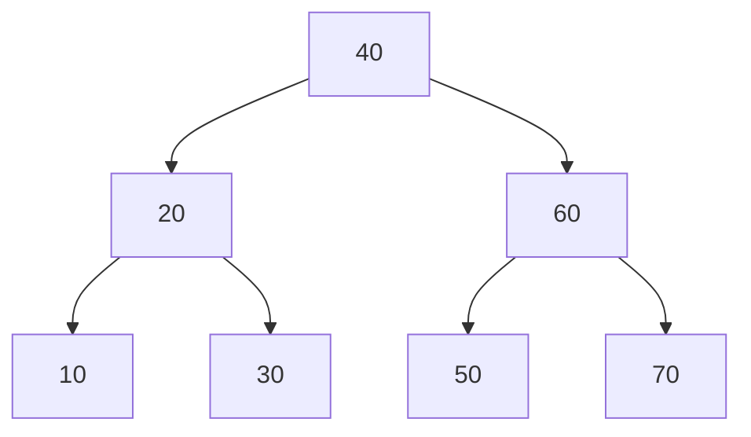

# Day 08：查找

> 本资料以知识理解、案例、习题与工程应用为主。2027 年官方 408 大纲正文尚未逐项核验；题源待核实的习题不可认定为历年真题。


---

<a id="s238f37299bf5"></a>

<a id="s238f37299bf5-1"></a>
## 查找基础：顺序、折半与分块

> 前置：[复杂度与概率口径](Day01.md#s29cd9e7587d0)、[顺序表](Day02.md#s907ba667adad)。本文默认键互不相同，数组下标从 0 开始；每次比较完整关键字的成本视为 O(1)。

<a id="s238f37299bf5-2"></a>
### 查找与平均查找长度

图书管理员需要根据编号找到一本书。查找以关键字为条件定位记录：找到称成功，确认不存在称失败。**平均查找长度 ASL** 是在指定查找情形的概率分布下，查找代价的期望。若第 i 个成功键被查询的条件概率为 pᵢ、需 Cᵢ 次关键字比较，则 `ASL成功=ΣpᵢCᵢ`，且 `Σpᵢ=1`。失败情形按其概率 qⱼ 和代价 C'ⱼ 加权；成功和失败的条件概率须分别说明。整体期望还要用成功、失败发生概率加权，不能把两个 ASL 直接平均。

“比较次数”要声明是否计入哨兵、空槽检查或边界判断；与记录的键比较、访问槽位和执行机器指令不是同一口径。各键、各失败区间**不必然等概率**，以下算例只在明确声明下取等概率。

<a id="s238f37299bf5-3"></a>
### 顺序查找与哨兵

无序记录 `[12,7,19,5]` 按从左至右比较，查 19：12、7 不等，第三次比较 19 命中。若四个成功键等概率，成功比较次数分别为 1、2、3、4，ASL=(1+2+3+4)/4=2.5；失败必与 4 个真实记录比较，所以只计真实键比较的失败 ASL=4。

哨兵写法把待查键临时放在数组 0 号槽，真实记录放在 1..n，从后向前查找。哨兵确保循环一定遇到相等值，省去循环中的下标越界判断，但不免费减少所有比较。

```text
带哨兵顺序查找(A, n, x):       // A[1..n] 为真实记录；A[0] 专供哨兵
    A[0] ← x
    i ← n
    当 A[i] ≠ x: i ← i-1
    若 i = 0: 返回“未找到”
    返回 i                     // 返回 1 基位序
```

例：A[1..4]=`[12,7,19,5]`，查 7 时依次比较 5、19、7，返回位序 2。查不存在的 8 时依次比较 5、19、7、12 和哨兵 8：若**连哨兵键比较也计入**共 5 次；若只计真实记录的键比较则是 4 次。这不是两种不同数据的平均概率，而是两种统计对象。n=0 时仅比较哨兵一次并返回未找到；A[0] 会被覆盖，不可指向只读内存或有效记录。

<a id="s238f37299bf5-4"></a>
### 折半查找与判定树

升序顺序表能 O(1) 随机访问中点。闭区间版维持不变量：若目标存在，必在 `A[low..high]`；每轮将中点及不可能的一半排除。

```text
折半查找(A, x):                // A 升序，0 基；可为空
    low ← 0; high ← |A|-1
    当 low ≤ high:
        mid ← low + floor((high-low)/2)
        若 A[mid] = x: 返回 mid
        若 A[mid] < x: low ← mid+1
        否则: high ← mid-1
    返回 -1
```

数组 `[10,20,30,40,50,60,70]` 查找 50：

| 轮次 | low | high | mid | 比较 | 下一步 |
|---:|---:|---:|---:|---|---|
| 1 | 0 | 6 | 3 | A[3]=40 < 50 | low=4 |
| 2 | 4 | 6 | 5 | A[5]=60 > 50 | high=4 |
| 3 | 4 | 4 | 4 | A[4]=50 | 返回下标 4 |

将每次可能比较的中点画为判定树：



七个键各等概率成功，比较次数按结点层数计：ASL成功=`(1+2×2+4×3)/7=17/7`。若八个失败间隙也**各等概率**，并且只数真实键比较，本例每个失败都比较 3 次，ASL失败=3；实际查找可能有不同概率。若把最后的空区间判断也计作一次额外操作，将得到另一种代价，必须标明，而不能称为同一口径。

每轮保留至多约一半元素，迭代时间 O(log n)，辅助空间 O(1)；n=0 时初始 high=-1 并直接返回 -1。重复键时该算法返回某个匹配位置，不保证第一个或最后一个；需重新设计边界。对链表，折半比较次数可为 O(log n)，但链路遍历成本不具备数组的随机访问优势：某些迭代器实现可用 O(n) 次链接遍历，不应一概断言 O(n log n)。[Oracle Collections 文档](https://docs.oracle.com/en/java/javase/25/docs/api/java.base/java/util/Collections.html)列出了这类实现的区分。

<a id="s238f37299bf5-5"></a>
### 分块查找：索引与块内扫描

将 n=9 条记录分成 3 个等长块，**块间有序、块内可无序**：

```text
块 1 [3,1,2]    块 2 [6,4,5]    块 3 [9,7,8]
索引最大键   3              6              9
```

查 5：顺序检查索引，5≤3 为假、5≤6 为真，定位第 2 块；依次比较 6、4、5 后命中。计索引键比较 2 次、块内键比较 3 次，共 5 次；若某题将两种比较赋予不同代价，不能直接相加。

设 b 块、每块 s 个且 n=bs，索引顺序扫描、块内顺序扫描、每个记录成功查找概率相同，且按上例将一次索引比较和一次块内比较各计一次，则 `ASL成功=(b+1)/2+(s+1)/2`。例中为 2+2=4。将 b=n/s 代入，连续近似在 s=√n 处最小；实际整数块数、最后一块不满、非等概率或索引改为二分时结论会改变。索引表额外 O(b) 空间；顺序索引最坏 O(b+s)，折半索引加块内顺序扫描为 O(log b+s)。失败情形须根据可能查询值与概率单独计算。

<a id="s238f37299bf5-6"></a>
### 工程选型

无序小列表或链表可顺序查找，不要求预排序；有序数组适合静态或少更新的随机访问，但维护有序性和插入可能 O(n)。块索引适合块间有序、块内需要局部扫描的场景；索引本身也有内存与更新成本。动态有序查找的 BST、AVL 和红黑树已在 [BST 与 AVL](Day06.md#sb76ad17e0a6b) 主讲，这里不重复实现。

<a id="s238f37299bf5-7"></a>
### 分级练习

<a id="s238f37299bf5-8"></a>
#### 基础

1. <a id="q-38d29bc94850e9"></a>**自编**：无序表 5 个不同键等概率成功查找，顺序扫描成功 ASL？答：3 次真实键比较。
2. <a id="q-0894c13d503f9f"></a>**自编**：空数组闭区间折半查找的初始 low、high？答：0、-1，循环不进入。
3. <a id="q-1147044d6eb687"></a>**自编**：哨兵查找失败，n=4、计入哨兵比较为几次？答：5 次。

<a id="s238f37299bf5-9"></a>
#### 进阶

1. <a id="q-113c6ad1b88356"></a>**平台题**：[LeetCode 704 二分查找](https://leetcode.cn/problems/binary-search/)。按平台有序且无重复的题设查找，时间 O(log n)、辅助空间 O(1)。
2. <a id="q-f3450af095e0b8"></a>**平台题**：[LeetCode 35 搜索插入位置](https://leetcode.cn/problems/search-insert-position/)。确定边界后返回应插位置；不能只在找到相等时结束。
3. <a id="q-4edd6369abb2d8"></a>**自编**：本页分块例查找 5，索引比较和块内比较各几次？答：2 次、3 次。

<a id="s238f37299bf5-10"></a>
#### 综合

1. <a id="q-663ff44b05d74b"></a>**平台题**：[LeetCode 34 在排序数组中查找元素的第一个和最后一个位置](https://leetcode.cn/problems/find-first-and-last-position-of-element-in-sorted-array/)。分别求左、右边界；题目允许空数组和重复值，时间 O(log n)、辅助空间 O(1)。


---

<a id="s2750714d0b21"></a>

<a id="s2750714d0b21-1"></a>
## B 树与 B+ 树

> 前置：[查找与 ASL](Day08.md#s238f37299bf5)、[BST 与 AVL](Day06.md#sb76ad17e0a6b)。本页键互不相同；同名结构存在多种“阶”和分隔键定义，下述示例明确采用的约定。n 为真实记录或键数，m 为最大分支数。

<a id="s2750714d0b21-2"></a>
### 为什么磁盘索引需要多路结构

订单系统经常需要按编号查单条记录，也需要查询一个编号范围。若数据大到不能全部驻留内存，一次磁盘或存储页访问的代价可能远大于一次内存比较。多路树让一个节点容纳多个有序键，以较少层级定位目标；节点更新、页分裂和并发控制也有成本。

<a id="s2750714d0b21-3"></a>
### B 树：每层可保存真实键

本节 m=4 的 B 树约定：每个节点最多 4 个孩子、3 个键；非根节点至少 1 个键（内部节点至少 2 个孩子）；有 c 个孩子的内部节点有 c−1 个有序键；所有真实叶节点同层。根若非叶至少两个孩子；空树单独表示。键可出现在内部或叶节点。教材有时把空孩子视为“不含键的失败叶”，本页将**含键的终端节点**称真实叶节点，避免混淆。

查找每层先在节点内比较键：相等则结束，否则进入相应的键区间子树。插入首先进入真实叶节点；若插入使节点超出 3 个键，就分裂并将分隔键**上移**到父节点，必要时继续向上传播。本例在临时出现 4 个键时选第 2 个键上移。删除内部键可先用前驱或后继替换，再到真实叶节点删除；非根节点下溢时先视兄弟是否有余量借位，否则与兄弟及父分隔键合并；根空时若有唯一孩子，将其提升为新根。

<a id="s2750714d0b21-4"></a>
#### 案例：查找、分裂、合并与借位

依次插入 `10,20,30,40,50,60`。中括号表示一个节点，斜线为子树，空树插入首键直接形成根：

```text
插 10,20,30：   [10 20 30]
插 40：         [10 20 30 40]  暂时溢出；20 上移
                     [20]
                    /    \
                  [10]  [30 40]
插 50：右叶变成 [30 40 50]
插 60：右叶暂为 [30 40 50 60]；40 上移
                  [20 | 40]
                /     |     \
              [10]   [30]  [50 60]
```

查 60：根节点先比较 20、40，进入大于 40 的右叶，再比较 50、60，命中。若节点内采用顺序比较，这条路径一共 4 次键比较、访问 2 个节点；换成节点内折半比较或缓存节点，比较次数和页 I/O 口径会变。

从上图**依次**删除 10、30、20：

```text
删 10：左叶空；相邻兄弟 [30] 只有最低 1 键，不能借。
       左叶 + 父键 20 + 兄弟 [30] 合并，父节点移除 20：
                  [40]
                 /    \
              [20 30] [50 60]
删 30：左叶保留 [20]，仍满足下限。
删 20：左叶空；右兄弟 [50 60] 有 2 键，可借。
       父键 40 下移左叶，右兄弟最小键 50 上移为新父键：
                  [50]
                 /    \
               [40]   [60]
```

每次分裂或删除修复完成后的节点均满足本例规则；图中标明的临时溢出状态是修复过程，不是最终合法状态。删除时如果父节点继续低于下限，要继续向上修复；本例没有发生父节点继续下溢。不存在的键应报告未找到而不改变树；不同合法分裂位置可能形成不同但仍有效的树。

```text
B树查找(node, key):
    当 node ≠ null:
        在 node 的有序键中找第一个 ≥ key 的位置 i
        若位置 i 存在 且 node.key[i] = key: 返回命中记录
        若 node 是叶节点: 返回“未找到”
        node ← 对应区间的第 i 个孩子
    返回“未找到”
```

该伪代码默认孩子位置和键均从 0 开始；若所有键都小于目标，i 等于键数，选择最后一个孩子。不要在节点键不存在时访问 key[i]。

<a id="s2750714d0b21-5"></a>
### B+ 树：内部索引与有序叶链

本节采用一种常见的**右子树最小键作为分隔符**的四阶教学变体：内部节点最多 4 个孩子，c 个孩子有 c−1 个分隔键；非根内部节点至少 2 个孩子。叶节点最多 3 条记录，非根叶至少 2 条，真实数据记录只在叶节点，所有叶节点在同一层并按键用 next 相连。根有特殊规则：根为叶时可只有 1 条记录，空树另表示；根为内部节点至少 2 个孩子。别的教材可能让内部节点的键数等于孩子数或采用不同叶容量，不可把不同变体的分裂和下限公式混用。

例如根分隔键为 `30,40`：小于 30 走第一个孩子，30≤key<40 走第二个，key≥40 走第三个；等于分隔键也要继续向右子树的叶节点寻找。查找命中内部键时不能提前当作找到记录。

<a id="s2750714d0b21-6"></a>
#### 案例：从插入到分裂、合并、借位

依次插入 `10,20,30,40,25,35,50`；叶节点满后插入使 4 条暂时溢出，按 2+2 分裂，将右叶最小键**复制**到父节点，原记录仍留在叶中。

```text
插 10,20,30：叶根 [10 20 30]
插 40 后叶溢出 [10 20 30 40]，分为 [10 20] 和 [30 40]：
                    <30>
                   /    \
              [10 20] → [30 40]
插 25：左叶 [10 20 25]；插 35：右叶 [30 35 40]
插 50：右叶 [30 35 40 50] 分裂，复制 40 到根：
                    <30 | 40>
                  /      |       \
       [10 20 25] → [30 35] → [40 50]
```

例如查 35：根比较分隔键，30≤35<40，进入中间叶 `[30 35]` 后命中。范围查询 `[25,45]`：先从根定位 25 所在叶，依次读到 25，沿叶链读 30、35、40；遇到大于 45 的 50 时停止，结果为 25、30、35、40。

继续从上图**依次**删除 10、20、50：

```text
删 10：左叶 [20 25]，仍有 2 条，无需修复。
删 20：左叶变 [25]，低于 2 条；右邻叶 [30 35] 恰好为下限，不能借。
       两叶合并为 [25 30 35]，从根删除分隔符 30：
                         <40>
                        /    \
             [25 30 35]  →  [40 50]
删 50：右叶变 [40]，低于 2 条；左叶有 3 条，可借出最大键 35。
       移动 35 到右叶，并把父分隔键更新为右叶最小键 35：
                         <35>
                        /    \
                [25 30]  →  [35 40]
```

插入叶分裂时是复制右叶最小键到父节点；删除时分隔键变化必须沿必要的祖先路径维护。若父节点因此下溢，还需要按内部节点规则借位或合并，必要时收缩根；本例未触发。叶链也必须在分裂、合并后更新，范围扫描才能不漏记录。

<a id="s2750714d0b21-7"></a>
### B 树与 B+ 树的选择与成本

| 维度 | B 树 | 本页 B+ 树变体 |
|---|---|---|
| 数据键 | 内部和叶节点均可能保存真实键及记录关联 | 内部为分隔索引，真实记录位于叶节点 |
| 相等查找 | 可在内部节点命中结束 | 必须继续至叶节点 |
| 范围查询 | 可通过有序遍历实现 | 先定位起始叶，再沿叶链扫描，顺序访问方便 |
| 内部节点 | c 个孩子、c−1 个真实键 | c 个孩子、c−1 个分隔键；其他约定也存在 |

树高为 O(log_m n) 的节点访问量只在节点装载度受约束、m 等参数明确时使用；若把 m 当可变参数，节点内线性比较可能需 O(m) 每层，节点内折半比较为 O(log m)；插入和删除在节点内移动或分裂可能涉及 O(m) 数据，不能忽略。磁盘页访问次数还受缓存命中、页布局和实现影响，不能简单等同于比较次数。

工程中 B+ 树式索引适合大量数据的点查与范围扫描，内部页只用于导航、叶页可顺序访问；但叶链和分隔键要维护，写入可能触发分裂，索引还占空间。B 树**也支持**范围查询，不能说完全不支持。具体数据库索引命名和实现会不同：例如 [PostgreSQL 官方 B-tree 文档](https://www.postgresql.org/docs/current/btree.html) 描述内部页指向下一层、叶页记录指向表行以及页之间链接；其产品实现细节不能完全等同于本页的教学约定。

<a id="s2750714d0b21-8"></a>
### 分级练习

<a id="s2750714d0b21-9"></a>
#### 基础

1. <a id="q-b990182c65a1a3"></a>**自编**：本页四阶 B 树一个节点最多几个键？答：3。
2. <a id="q-4273978341cdc6"></a>**自编**：本页 B+ 树查找命中内部 30 后是否可以直接返回记录？答：不能，进入对应右子树叶节点。
3. <a id="q-193aeeb10ae961"></a>**自编**：本页非根 B+ 叶节点最少几条记录？答：2。

<a id="s2750714d0b21-10"></a>
#### 进阶

1. <a id="q-fef18e2f4f385f"></a>**自编**：本页 B 树初始 `[20|40]` 的右叶 `[50,60]` 查 60，节点访问几次？答：2 次；键比较数取决于节点内搜索方法。
2. <a id="q-6d0fe78ce2ec7f"></a>**自编**：本页 B+ 树插入 40 后，为什么 30 同时出现在父节点和右叶？答：父节点复制分隔键，叶中保留真实记录。
3. <a id="q-0fb01ef81d0ce0"></a>**自编**：上述 B+ 删除 50 后为什么父分隔键从 40 改为 35？答：借位后右叶最小键为 35。

<a id="s2750714d0b21-11"></a>
#### 综合

1. <a id="q-6f4b851f739de4"></a>**自编**：订单表有大量等值查询和编号范围扫描，比较散列表与本页 B+ 树；讨论页缓存、叶链、索引维护和写入分裂。不要声称散列绝不可以通过额外排序支持范围查询，也不要假定数据库必然选择某个索引。


---

<a id="sd54f06c64b7a"></a>

<a id="sd54f06c64b7a-1"></a>
## 散列表：用关键字直接定位

一个用户资料缓存每天要按用户编号进行大量查询。如果每次都从头比较，数据量增长后平均查找次数也会增长。散列表先把关键字映射为数组位置，再处理不同关键字落在同一位置的情况。映射可以很快，但它通常不能保持关键字大小顺序，也不能保证每次操作都快。

<a id="sd54f06c64b7a-2"></a>
### 基本概念与散列函数

散列函数 `h(key)` 将关键字映射到表下标；表长为 `m` 时，下标必须在 `0..m-1`。不同关键字得到同一下标称为**冲突**，发生冲突的关键字互为同义词。冲突无法仅凭函数彻底避免：当可能的关键字多于槽位时，必有不同关键字映射到同一位置。散列函数应计算方便，并结合实际数据尽量使结果分布均匀；例如整数可取 `h(k)=k mod m`，负数须按所用语言规则归一化到有效下标。字符串可由各字符逐步计算散列值，但不同字符串仍可能有相同值，因此最终必须比较原关键字。

**装填因子** α = n/m，其中 n 为当前有效记录数、m 为槽位或桶数。开放定址法每槽至多存一条，α≤1；拉链法每桶可存多条，α 可以大于 1。α 影响冲突，但它不是唯一因素：散列函数、键分布及冲突处理方式也会影响性能。

> 原资料中“表长以下最大素数使冲突最少”不能作为普遍结论。例如表长 16、关键字 13、26、39：取模 13 时三者都落到 0；取模 11 时分别落到 2、4、6。实际分布要结合关键字与散列函数评估。

<a id="sd54f06c64b7a-3"></a>
### 开放定址：线性探测

冲突时按探测序列寻找同一数组中的其他槽位。线性探测依次访问 `(h(k)+i) mod m`，i=0,1,…,m−1，最多检查 m 个槽；必须回绕，不能无限循环。查找遇到相同键即成功；遇到**从未使用过的空槽**即可失败，扫描完 m 槽仍未找到也失败。删除不能简单地把槽改成从未使用，因为这可能截断后续键的查找路径，应使用“已删除”标记（墓碑）。

```text
查找(T, key):
    对 i 从 0 到 m-1:
        p ← (h(key)+i) mod m
        若 T[p] 是从未使用的空槽: 返回 未找到
        若 T[p] 是有效记录 且 T[p].key = key: 返回 p
        // 已删除的槽不能终止查找
    返回 未找到
```

插入时须先确认键不存在：记录遇到的第一个墓碑，继续查找，直至遇到原始空槽、已有相同键或完成一圈；若已存在则按字典语义更新；否则优先使用记录的墓碑，其次使用原始空槽。整圈无空槽和墓碑时表满，需扩容或报告失败。墓碑过多会延长探测，可重建表清理；扩容后必须按新表长重新散列，不能只复制数组下标。

<a id="sd54f06c64b7a-4"></a>
#### 完整案例：冲突、回绕与删除

表长 m=7，h(k)=k mod 7；依次插入 10、17、24、9、31。表初始全为空；槽位从 0 开始。

| 插入键 | 起始位置 | 依次探测的槽 | 放入位置 | 槽访问次数 |
|---|---:|---|---:|---:|
| 10 | 3 | 3 | 3 | 1 |
| 17 | 3 | 3→4 | 4 | 2 |
| 24 | 3 | 3→4→5 | 5 | 3 |
| 9 | 2 | 2 | 2 | 1 |
| 31 | 3 | 3→4→5→6 | 6 | 4 |

最终表为：

```text
下标   0   1   2   3   4   5   6
内容   ∅   ∅   9  10  17  24  31
```

例如查找 31，依次检查 3、4、5、6，共 4 次。删除 17 后槽 4 标为“已删除”，查 24 时仍依次经过槽 3、4、5，不能在槽 4 停止。若之后插入 38，起点为 3，先记住墓碑 4，继续检查 5、6、0，遇到从未使用的槽 0 且确认不存在后，才将 38 放入槽 4。这一过程也展示了从 6 回绕到 0。

**ASL 必须先说清查找分布和比较口径。**在上面未删除的静态表中，5 个现有键被等概率查找，按与真实键的相等比较次数计，成功 ASL = (1+2+3+1+4)/5 = 11/5。若失败查找的**起始槽** 0..6 等概率，且从未使用过的空槽检查也计一次槽访问，则对应访问次数分别为 1、1、6、5、4、3、2，失败平均槽访问次数 = 22/7；若只算与真实键的比较，则为 15/7。这一失败结果依赖题设的起始槽分布，不代表所有输入分布，也不适用于改动后有墓碑的表。一般 ASL 定义见[算法基础与复杂度](Day01.md#s29cd9e7587d0)。

线性探测容易产生连续占用的**聚集**，使后续探测变长。二次探测可用平方偏移，双重散列用另一个散列值作为步长；但不恰当的参数可能不能访问所有槽。比如双重散列要使步长与表长互素，才能在一圈内覆盖全部槽。具体实现仍须限制探测次数。

<a id="sd54f06c64b7a-5"></a>
### 拉链法

每个桶保存一个链表或其他容器；同义词进入同一个桶。仍取 m=7、h(k)=k mod 7，使用上例关键字并按插入顺序追加：

```text
桶 2 → 9
桶 3 → 10 → 17 → 24 → 31
其余桶 → 空
```

查 24 时先算出桶 3，再依次比较 10、17、24，共 3 次关键字比较；若查到链尾仍未匹配则失败。删除时从桶中移除节点即可，不需要墓碑。若桶内记录等概率被查找，上表成功 ASL=(1+1+2+3+4)/5=11/5；这一数值也取决于链内顺序及查找概率，不能据此断言两种方法总是一样快。链结构及边界操作见[单链表](Day02.md#sbec6e18439ba)。

| 方案 | 主要收益 | 局限 |
|---|---|---|
| 开放定址 | 数组连续，避免每条记录单独分配链节点 | 聚集、墓碑和高装填因子可能增加探测；需要空槽或扩容 |
| 拉链法 | 删除方便，记录数可超过桶数 | 额外指针或容器开销；链长不均时退化 |

假设散列计算与键比较为 O(1)，装填因子受控且键均匀分布时，两者查找、插入、删除通常具有期望 O(1) 成本；碰撞严重时单次操作最坏 O(n)，不应把期望当作最坏保证。表本身占 O(m+n) 空间；开放定址有效记录存入 m 个槽，额外槽表为 O(m)，拉链法桶和节点合计 O(m+n)。字符串散列或比较还需计入键长成本，扩容的单次重散列通常为 O(n+m)；均摊结论需要给出具体扩容策略。

<a id="sd54f06c64b7a-6"></a>
### 工程应用：缓存与键值查询

缓存通过哈希表由键定位条目，避免每次遍历所有缓存项；需要最近最少使用淘汰时，还可与双向链表配合，使定位和调整顺序各司其职。收益取决于较均匀的散列、适当的容量管理和键的比较成本；碰撞、扩容停顿、内存开销以及并发同步都可能影响实际延迟。若需求是按键排序或区间扫描，应考虑有序索引（见 [B 树与 B+ 树](Day08.md#s2750714d0b21)），普通哈希表不提供自然的有序遍历。

<a id="sd54f06c64b7a-7"></a>
### 分级练习

以下自编题为练习设计，不标为历年真题；平台链接为官方题面。

<a id="sd54f06c64b7a-8"></a>
#### 基础

1. <a id="q-cac2e7751131cf"></a>**自编**：m=7，h(k)=k mod 7，解释 10 与 17 为何冲突，并计算 5 条记录的装填因子。
2. <a id="q-d07481af664de1"></a>**自编**：为什么开放定址删除必须区分从未使用和已删除？用上面的 17、24 说明。
3. <a id="q-7a28c50d81c9ac"></a>**自编**：比较拉链法与线性探测在存储位置、删除处理和 α 上的区别。

<a id="sd54f06c64b7a-9"></a>
#### 进阶

4. <a id="q-5611acb343c529"></a>**自编**：依次插入 6、13、20、7 到长度 7 的线性探测表，写出各次探测和最终表；假设等概率查找已插入键，计算成功 ASL 并说明比较口径。
5. <a id="q-f1ecd152c1bc9e"></a>**平台题（已核实）**：[LeetCode 706 设计哈希映射](https://leetcode.cn/problems/design-hashmap/)：考虑更新已有键、删除、冲突和空表。思路：使用桶与链，按键比较后更新或删除；均匀散列且负载受控时期望 O(1)，碰撞最坏 O(n)，空间 O(m+n)。
6. <a id="q-4a1dbcdc76b273"></a>**平台题（已核实）**：[LeetCode 1 两数之和](https://leetcode.cn/problems/two-sum/)：扫描时查找目标与当前值之差，并保存已访问元素的位置；先查再存可避免重复使用同一元素。期望 O(n) 时间、O(n) 空间，哈希操作的最坏情况取决于实现与输入。

<a id="sd54f06c64b7a-10"></a>
#### 综合

7. <a id="q-1f1a4e230820e7"></a>**自编**：为一个缓存设计键到值的查询和容量限制方案。比较开放定址、拉链法，并说明扩容、删除、键分布及需要按顺序淘汰时的额外结构；分别分析期望成本和碰撞严重时的最坏成本。
